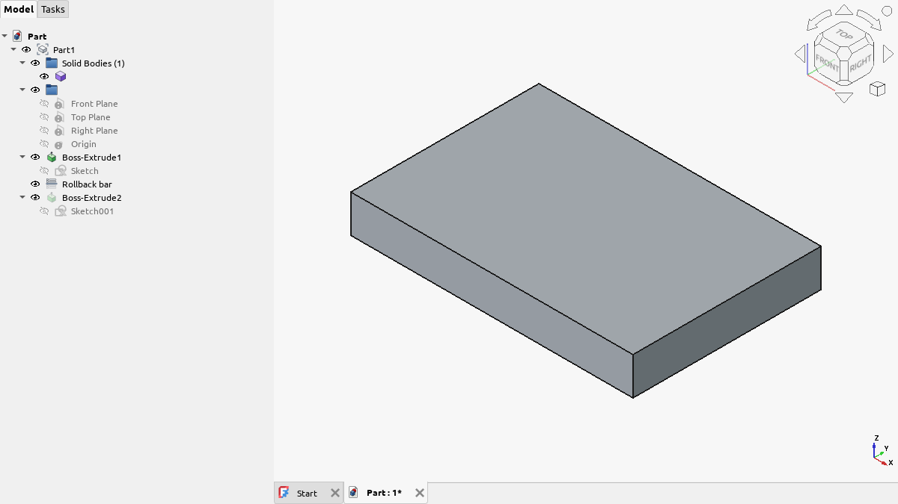

# History and rollback

The features in a part are built in order, top to bottom, each from the result of the one before:
SolidWorks' FeatureManager history.

## The rollback bar

The **Rollback bar** at the end of the features marks how far the model is built. Move it up and the
features below it are greyed and skipped. New features go just above it, so you can add a feature
early in the history.

## Editing an earlier feature

Opening a feature that isn't the last rolls the model back to it while its panel is open, so you
see the model as the feature saw it. When you close the panel, the bar goes back.

## Suppressing

A suppressed feature is skipped: the model builds as if it weren't there, and the features after
it carry on from the one before.

## Force Rebuild

Normally only what changed is rebuilt: a feature and the ones after it when you change it, a new
feature on its own when you add one, and when the rollback bar moves, only the features it moves
past (those coming back are rebuilt; those going below it keep their last result).
[Force Rebuild](../reference/tools/force-rebuild.md) builds everything again from scratch.

If something is slow, [Performance Trace](../reference/tools/performance-trace.md) shows where the
time goes.
