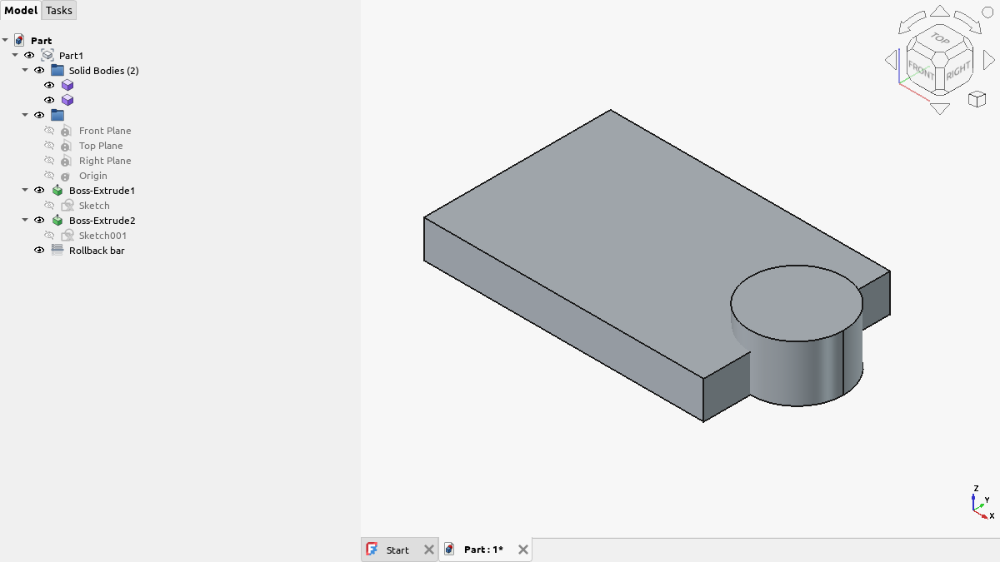

# Parts and bodies

## A part

A part holds a whole model: its **Origin** (three planes and three axes), its sketches, reference
geometry and features in order, and the bodies they make. It is one object in FreeCAD's tree.

## Bodies

A body is one connected solid, or one surface. A part can hold any number of each, kept in its
**Solid Bodies** and **Surface Bodies** folders. Unlike PartDesign, you don't make bodies by hand:
features make them.

- A new solid that touches others joins them, unless **Merge result** is off.
- A cut that splits a body in two makes two bodies.
- [Split](../reference/tools/split.md), [Combine](../reference/tools/combine.md) and the other
  body tools change them on purpose.

## Bodies keep their names

Every body has an identity that survives changes: its name stays when a feature before it changes
size, and a feature that changes a body says which one. So **Feature Scope**, patterns of bodies
and the body tools keep working on the same bodies as you edit.

