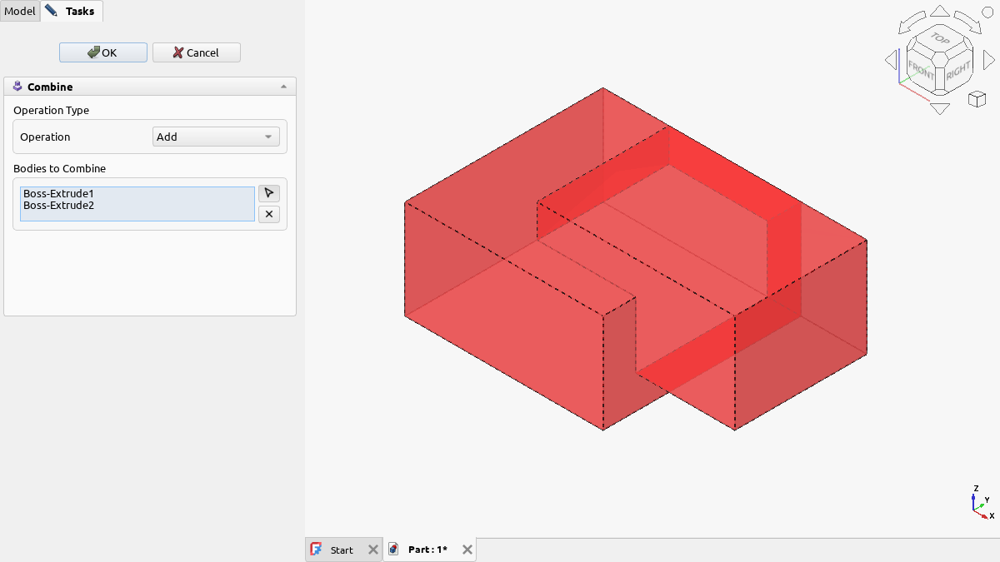

# Working with bodies

A part can hold many bodies, and most tools say which ones they change. That lets you model a
lid and a base together, use one body to shape another, or split a part into pieces to print.

## Making a second body

A new solid joins the bodies it touches, unless you untick **Merge result** in its panel. Untick it
and the solid becomes a body of its own, listed in the **Solid Bodies** folder.

## Choosing which bodies a feature changes

Cuts and other tools that change existing bodies have a **Feature Scope** group: **All bodies**, or
**Selected bodies** and the ones you click.

## The body tools

- [Combine](../reference/tools/combine.md): add bodies together, subtract one from another, or keep
  what they share.
- [Split](../reference/tools/split.md): cut a body into bodies with planes, sketches or surfaces.
- [Move/Copy Body](../reference/tools/move-copy-body.md): move or copy bodies.
- [Delete/Keep Body](../reference/tools/delete-keep-body.md): drop bodies, or keep only some.
- [Indent](../reference/tools/indent.md), [Intersect](../reference/tools/intersect.md),
  [Lip/Groove](../reference/tools/lip-groove.md): tools that work between bodies.

## In the 3D view

Right-click a body for **Isolate** (show only it), **Hide** and its other tools. With bodies
hidden, right-click empty space for **Show Hidden Bodies**.

See [parts and bodies](../concepts/parts-and-bodies.md) for how bodies keep their names through
changes.
