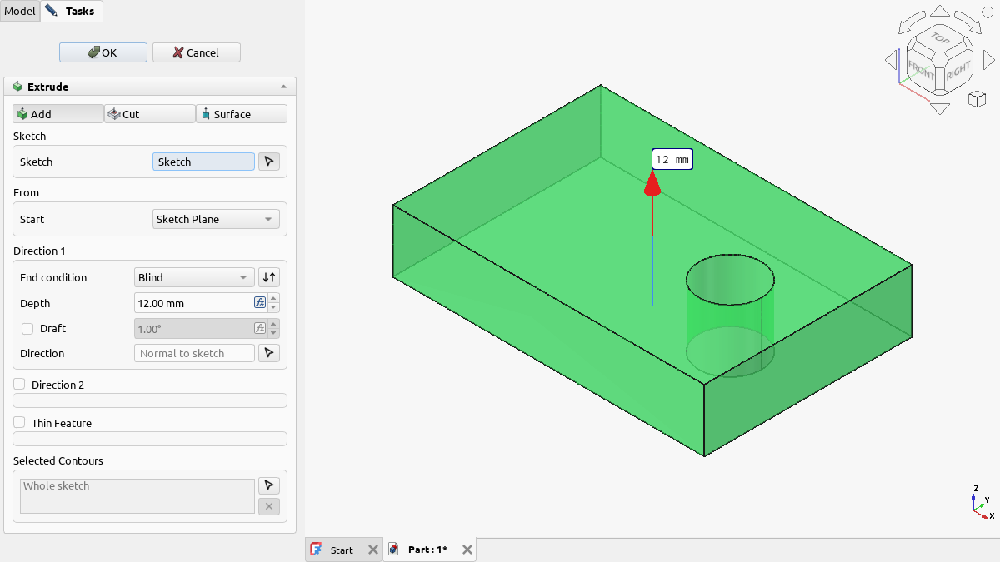
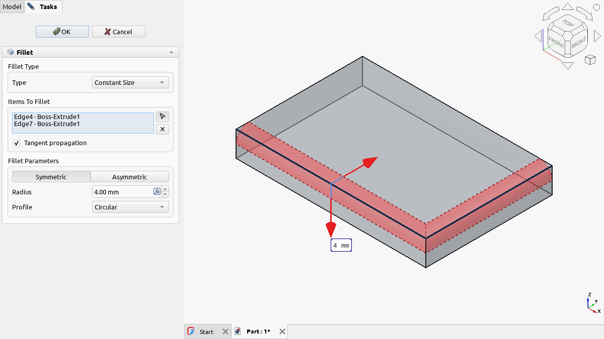
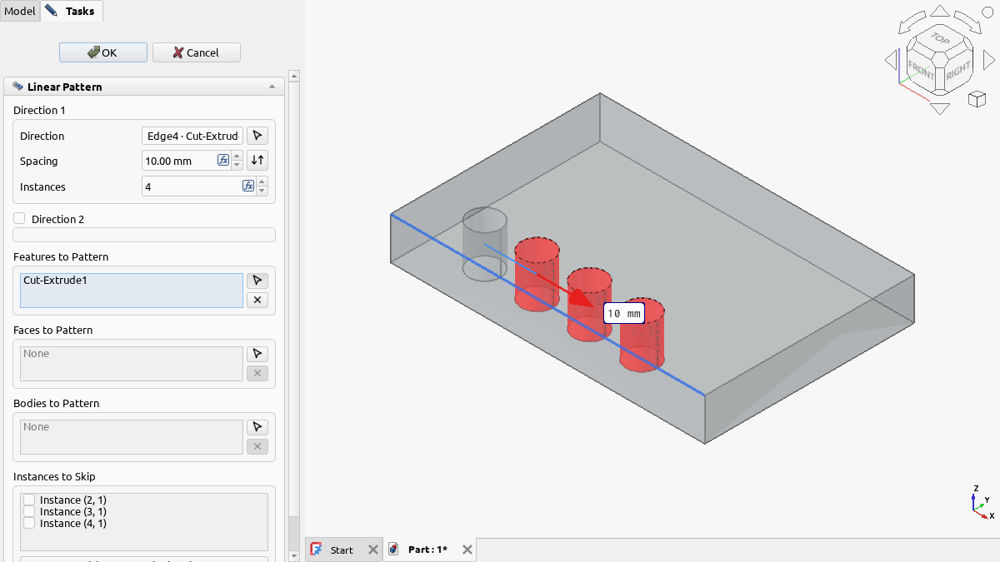

# Your first part

This walks through a small part: a plate with a boss, rounded edges, a counterbored hole and a row
of holes. It uses the tools you will use most.

## 1. Start a part

Make a new document (**File → New**) and click **Part**. The part appears in the tree with its
origin planes.

## 2. Sketch the plate

Select the **Top Plane** in the tree and click **Sketch**. Draw a rectangle round the origin and
dimension it, then click **Close**.

## 3. Extrude it

With the sketch selected, click **Extrude**. Set the **Depth**, or drag the arrow in the 3D view.
The preview is green: material is added. Click **OK**.

!!! tip "A shortcut"

    Click **Extrude** with the top face selected instead of a sketch: it starts a sketch on the
    face, and opens Extrude when you close the sketch.

## 4. Round the edges

Select edges of the plate (hold <kbd>Ctrl</kbd> for more than one) and click **Fillet**. Set the
**Radius** or drag the handle, then click **OK**.

## 5. Add a hole

Click **Hole Wizard**, choose **Counterbore** and a size, then click on the top face where the hole
goes. Click **OK**.

## 6. Make a row of them

Select the hole in the tree and click **Linear Pattern**. Click an edge of the plate for
**Direction 1**, and set the **Spacing** and **Instances**. Click **OK**.

## 7. Change your mind

Every feature can be changed: double-click it in the tree to open its panel again, or select it
and drag its handles in the 3D view. The features after it rebuild, and find their faces and edges
again. If one can't, [What's Wrong](../reference/tools/whats-wrong.md) says why.

Next: [working with bodies](bodies.md).
