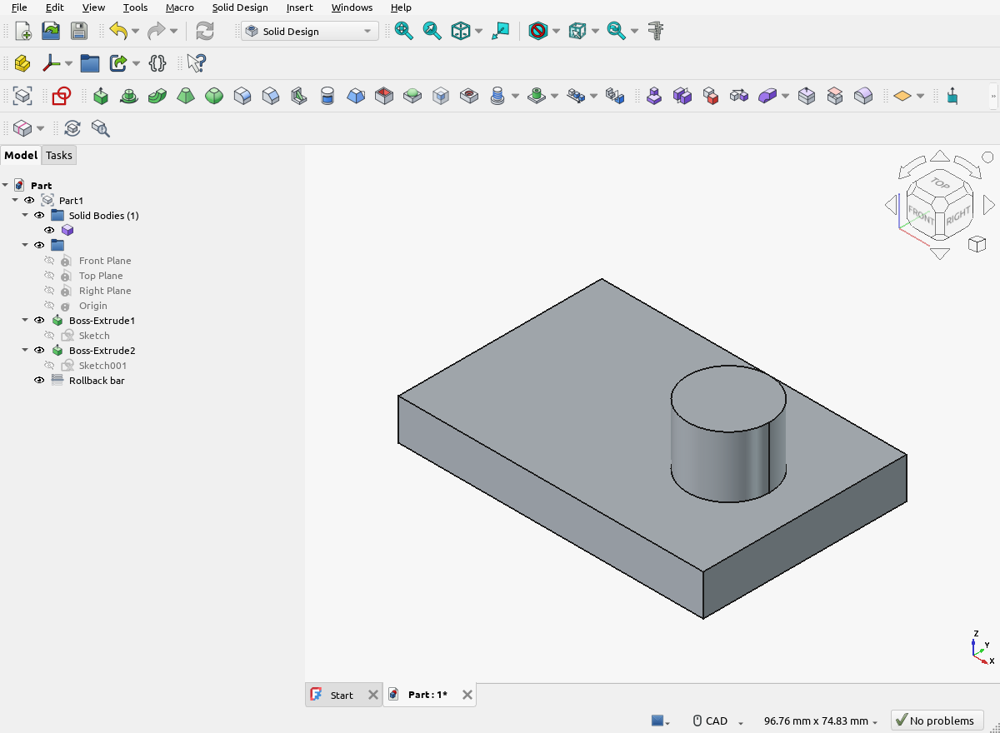
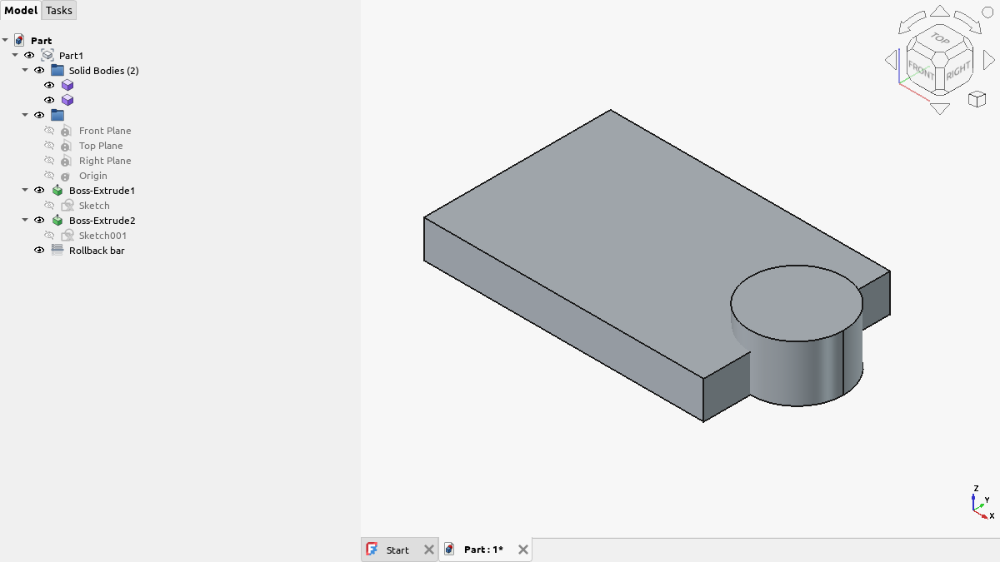

# Around the workbench

## The toolbars

The toolbars follow SolidWorks' CommandManager, left to right: **Part**, **Sketch**,
**Features**, **Bodies**, **Reference Geometry**, **Surfaces**, **Curves** and **Evaluate**. A
button with a small arrow is a drop-down: click the arrow for the other tools in it.
[Toolbars](../reference/toolbars.md) lists them all.

Every tool is also in the **Solid Design** menu, and in **Insert** where SolidWorks keeps it.

## The tree

The tree (the **Model** tab) shows your part: its **Origin** (three planes and three axes), its
bodies, and its features in the order they were made. The **Rollback bar** at the bottom of the
features marks how far the model is built. See [parts and bodies](../concepts/parts-and-bodies.md).

## The panel

When a tool is open, its panel takes the **Tasks** tab. Every panel is built the same way:

- A problem, if there is one, at the top in red, and what it needs.
- For shape tools, **Add | Cut | Surface** buttons.
- Groups of options, in SolidWorks' order. Hover over any control for what it does.
- Selection boxes: the active one is highlighted; click in the 3D view to fill it. See
  [picking things](../guides/picking.md).

The 3D view shows a live preview: green where material is added, red where it is taken away.
**OK** (or <kbd>Enter</kbd>) makes the feature; **Cancel** (or <kbd>Esc</kbd>) leaves the model
as it was.

## The 3D view

Besides the usual FreeCAD view:

- **Drag handles** set a feature's sizes by dragging: in a panel, and on a feature you select.
  See [drag handles](../guides/drag-handles.md).
- **The context toolbar** shows the tools that fit a face, edge or vertex beside the pointer when
  you click it.
- **Right-click** a face, edge or vertex for the tools that fit it, or empty space for the rest.
- <kbd>/</kbd> opens command search; <kbd>:</kbd> the command line. See
  [keyboard modelling](../guides/keyboard.md).

## The status bar

The health badge at the bottom right counts the model's problems. Click it to open
[What's Wrong](../reference/tools/whats-wrong.md).

Next: [your first part](first-part.md).
