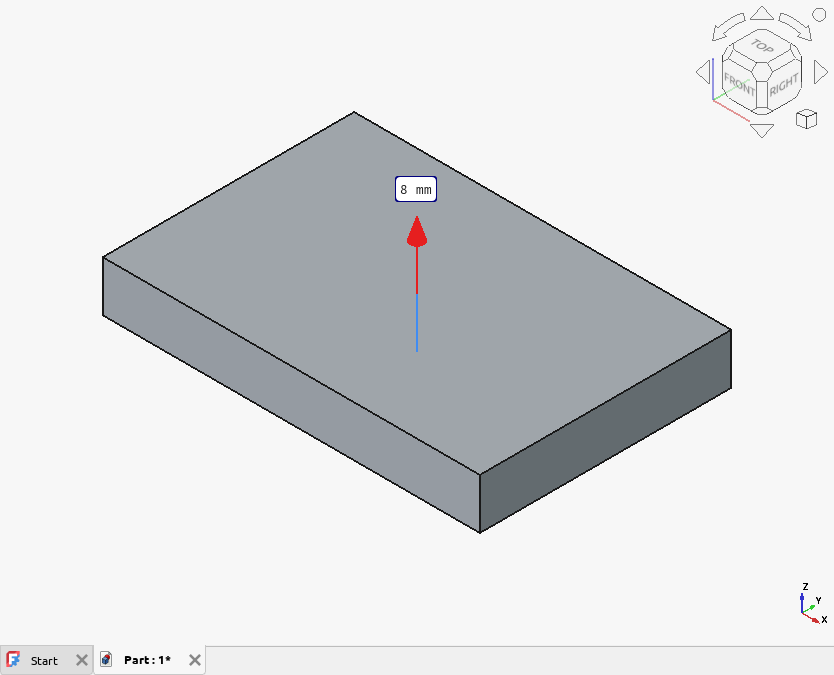

# Drag handles

Many features have handles in the 3D view: arrows for lengths, rings for angles, arcs for draft.
Drag one to change the value; the panel's field follows.

## In a panel

While a tool's panel is open, its handles show on the preview. Drag them, or click a handle's value
and type a new one.

## On a selected feature

Select a feature in the tree (or click a face it made) with no tool open: its handles show, as
SolidWorks' Instant3D. Drag one and the feature changes when you let go. One undo step undoes it.

## Snapping

Lengths snap to round values as you drag, finer when the value is small; angles snap the same way.
Type a value for anything in between.

[Drag handles](../reference/drag-handles.md) in the reference lists which tools have handles and
what each one sets.
