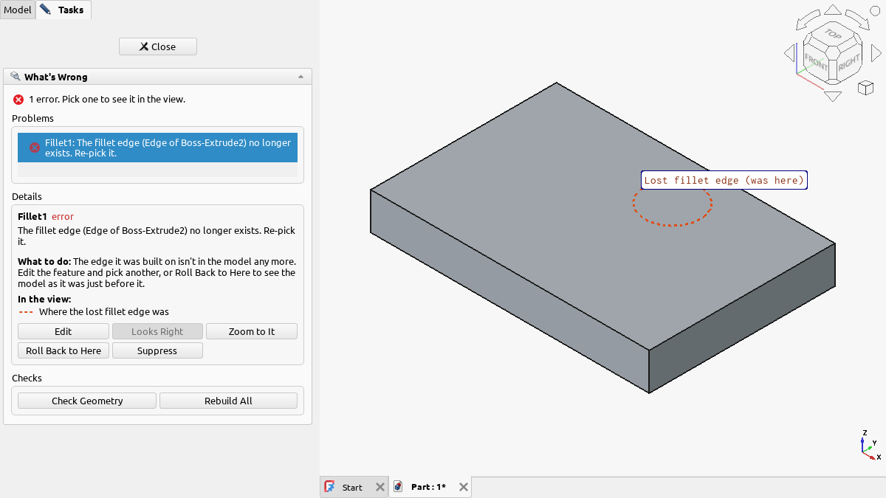
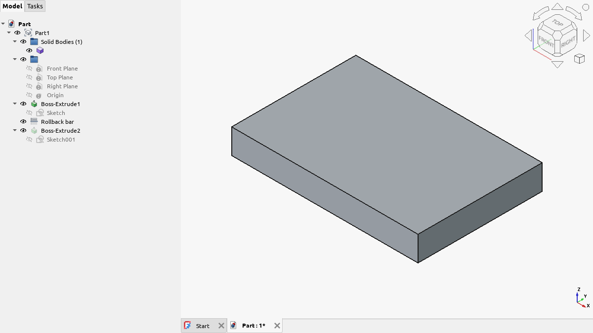

# When something breaks

Change an early feature and a later one can lose what it was built on: an edge you filleted gets
cut away, a face you sketched on moves. Solid Design tries hard not to let that happen, and says
plainly when it does.

## The health badge

The badge at the right of the status bar counts the model's errors and warnings. When it shows a
count, click it.

## What's Wrong

[What's Wrong](../reference/tools/whats-wrong.md) lists each problem with what happened, why, and
what to do. Click one and the 3D view shows where: a lost edge, in red, where it was. A problem
caused by another is listed under it, so you fix the first one.

## Warnings: found again

When a change rebuilds a face or edge a feature used, Solid Design finds it again by its shape and
place, and warns you. Check the edge shown in green is the one you meant: if it is, press **Looks
Right**; if not, **Edit** the feature and pick it again. See
[how features remember picks](../concepts/references.md).

## Errors: lost

When what a feature used is gone, it can't be built. **Edit** it and pick something else, or
**Roll Back to Here** to see the model just before it, as it was when you picked.

## Rolling back

Drag the **Rollback bar** in the tree, or use **Roll Back to Here**, to see the model at any step.
Features below the bar are greyed and not built. Add features there to insert them earlier in the
history. **Roll to End** builds everything again.

## Suppressing

**Suppress** a feature to skip it while you look into it: the model builds as if it weren't there.

## Checking the geometry

**Check Geometry** in What's Wrong looks for what a rebuild doesn't report: invalid bodies, tiny
edges and sliver faces that trouble fillets, shells and exports.
