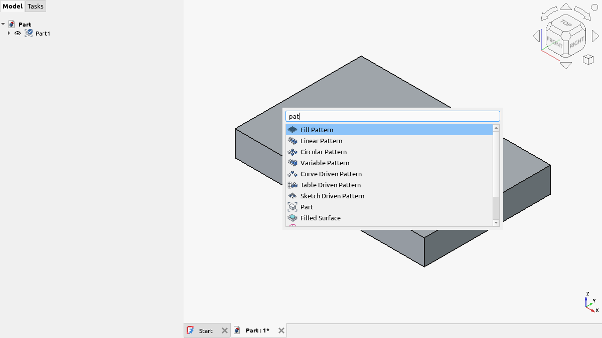

# Keyboard modelling

Everything can be done with the mouse, but three keys make modelling much faster. They work in the
3D view, with no tool open.

## Find a tool: <kbd>/</kbd>

Press <kbd>/</kbd> and type a few letters of a tool's name: letters in order are enough ("lpat"
finds Linear Pattern). <kbd>Enter</kbd> starts it.

## Make a feature: <kbd>:</kbd>

Press <kbd>:</kbd> and a bar opens along the bottom of the view. Type a tool and what to set, then
<kbd>Enter</kbd>:

| You type | It makes |
| :-- | :-- |
| `fillet 2` | A fillet on the selection, its main value (the radius) 2 |
| `extrude 10 cut` | An extruded cut, 10 deep: a word picks an option |
| `extrude throughall` | Spaces and case don't matter in options |
| `lp 20 4` | A linear pattern: names match loosely, values go in order |
| `chamfer d=1.5 flip` | `name=value` sets any option; a yes/no option by its name |
| `fillet =Width/2 + 1mm` | `=` starts any FreeCAD expression; units work anywhere |

It works on the selection; with nothing selected, on what was under the pointer when you pressed
<kbd>:</kbd>. If the feature builds, it's made at once, as one undo step. If it can't, its panel
opens with your values in and the problem shown.

- <kbd>Tab</kbd> completes tools, options, choices and variables; <kbd>Up</kbd> and
  <kbd>Down</kbd> go through what you typed before; <kbd>Esc</kbd> closes the bar.
- A variable of the document's VarSets can be typed by name and stays linked.

[Command line words](../reference/command-line.md) lists every tool's word and the values it takes
in order. Each tool's page lists all its options.

## Pick from the keyboard: `sel=`

Type `sel=` and press <kbd>Tab</kbd>: every face, edge or vertex the tool can use gets a short
label in the view. Type a label to pick it; picks are separated by commas, and a comma is added for
you after each good one. You can also click a label.

## Do it again: <kbd>.</kbd>

<kbd>.</kbd> makes the last feature again, with the same settings, on the selection or what's under
the pointer. Fillet one edge, then point at the next and press <kbd>.</kbd>.
