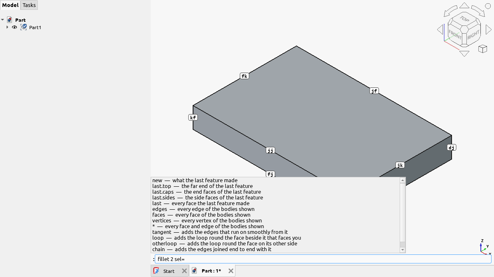

# Keyboard modelling

Everything can be done with the mouse, but three keys make modelling much faster. They work in the
3D view, with no tool open.

## Find a tool: <kbd>/</kbd>

Press <kbd>/</kbd> and type a few letters of a tool's name: letters in order are enough ("lpat"
finds Linear Pattern). <kbd>Enter</kbd> starts it.

## Make a feature: <kbd>:</kbd>

Press <kbd>:</kbd> and a bar opens along the bottom of the view. Type a tool and what to set, then
<kbd>Enter</kbd>:

| You type | It makes |
| :-- | :-- |
| `fillet 2` | A fillet on the selection, its main value (the radius) 2 |
| `extrude 10 cut` | An extruded cut, 10 deep: a word picks an option |
| `extrude throughall` | Spaces and case don't matter in options |
| `lp 20 4` | A linear pattern: names match loosely, values go in order |
| `chamfer d=1.5 flip` | `name=value` sets any option; a yes/no option by its name |
| `fillet =Width/2 + 1mm` | `=` starts any FreeCAD expression; units work anywhere |

It works on the selection; with nothing selected, on what was under the pointer when you pressed
<kbd>:</kbd>. If the feature builds, it's made at once, as one undo step. If it can't, its panel
opens with your values in and the problem shown.

- While you type, the feature shows in the view (green where it adds, red where it takes
  away), and if it can't be made the reason shows above the line, before you press
  <kbd>Enter</kbd>. Nothing is added to the document or the undo list until you do.
- <kbd>Tab</kbd> completes tools, commands, options, choices, variables, feature names and
  selection words. When there's only one way to go, the rest of the word shows in grey and
  <kbd>Tab</kbd> (or <kbd>→</kbd>) takes it; with several, <kbd>Tab</kbd> goes down the list
  and <kbd>Shift</kbd>+<kbd>Tab</kbd> back up.
- <kbd>Up</kbd> and <kbd>Down</kbd> go through what you typed before; <kbd>Ctrl</kbd>+<kbd>R</kbd>
  searches it. <kbd>Esc</kbd> closes the bar.
- A variable of the document's VarSets can be typed by name and stays linked.
- `:h` (or `:help`) shows a cheat sheet of everything below over the view; <kbd>Esc</kbd> closes
  it. `:h sel` marks one part.

[Command line words](../reference/command-line.md) lists every tool's word and the values it takes
in order. Each tool's page lists all its options.

## Pick from the keyboard: `sel=`

Type `sel=` and press <kbd>Tab</kbd>: every face, edge or vertex the tool can use gets a short
label in the view. Type a label to pick it; picks are separated by commas, and a comma is added for
you after each good one. You can also click a label: the one under the pointer turns FreeCAD's
preselection colour and what it's on lights up. Or click the model itself: what you click is added
to the line by its label (<kbd>Ctrl</kbd>+click a pick to take it out again).

Only what can be seen gets a label. <kbd>Ctrl</kbd>+<kbd>X</kbd> labels the rest too (edges and faces
behind the model or facing away, with dashed labels) and draws the bodies see-through;
<kbd>Ctrl</kbd>+<kbd>X</kbd> again goes back. Tools that take a plane (Split, Mirror, Sketch,
Plane...) label the planes as well, showing the hidden origin planes while you pick.

After an edge, a word adds the edges that go with it, as the chain button in a panel does:

| Word | Adds |
| :-- | :-- |
| `tangent` (or `tan`) | The edges that run on smoothly from it |
| `loop` | The loop round the face beside it that faces you |
| `otherloop` (or `oloop`) | The loop round the face on its other side |
| `chain` | The edges joined end to end with it |

So `fillet 2 sel=jk,loop` fillets every edge round a face from one label. A word counts once you
type the comma after it (<kbd>Tab</kbd> completes it and adds the comma); delete it and its edges
are unpicked again. Two words after one edge both work from it: `sel=jk,loop,otherloop`.

After a label, `]` steps to the next neighbour clockwise on screen and `[` back; `+` steps along
tangent edges. So `sel=jk]]` is two edges round from `jk`.

You don't always need a label. These pick by what things are:

| You type | It picks |
| :-- | :-- |
| `sel=new` | What the last feature made (of the kinds the tool takes) |
| `sel=last.top` | The far end of the last feature (`last.caps`: both ends, `last.sides`, `last`: all its faces) |
| `sel=edges` | Every edge of the bodies shown (`faces`, `vertices`; `*` for faces and edges) |
| `sel=jk:edges` | The edges of face `jk` |
| `sel=@a` | What you kept in register `a` |
| `sel=front` | The origin's Front Plane (`top`, `right`) |
| `sel=Plane1` | Anything in the tree by name, spaces left out (`sel=FrontPlane`, `sel=Sketch2`, a body); `sel=Body.Edge3` an element of it |

And a colon narrows what's picked, as many times as you like:

| Filter | Keeps |
| :-- | :-- |
| `:circular` `:linear` `:curved` | Circles and arcs; straight edges; the rest |
| `:planar` `:cylindrical` `:conical` `:spherical` | Faces of that shape |
| `:concave` `:convex` | Inside corners (where a fillet adds material); outside ones |
| `:top` `:bottom` `:front` `:back` `:left` `:right` `:+x` ... | The highest, lowest... |
| `:largest` `:smallest` `:nearest` | The biggest, the smallest, the nearest the pointer |
| `:r<5` `:d=10` `:len>20` `:area>100` `:z=10` | By radius, diameter, length, area or height (`< > = <= >=`) |
| `:par:z` `:perp:z` | Faces facing along an axis, or square to it (walls); edges running along it, or across |

`fillet 1 sel=edges:concave` rounds every inside corner; `chamfer 0.5 sel=new:circular:top` the top
of a hole you just made. Add `>a` to keep the picks in register `a` for later
(`sel=edges:circular >a`), saved with the document: `sel=@a` finds them again after the model
changes. `registers` lists them, `delreg a` forgets one.

## Work on the tree by name

A line can start with a feature's name, or `last` for the last one, to change it without opening
it: `Fillet1 r=3`, `last d=+2` (`+` and `-` add to what it is). The other words a line can start
with:

| You type | It does |
| :-- | :-- |
| `edit Fillet1` | Opens it (after `edit `, the tree's rows get labels; `edit jk`: the feature that made face `jk`) |
| `suppress /Fillet/` | Suppresses every feature whose name matches (or names: `suppress Fillet1,Fillet2`); `unsuppress` |
| `rollto Boss-Extrude2` | Moves the rollback bar to just after it; `rollto end` |
| `hide Body2` `show Body2` `isolate Body1` `showall` | Bodies |
| `set r=2->3 /Fillet/` | Every 2 mm radius of those features to 3 mm (`set r=3 /Fillet/`: all of them) |
| `mark a` · `'a` | Saves the view as `a`; jumps back to it (`marks`, `delmark a`) |
| `yank sel=jk` · `yank Fillet1.Radius` | Copies a measurement (length, radius, area, point) or a value |
| `toolbar` | Labels on the toolbar buttons, and a list of what each is: type a label to click it, or type a button's name and <kbd>Enter</kbd> |

## Make it yours

| You type | It does |
| :-- | :-- |
| `alias m6 = holewizard size=m6 type=counterbore` | `m6 sel=jk` then does the rest (`unalias m6`) |
| `bind gf = fillet 1 sel=new` | Typing <kbd>g</kbd> <kbd>f</kbd> in the 3D view runs the line (`unbind gf`) |
| `set fillet.r=1` | A tool's default: `fillet` alone now uses 1 mm (`unset fillet.r`) |

`alias`, `bind` and `set` on their own list what you have. A binding's first key belongs to the
binding while you have one that starts with it.

## In a panel: <kbd>:</kbd>

With a tool's panel open, <kbd>:</kbd> puts a label on each of its controls. Type a label and
<kbd>Enter</kbd> to go to that control (a field takes your typing, a button is pressed, a list
opens). `ds=10` types 10 into the control labelled `ds`, and `radius=10` into the one named Radius.

## Do it again: <kbd>.</kbd>

<kbd>.</kbd> makes the last feature again, with the same settings, on the selection or what's under
the pointer. Fillet one edge, then point at the next and press <kbd>.</kbd>.
