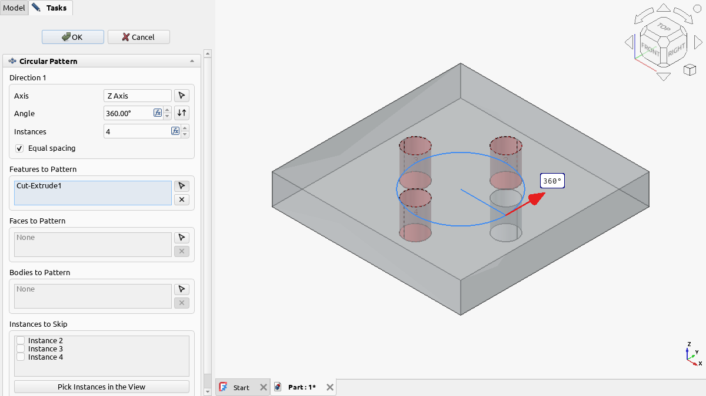

# Patterns and mirrors

Patterns repeat features, faces or whole bodies. Each makes one feature in the tree; change the
original and every copy follows.

| To repeat | Use |
| :-- | :-- |
| In a row or grid | [Linear Pattern](../reference/tools/linear-pattern.md) |
| Round an axis | [Circular Pattern](../reference/tools/circular-pattern.md) |
| Along a curve | [Curve Driven Pattern](../reference/tools/curve-driven-pattern.md) |
| At a sketch's points | [Sketch Driven Pattern](../reference/tools/sketch-driven-pattern.md) |
| At typed positions | [Table Driven Pattern](../reference/tools/table-driven-pattern.md) |
| Over a whole face | [Fill Pattern](../reference/tools/fill-pattern.md) |
| With its sizes changing | [Variable Pattern](../reference/tools/variable-pattern.md) |
| On the other side of a plane | [Mirror](../reference/tools/mirror.md) |

## Features, faces or bodies

Every pattern has three boxes: **Features to Pattern** (features from the tree), **Faces to
Pattern** (faces, for a model with no history, such as an import) and **Bodies to Pattern** (whole
bodies, which makes new bodies).

## Leaving gaps

**Instances to Skip** lists the copies. Tick the ones to leave out, or click **Pick Instances in the
View** and click them in the 3D view.

