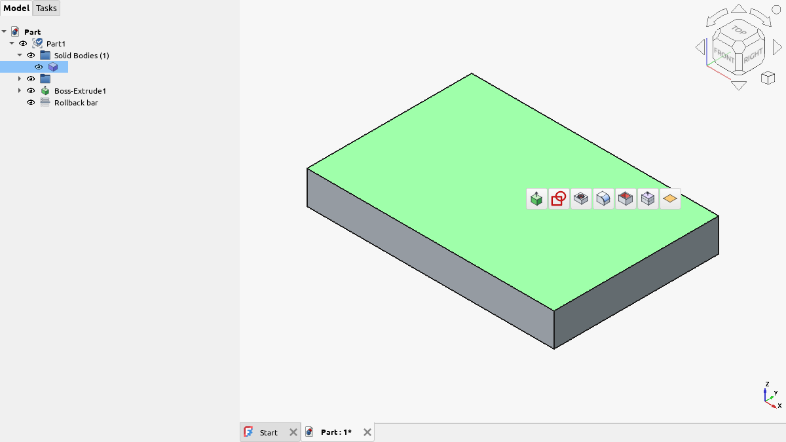

# Picking things

Tools need things picked: edges for a fillet, a face for a hole, an axis to revolve round. Solid
Design picks the way SolidWorks does.

## Pick first, or pick in the panel

Select before you click a tool and the tool takes what fits. Or open the tool and click in the 3D
view: the panel's **active box** (the highlighted one) takes the pick. When a box is full, the
next box that needs something becomes active.

A pick that the active box can't take goes to another box that can, if only one can. A pick no box
takes is refused, and the box says why underneath.

Click a box's arrow button to make it active. Click an item again in the 3D view to take it out;
the **×** button clears the box.

## What you picked

Picks show in the 3D view in the selection colour while the panel is open, so you can see every
edge and face a box holds.

## Many edges at once

When the last thing you picked into a list is an edge, the chain button beside the list adds the
edges that go with it:

- **Select Tangency**: the edges running smoothly on from it.
- **Select Loop**: the loop round a face beside it.
- **Select Chain**: the edges joined end to end with it.

Right-click an edge in the 3D view while a tool is open for the same choices, and **Add This
Edge**.

## Temporary axes

When a box wants an axis, hover over a round face or a straight edge: its axis shows as a dashed
line. Click it to use it. It stays until it's used or you click elsewhere. Often you don't need a
reference axis at all.

## Right-click menus

Right-click in the 3D view (with no tool open) for the tools that fit what's under the pointer:

- a **face**: Sketch on Face, Extrude from Face, Fillet, Chamfer, Shell, a plane on it, more face
  tools;
- an **edge**: Fillet, Chamfer, an axis along it, a plane normal to it, a point on it;
- a **vertex**: a point or a coordinate system at it;
- **empty space**: Sketch, Part, reference geometry, Show Hidden Bodies, Force Rebuild and What's
  Wrong.

The [context toolbar](../reference/tools/context-toolbar.md) shows the same kind of tools by the
pointer after a left click.

