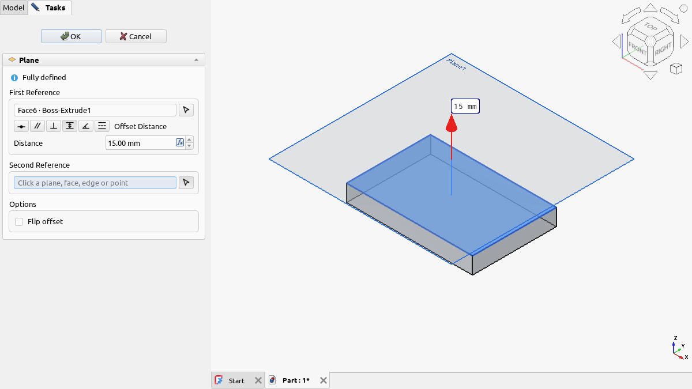

# Reference geometry

Reference geometry is construction you build the model with: planes to sketch on, axes to turn
round, points to measure from. It doesn't add material.

| Tool | For |
| :-- | :-- |
| [Plane](../reference/tools/plane.md) | Sketching off the origin, mirroring, splitting, cutting |
| [Axis](../reference/tools/axis.md) | Revolving and patterning round |
| [Point](../reference/tools/point.md) | Positions to measure from, curve points |
| [Coordinate System](../reference/tools/coordinate-system.md) | An origin of its own for positions and sketches |
| [Bounding Box](../reference/tools/bounding-box.md) | A box round the model that keeps its size up to date |
| [Center of Mass](../reference/tools/center-of-mass.md) | A point at the centre of mass |

## Planes from up to three picks

Pick up to three things and click **Plane**: it works out the plane you most likely mean, and
shows how it relates to each pick. Change any of those if it guessed wrong.

## Names in the view

The names of planes, axes and points show in the 3D view, the same size however far you zoom.
[Reference Names](../reference/tools/reference-names.md) turns them off.

## Hidden ones show while selected

Click a hidden plane, axis or point in the tree (an origin one, or one you made) and it shows in the
3D view while it stays selected, then hides again. It is still hidden as far as the file is
concerned: nothing to save, nothing to undo.

## They follow the model

Reference geometry made from faces and edges moves when they move. If what it was built on goes,
it says so in [What's Wrong](fixing-problems.md).
