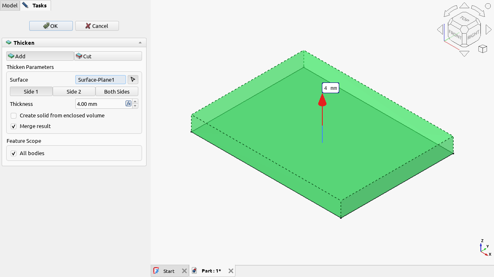

# Surfaces

A surface body is a shape with no thickness: a skin. Surfaces build shapes solids can't easily
make, then become solids with [Thicken](../reference/tools/thicken.md),
[Knit Surface](../reference/tools/knit-surface.md) or by cutting with them.

## Making surfaces

- From sketches: [Extruded](../reference/tools/extruded-surface.md),
  [Revolved](../reference/tools/revolved-surface.md), [Swept](../reference/tools/swept-surface.md),
  [Lofted](../reference/tools/lofted-surface.md) and
  [Boundary Surface](../reference/tools/boundary-surface.md). These are the sketch features with
  **Surface** pressed.
- Flat ones: [Planar Surface](../reference/tools/planar-surface.md).
- From the model: [Offset Surface](../reference/tools/offset-surface.md),
  [Ruled Surface](../reference/tools/ruled-surface.md),
  [Radiate Surface](../reference/tools/radiate-surface.md),
  [Mid-Surface](../reference/tools/mid-surface.md).
- To close a hole: [Filled Surface](../reference/tools/filled-surface.md).

## Shaping them

[Trim](../reference/tools/trim-surface.md), [Extend](../reference/tools/extend-surface.md) and
[Untrim](../reference/tools/untrim-surface.md) them;
[Surface Flatten](../reference/tools/surface-flatten.md) lays them out flat.

## Back to solids

| To | Use |
| :-- | :-- |
| Give a surface a thickness | [Thicken](../reference/tools/thicken.md) |
| Join surfaces that close a volume into a solid | [Knit Surface](../reference/tools/knit-surface.md) |
| Cut a solid with a surface | [Cut With Surface](../reference/tools/cut-with-surface.md) |
| Push a solid's faces out to a surface | [Replace Face](../reference/tools/replace-face.md) |

Surface bodies are kept in the part's **Surface Bodies** folder.

