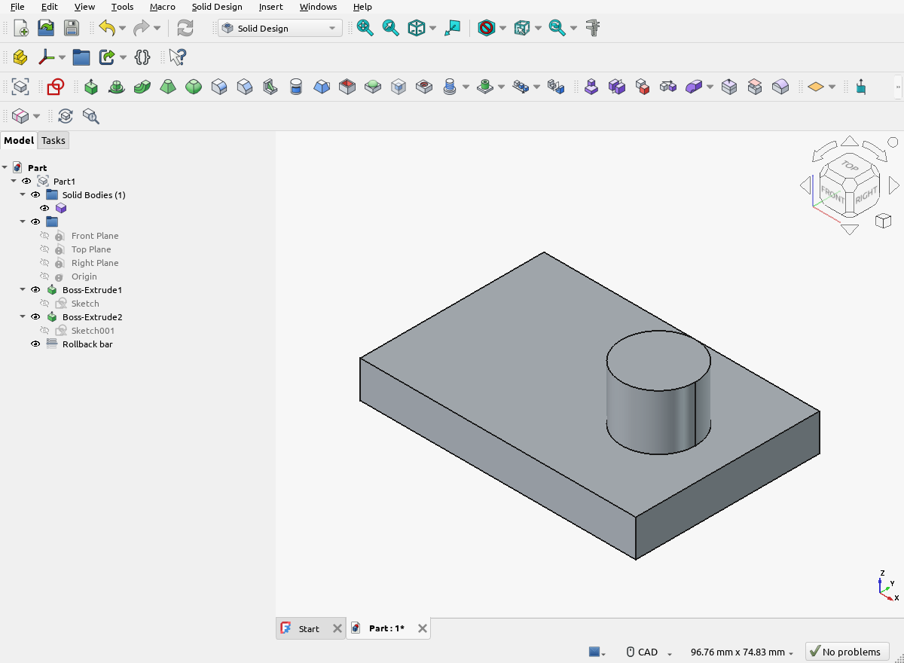

# Solid Design

A [FreeCAD](https://www.freecad.org) workbench for modelling parts the SolidWorks way: sketch, then
build features on it, with several bodies in one part from the start. The tools, their panels and
their names follow SolidWorks, so what you know there works here.

-   **New to Solid Design?**

    Install it, find your way round, and model your first part step by step.

    [Get started](getting-started/install.md)

-   **Every tool**

    What each tool does, how to use it, and what every control in its panel means.

    [Browse the tools](reference/tools/index.md)

-   **Guides**

    Sketch features, picking, drag handles, keyboard modelling, surfaces, and fixing a model
    that breaks.

    [Read the guides](guides/index.md)

-   **How it works**

    Parts and bodies, Add, Cut and Surface, the history, and how features remember what you
    picked.

    [The concepts](concepts/index.md)

## What it does

- **Multi-body from the start.** A part holds as many solid and surface bodies as you need; every
  feature says which bodies it changes.
- **SolidWorks' tools and panels.** Extrude, Revolve, Sweep, Loft and Boundary with Add, Cut and
  Surface in one tool; Fillet, Chamfer, Shell, Draft; the Hole Wizard; every pattern; body,
  surface and curve tools.
- **Fast to drive.** Drag handles in the 3D view, a context toolbar by the pointer, command
  search, and a command line for modelling from the keyboard.
- **Stable.** Features find their faces and edges again when the model changes, and What's Wrong
  says what broke, why, and how to fix it.

!!! info "Always up to date"

    This site is built from the workbench's latest version. The tool pages, panel descriptions and
    pictures are generated from its code, so they change when the workbench does.
