<!-- Generated by docs/build.py from docs/_data/catalog.json (freecad/SolidDesign/init_gui.py). Do not edit this file: change its sources and run `pixi run docs`. -->

# Toolbars

The workbench's toolbars, left to right, and what is on each. A tool with ▾ is a drop-down: click its arrow for the tools in it.

## Part

|  | Tool | What it does |
| :-- | :-- | :-- |
| 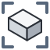{ .tool-icon-small } | [Part](tools/part.md) | Creates a part with its origin, default planes and body folders. |

## Sketch

|  | Tool | What it does |
| :-- | :-- | :-- |
|  | [Sketch](tools/sketch.md) | Sketches on the selected plane or planar face. |

## Features

|  | Tool | What it does |
| :-- | :-- | :-- |
| { .tool-icon-small } | [Extrude](tools/extrude.md) | Extrudes a sketch or selected sketch contours in one or two directions to add material, or to cut it (Add \| Cut in the panel). |
| { .tool-icon-small } | [Revolve](tools/revolve.md) | Revolves a sketch or selected sketch contours around an axis to add material, or to cut it (Add \| Cut in the panel). |
| { .tool-icon-small } | [Sweep](tools/sweep.md) | Sweeps a profile along a path to add material, or to cut it (Add \| Cut in the panel). |
| { .tool-icon-small } | [Loft](tools/loft.md) | Adds or cuts material between two or more profiles (Add \| Cut in the panel). |
| { .tool-icon-small } | [Boundary](tools/boundary.md) | Adds or cuts material through curves in one or two directions (Add \| Cut in the panel); with curves both ways the shape passes through the whole network. |
| 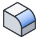{ .tool-icon-small } | [Fillet](tools/fillet.md) | Creates a rounded internal or external face along one or more edges. |
| 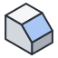{ .tool-icon-small } | [Chamfer](tools/chamfer.md) | Creates a bevel on selected edges, faces or a vertex. |
| { .tool-icon-small } | [Rib](tools/rib.md) | Grows a wall of material from open sketch lines until it meets the model: in the sketch plane, or out of it. |
| { .tool-icon-small } | [Wrap](tools/wrap.md) | Wraps a sketch onto a cylindrical or flat face: emboss, deboss or scribe it. |
| { .tool-icon-small } | [Draft](tools/draft.md) | Tapers faces by an angle so the part releases from a mould: about a neutral plane, or about parting lines. |
| 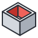{ .tool-icon-small } | [Shell](tools/shell.md) | Hollows a body, leaving open the faces you pick, with walls of the given thickness. |
| 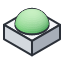{ .tool-icon-small } | [Dome](tools/dome.md) | Adds a dome (or a dent) on flat faces. |
| 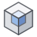{ .tool-icon-small } | [Intersect](tools/intersect.md) | Makes solid bodies from the regions where solids, surfaces and planes meet; exclude the regions you don't want. |
| { .tool-icon-small } | [Hole Wizard](tools/hole-wizard.md) | Inserts holes of a standard type and size at points on a face or a sketch. |
| { .tool-icon-small } | **Threads** ▾ | [Thread](tools/thread.md), [Cosmetic Thread](tools/cosmetic-thread.md) |
| { .tool-icon-small } | **Fastening Features** ▾ | [Mounting Boss](tools/mounting-boss.md), [Snap Hook](tools/snap-hook.md), [Lip/Groove](tools/lip-groove.md), [Vent](tools/vent.md) |
| { .tool-icon-small } | **Patterns** ▾ | [Linear Pattern](tools/linear-pattern.md), [Circular Pattern](tools/circular-pattern.md), [Curve Driven Pattern](tools/curve-driven-pattern.md), [Sketch Driven Pattern](tools/sketch-driven-pattern.md), [Table Driven Pattern](tools/table-driven-pattern.md), [Fill Pattern](tools/fill-pattern.md), [Variable Pattern](tools/variable-pattern.md) |
| { .tool-icon-small } | [Mirror](tools/mirror.md) | Mirrors features or bodies about a face or plane. |

## Bodies

|  | Tool | What it does |
| :-- | :-- | :-- |
| { .tool-icon-small } | [Combine](tools/combine.md) | Combines bodies: adds them, subtracts some from a main body, or keeps what they have in common. |
| { .tool-icon-small } | [Split](tools/split.md) | Splits bodies with planes, faces, surface bodies or sketches into separate bodies. |
| 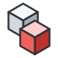{ .tool-icon-small } | [Delete/Keep Body](tools/delete-keep-body.md) | Deletes the selected bodies, or keeps only them. |
| { .tool-icon-small } | [Move/Copy Body](tools/move-copy-body.md) | Moves or copies bodies by a translation and a rotation. |
| { .tool-icon-small } | **Deform Bodies** ▾ | [Flex](tools/flex.md), [Deform](tools/deform.md), [Indent](tools/indent.md), [Freeform](tools/freeform.md), [Scale](tools/scale.md) |
| 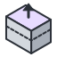{ .tool-icon-small } | [Move Face](tools/move-face.md) | Moves faces of a solid (offset, translate or rotate); the faces around them extend or trim to follow. |
| 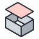{ .tool-icon-small } | [Delete Face](tools/delete-face.md) | Deletes faces: leaves a gap (the body becomes a surface), heals it from the faces around, or fills it. |
| 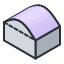{ .tool-icon-small } | [Replace Face](tools/replace-face.md) | Replaces faces of a solid with a surface: the solid grows out to it or is trimmed back. |

## Reference Geometry

|  | Tool | What it does |
| :-- | :-- | :-- |
| { .tool-icon-small } | **Reference Geometry** ▾ | [Plane](tools/plane.md), [Axis](tools/axis.md), [Coordinate System](tools/coordinate-system.md), [Point](tools/point.md), [Bounding Box](tools/bounding-box.md), [Center of Mass](tools/center-of-mass.md) |

## Surfaces

|  | Tool | What it does |
| :-- | :-- | :-- |
| { .tool-icon-small } | [Extruded Surface](tools/extruded-surface.md) | Extrudes a sketch's curves (open or closed) into a surface body. Surface in the feature's Add \| Cut \| Surface switch. |
| { .tool-icon-small } | [Revolved Surface](tools/revolved-surface.md) | Revolves a sketch's curves around an axis into a surface body. Surface in the feature's Add \| Cut \| Surface switch. |
| { .tool-icon-small } | [Swept Surface](tools/swept-surface.md) | Sweeps a profile's curves along a path into a surface body. Surface in the feature's Add \| Cut \| Surface switch. |
| { .tool-icon-small } | [Lofted Surface](tools/lofted-surface.md) | Makes a surface body between two or more profiles. Surface in the feature's Add \| Cut \| Surface switch. |
| { .tool-icon-small } | [Boundary Surface](tools/boundary-surface.md) | Makes a surface body through curves in one or two directions. Surface in the feature's Add \| Cut \| Surface switch. |
| 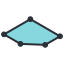{ .tool-icon-small } | [Planar Surface](tools/planar-surface.md) | Makes a flat surface inside a sketch's closed regions or closed, flat loops of edges. |
| { .tool-icon-small } | [Offset Surface](tools/offset-surface.md) | Offsets faces or surfaces by a distance into a new surface body (0: a copy). |
| 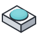{ .tool-icon-small } | [Filled Surface](tools/filled-surface.md) | Patches a closed loop of edges with a surface, touching or tangent to the faces around it. |
| { .tool-icon-small } | [Extend Surface](tools/extend-surface.md) | Extends a surface past its open edges, on the same surface or straight on. |
| { .tool-icon-small } | [Trim Surface](tools/trim-surface.md) | Trims surfaces with a plane, sketch or surface, or with each other; click the pieces to keep or remove. |
| { .tool-icon-small } | [Knit Surface](tools/knit-surface.md) | Knits surfaces into one; closed, it can become a solid. |
| { .tool-icon-small } | **More Surfaces** ▾ | [Ruled Surface](tools/ruled-surface.md), [Radiate Surface](tools/radiate-surface.md), [Untrim Surface](tools/untrim-surface.md), [Mid-Surface](tools/mid-surface.md), [Surface Flatten](tools/surface-flatten.md) |
| { .tool-icon-small } | [Thicken](tools/thicken.md) | Thickens a surface body into a solid, or cuts the solids with it (Add \| Cut in the panel). |
| { .tool-icon-small } | [Cut With Surface](tools/cut-with-surface.md) | Cuts bodies with a surface or plane, keeping one side. |

## Curves

|  | Tool | What it does |
| :-- | :-- | :-- |
| { .tool-icon-small } | **Curves** ▾ | [Split Line](tools/split-line.md), [Projected Curve](tools/projected-curve.md), [Composite Curve](tools/composite-curve.md), [Curve Through XYZ Points](tools/curve-through-xyz-points.md), [Curve Through Reference Points](tools/curve-through-reference-points.md), [Helix/Spiral](tools/helix-spiral.md) |

## Evaluate

|  | Tool | What it does |
| :-- | :-- | :-- |
| 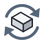{ .tool-icon-small } | [Force Rebuild](tools/force-rebuild.md) | Rebuilds every feature from scratch. |
| { .tool-icon-small } | [What's Wrong](tools/whats-wrong.md) | Lists what's wrong in the model, why, and what to do: shows each problem in the view and offers the fix. |

