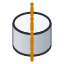
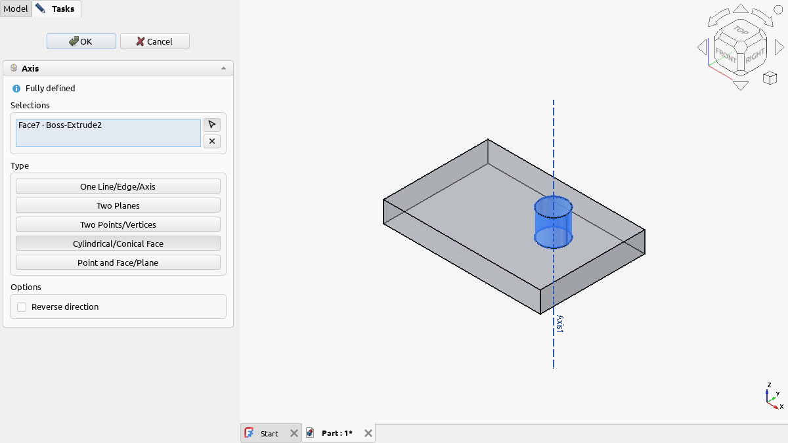

<!-- Generated by docs/build.py from docs/_data/catalog.json, docs/_authored/tools/axis.md, docs/_data/panels.json. Do not edit this file: change its sources and run `pixi run docs`. -->

# Axis

{ .tool-icon }
Adds a reference axis.
{ .tool-lead }

Axis adds a reference axis: to revolve around, pattern around, or sketch from. It guesses the type from what you pick.

## How to use it

1. Select one or two references: a round face (its axis), a straight edge, two planes (where they meet), two points.
2. Click **Axis**. The type matching your picks is pressed; press another if you meant something else.
3. Click **OK**.

## Good to know

- Hovering a round face or a straight edge while a tool needs an axis shows a temporary axis you can click: often you don't need a reference axis at all. See [picking things](../../guides/picking.md).

## Where to find it

- The **Reference Geometry** toolbar, in the **Reference Geometry** drop-down.
- **Solid Design** → **Reference Geometry** → **Axis**
- **Insert** → **Reference Geometry** → **Axis**
- Command search: press <kbd>/</kbd> in the 3D view and type its name.
- The command line: <kbd>:</kbd> then `axis` ([below](#on-the-command-line)).

## The panel

Every control's tooltip says the same as here: hover over it in FreeCAD. **OK** (or <kbd>Enter</kbd>) makes the feature, **Cancel** (or <kbd>Esc</kbd>) leaves the model as it was.

### Selections

Up to two references the axis is made from

| Control | Kind | What it does |
| :-- | :-- | :-- |
| **References** | Selection list: click an edge, a round face, two planes or two points | Up to two references: an edge or axis; a cylindrical or conical face; two planes; two points; a point and a face |

### Type

How the axis is made from the references; picked from what they are, or press another

| Control | Kind | What it does |
| :-- | :-- | :-- |
| **One Line/Edge/Axis** | A button | Along a straight edge, an axis or a sketch line (or a circular edge's axis) |
| **Two Planes** | A button | Where two planes or planar faces meet |
| **Two Points/Vertices** | A button | Through two points or vertices |
| **Cylindrical/Conical Face** | A button | The axis of a cylindrical or conical face |
| **Point and Face/Plane** | A button | Through a point, square to a plane or planar face |

### Options

| Control | Kind | What it does |
| :-- | :-- | :-- |
| **Reverse direction** | A check box | Turn the axis the other way round |

## On the command line

Press <kbd>:</kbd> in the 3D view and type `axis`, then what to set. See [the command line](../../guides/keyboard.md) for how it works.

??? note "Options it takes"

    | Option | How to type it | What it is |
    | :-- | :-- | :-- |
    | `Type` | a word: `onelineedgeaxis`, `twoplanes`, `twopointsvertices`, `cylindricalconicalface`, `pointandfaceplane` | How it is defined |
    | `Flip` | `flip` turns it on, `flip=no` off | Flip |

## Properties

??? info "All properties"

    What the feature stores, as the **Property** editor shows it (select the feature in the tree, then the **Data** tab). The panel sets these for you.

    | Property | Kind | Default | What it is |
    | :-- | :-- | :-- | :-- |
    | `Type` | Choice | One Line/Edge/Axis | How it is defined Choices: *One Line/Edge/Axis*, *Two Planes*, *Two Points/Vertices*, *Cylindrical/Conical Face*, *Point and Face/Plane*. |
    | `Reference1` | Picks | – | Reference 1 |
    | `Reference2` | Picks | – | Reference 2 |
    | `Reference3` | Picks | – | Reference 3 |
    | `Flip` | Yes/No | No | Flip |

