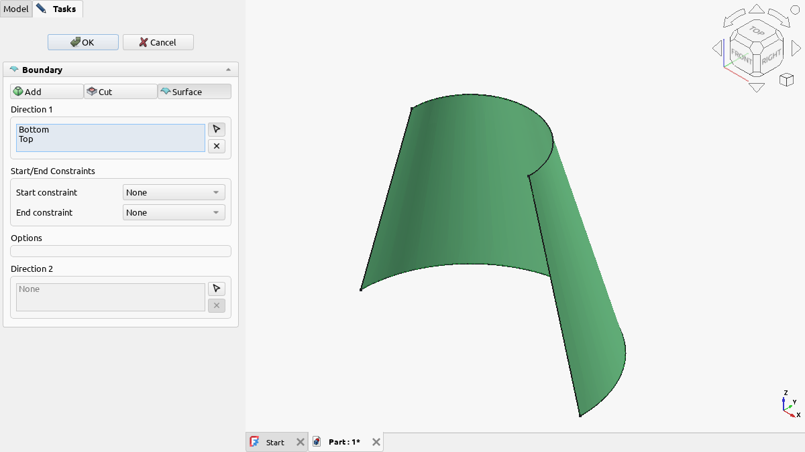

<!-- Generated by docs/build.py from docs/_data/catalog.json, docs/_authored/tools/boundary-surface.md, docs/_data/panels.json. Do not edit this file: change its sources and run `pixi run docs`. -->

# Boundary Surface

{ .tool-icon }
Makes a surface body through curves in one or two directions. Surface in the feature's Add | Cut | Surface switch.
{ .tool-lead }

Boundary Surface makes a surface body through curves in one or two directions. It is [Boundary](boundary.md) with **Surface** pressed.

## How to use it

1. Click **Boundary Surface**.
2. Click the curves for **Direction 1**, and optionally **Direction 2**.
3. Click **OK**.

## Where to find it

- The **Surfaces** toolbar.
- **Solid Design** → **Surfaces** → **Boundary Surface**
- **Insert** → **Surface** → **Boundary Surface**
- Command search: press <kbd>/</kbd> in the 3D view and type its name.
- The command line: <kbd>:</kbd> then `boundarysurface` ([below](#on-the-command-line)).

## The panel

Every control's tooltip says the same as here: hover over it in FreeCAD. **OK** (or <kbd>Enter</kbd>) makes the feature, **Cancel** (or <kbd>Esc</kbd>) leaves the model as it was.

| Control | Kind | What it does |
| :-- | :-- | :-- |
| **Add \\| Cut \\| Surface** | Buttons: *Add* \\| *Cut* \\| *Surface* |  |

### Sketch

*Shown only for some choices above.*

| Control | Kind | What it does |
| :-- | :-- | :-- |
| **Sketch** | Selection box: click a sketch | The sketch to use. Press the button, then click a sketch in the 3D view or tree. |

### Direction 1

| Control | Kind | What it does |
| :-- | :-- | :-- |
| **Profiles** | Selection list: click the profiles in order | The sketches to loft through, in order; a point may start or end the loft |

### Start/End Constraints

How the loft leaves the first profile and reaches the last

| Control | Kind | What it does |
| :-- | :-- | :-- |
| **Start constraint** | One of: *None*, *Normal To Profile*, *Direction Vector*, *Tangency To Face* | None: no constraint. Normal To Profile: the loft leaves the profile square to it. Direction Vector: it leaves along a direction you pick. Tangency To Face: a profile drawn along a face's edges; the loft carries on the faces beside it. |
| **Direction** | Selection box: click an edge, axis or plane | The direction the loft leaves the profile in: an edge or axis, or a plane's normal *(shown for some choices only)* |
| **Tangent length** | A number | How far the constraint reaches into the loft (1: normal) *(shown for some choices only)* |
| **Draft angle** | A number | Tilts the loft outwards where it leaves the profile *(shown for some choices only)* |
| **End constraint** | One of: *None*, *Normal To Profile*, *Direction Vector*, *Tangency To Face* | None: no constraint. Normal To Profile: the loft leaves the profile square to it. Direction Vector: it leaves along a direction you pick. Tangency To Face: a profile drawn along a face's edges; the loft carries on the faces beside it. |
| **Direction** | Selection box: click an edge, axis or plane | The direction the loft leaves the profile in: an edge or axis, or a plane's normal *(shown for some choices only)* |
| **Tangent length** | A number | How far the constraint reaches into the loft (1: normal) *(shown for some choices only)* |
| **Draft angle** | A number | Tilts the loft outwards where it leaves the profile *(shown for some choices only)* |

### Guide Curves

Curves the loft follows between the profiles

*Shown only for some choices above.*

| Control | Kind | What it does |
| :-- | :-- | :-- |
| **Guide curves** | Selection list: click guide curve sketches | Sketches whose curves the loft follows; each must touch every profile |
| **Influence** | One of: *To Next Edge*, *To Next Guide* | To Next Edge: a guide shapes only the faces beside it. To Next Guide: its pull blends to the next guide (with one guide, the whole profile moves). *(shown for some choices only)* |

### Options

| Control | Kind | What it does |
| :-- | :-- | :-- |
| **Close loft** | A check box | Join the last profile back to the first, making a ring *(shown for some choices only)* |
| **Merge result** | A check box | Fuse the new material with the bodies it touches. Off: it becomes a body of its own. *(shown for some choices only)* |
| **Flip side to cut** | A check box | Remove the material outside the profile instead of inside it *(shown for some choices only)* |

### Direction 2

Curves crossing every Direction 1 curve: the shape passes through the whole network

| Control | Kind | What it does |
| :-- | :-- | :-- |
| **Curves** | Selection list: click Direction 2 sketches | Sketches whose curves cross every Direction 1 curve; the first and last run along the ends |

### Thin Feature

Make a wall of constant thickness from the sketch's curves instead of filling it

*Optional: tick its title to use it. Shown only for some choices above.*

| Control | Kind | What it does |
| :-- | :-- | :-- |
| **Type** | One of: *One-Direction*, *Mid-Plane*, *Two-Direction* | Which side of the curves the wall grows on *(a flip button beside it; shown for some choices only)* |
| **Thickness** | A length | Wall thickness *(shown for some choices only)* |
| **Thickness 2** | A length | Wall thickness on the second side *(shown for some choices only)* |

### Selected Contours

*Shown only for some choices above.*

| Control | Kind | What it does |
| :-- | :-- | :-- |
| **Regions** | Selection list: click inside regions of the sketch | Use only some regions of the sketch: click inside them in the 3D view. Empty: the whole sketch. |

### Feature Scope

Which bodies the feature works on

*Shown only for some choices above.*

| Control | Kind | What it does |
| :-- | :-- | :-- |
| **All bodies \\| Selected bodies** | Buttons: *All bodies* \\| *Selected bodies* |  |
| **Auto-select** | A check box | Use the bodies the feature touches; untick to choose them *(shown for some choices only)* |
| **Bodies** | Selection list: click bodies in the 3D view or tree | The bodies the feature works on *(shown for some choices only)* |

### Bodies to Keep

The cut splits a body: choose which pieces to keep

*Shown only for some choices above.*

| Control | Kind | What it does |
| :-- | :-- | :-- |
| **All bodies \\| Selected bodies** | Buttons: *All bodies* \\| *Selected bodies* |  |
|  | A list | Tick the pieces to keep. They are numbered in the 3D view. |

## On the command line

Press <kbd>:</kbd> in the 3D view and type `boundarysurface`, then what to set. See [the command line](../../guides/keyboard.md) for how it works.

??? note "Options it takes"

    | Option | How to type it | What it is |
    | :-- | :-- | :-- |
    | `Mode` | a word: `add`, `cut`, `surface` | Add material, cut it, or make a surface body |
    | `Thin` | `thin` turns it on, `thin=no` off | Thin Feature on/off |
    | `ThinType` | a word: `onedirection`, `midplane`, `twodirection` | Thin type |
    | `ThinThickness` | `thinthickness=`a value | Thickness |
    | `ThinThickness2` | `thinthickness2=`a value | Thickness 2 (Two-Direction) |
    | `ThinReverse` | `thinreverse` turns it on, `thinreverse=no` off | Reverse the thin direction |
    | `MergeResult` | `mergeresult` turns it on, `mergeresult=no` off | Merge result (Add mode) |
    | `FeatureScope` | a word: `allbodies`, `selectedbodies` | Feature scope |
    | `AutoSelect` | `autoselect` turns it on, `autoselect=no` off | Auto-select the bodies in scope |
    | `BodiesToKeep` | a word: `allbodies`, `selectedbodies` | Bodies to Keep |
    | `FlipSideToCut` | `flipsidetocut` turns it on, `flipsidetocut=no` off | Flip side to cut (Cut mode) |
    | `Closed` | `closed` turns it on, `closed=no` off | Close the loft back to the first profile |
    | `GuideInfluence` | a word: `tonextedge`, `tonextguide` | To Next Edge: a guide shapes the faces beside it. To Next Guide: it blends to the next guide. |
    | `StartConstraint` | a word: `none`, `normaltoprofile`, `directionvector`, `tangencytoface` | Start constraint |

## Properties

??? info "All properties"

    What the feature stores, as the **Property** editor shows it (select the feature in the tree, then the **Data** tab). The panel sets these for you.

    | Property | Kind | Default | What it is |
    | :-- | :-- | :-- | :-- |
    | `Mode` | Choice | Add | Add material, cut it, or make a surface body Choices: *Add*, *Cut*, *Surface*. |
    | `Contours` | List | – | Selected Contours: regions of the sketch (bounding geometry IDs + a point inside) |
    | `Thin` | Yes/No | No | Thin Feature on/off |
    | `ThinType` | Choice | One-Direction | Thin type Choices: *One-Direction*, *Mid-Plane*, *Two-Direction*. |
    | `ThinThickness` | Length | 1 mm | Thickness |
    | `ThinThickness2` | Length | 1 mm | Thickness 2 (Two-Direction) |
    | `ThinReverse` | Yes/No | No | Reverse the thin direction |
    | `MergeResult` | Yes/No | Yes | Merge result (Add mode) |
    | `FeatureScope` | Choice | All bodies | Feature scope Choices: *All bodies*, *Selected bodies*. |
    | `AutoSelect` | Yes/No | Yes | Auto-select the bodies in scope |
    | `ScopeBodies` | List | – | Body IDs in scope |
    | `BodiesToKeep` | Choice | All bodies | Bodies to Keep Choices: *All bodies*, *Selected bodies*. |
    | `KeepBodies` | List | – | Piece IDs to keep |
    | `FlipSideToCut` | Yes/No | No | Flip side to cut (Cut mode) |
    | `Profiles` | Objects | – | Profiles in order: sketches, or a point at either end |
    | `Closed` | Yes/No | No | Close the loft back to the first profile |
    | `GuideCurves` | Objects | – | Sketches whose curves the loft follows (each must touch every profile) |
    | `GuideInfluence` | Choice | To Next Edge | To Next Edge: a guide shapes the faces beside it. To Next Guide: it blends to the next guide. Choices: *To Next Edge*, *To Next Guide*. |
    | `StartConstraint` | Choice | None | Start constraint Choices: *None*, *Normal To Profile*, *Direction Vector*, *Tangency To Face*. |

