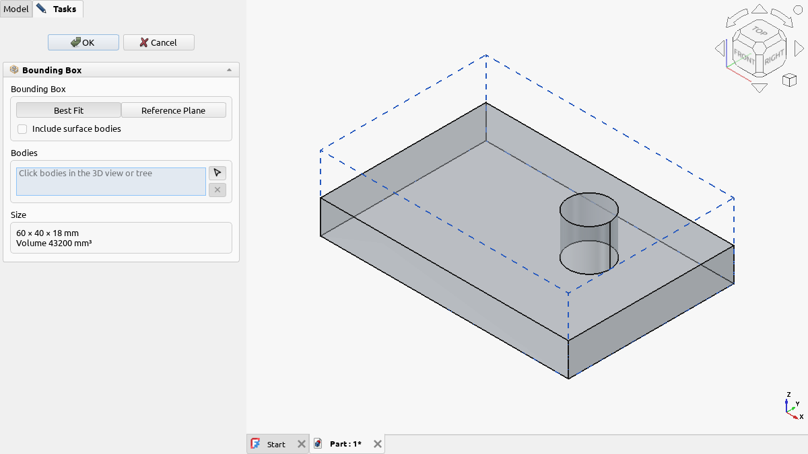

<!-- Generated by docs/build.py from docs/_data/catalog.json, docs/_authored/tools/bounding-box.md, docs/_data/panels.json. Do not edit this file: change its sources and run `pixi run docs`. -->

# Bounding Box

{ .tool-icon }
Adds a box round the bodies: the smallest one, or one square to a plane. Its length, width and thickness follow the model.
{ .tool-lead }

Bounding Box adds a box round the bodies that follows the model: its length, width and thickness show in the panel and update with every change. Use it for stock sizes and packaging.

## How to use it

1. Click **Bounding Box**.
2. Choose **Best Fit** (the smallest box) or **Reference Plane** (a box square to a plane you pick).
3. Leave **Bodies** empty for all of them, or click the ones to box.
4. Click **OK**.

## Where to find it

- The **Reference Geometry** toolbar, in the **Reference Geometry** drop-down.
- **Solid Design** → **Reference Geometry** → **Bounding Box**
- **Insert** → **Reference Geometry** → **Bounding Box**
- Command search: press <kbd>/</kbd> in the 3D view and type its name.
- The command line: <kbd>:</kbd> then `boundingbox` ([below](#on-the-command-line)).

## The panel

Every control's tooltip says the same as here: hover over it in FreeCAD. **OK** (or <kbd>Enter</kbd>) makes the feature, **Cancel** (or <kbd>Esc</kbd>) leaves the model as it was.

### Bounding Box

| Control | Kind | What it does |
| :-- | :-- | :-- |
| **Best Fit \\| Reference Plane** | Buttons: *Best Fit* \\| *Reference Plane* |  |
| **Plane** | Selection box: click a plane or face | The box sits square to this plane *(shown for some choices only)* |
| **Include surface bodies** | A check box | Put the surface bodies in the box too |

### Bodies

| Control | Kind | What it does |
| :-- | :-- | :-- |
| **Bodies** | Selection list: click bodies in the 3D view or tree | The bodies in the box (none picked: every body) |

### Size

> 60 × 40 × 18 mm
Volume 43200 mm³

## On the command line

Press <kbd>:</kbd> in the 3D view and type `boundingbox`, then what to set. See [the command line](../../guides/keyboard.md) for how it works.

??? note "Options it takes"

    | Option | How to type it | What it is |
    | :-- | :-- | :-- |
    | `Type` | a word: `bestfit`, `referenceplane` | How it is defined |
    | `IncludeSurfaces` | `includesurfaces` turns it on, `includesurfaces=no` off | Put the surface bodies in it too |

## Properties

??? info "All properties"

    What the feature stores, as the **Property** editor shows it (select the feature in the tree, then the **Data** tab). The panel sets these for you.

    | Property | Kind | Default | What it is |
    | :-- | :-- | :-- | :-- |
    | `Type` | Choice | Best Fit | How it is defined Choices: *Best Fit*, *Reference Plane*. |
    | `Reference1` | Picks | – | Reference 1 |
    | `Bodies` | List | – | The bodies it measures, by ID (empty: every solid body) |
    | `IncludeSurfaces` | Yes/No | No | Put the surface bodies in it too |
    | `Length` | Length | 0 mm | The box's longest side |
    | `Width` | Length | 0 mm | The box's middle side |
    | `Thickness` | Length | 0 mm | The box's shortest side |
    | `BoxVolume` | Volume | 0 | The box's volume |

