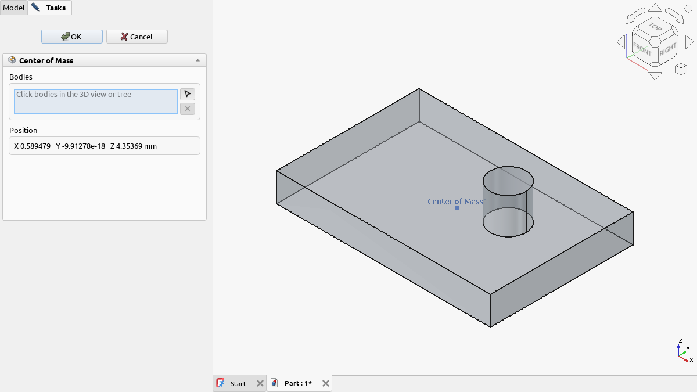

<!-- Generated by docs/build.py from docs/_data/catalog.json, docs/_authored/tools/center-of-mass.md, docs/_data/panels.json. Do not edit this file: change its sources and run `pixi run docs`. -->

# Center of Mass

{ .tool-icon }
Adds a point at the solid bodies' centre of mass; it follows the model and can be used like any point.
{ .tool-lead }

Center of Mass adds a point at the solid bodies' centre of mass (for one density). It moves when the model changes, and can be used like any point: to measure from, or to place things on.

## How to use it

1. Click **Center of Mass**.
2. Leave **Bodies** empty for all solid bodies, or click the ones to include.
3. Click **OK**. Its position shows in the panel.

## Where to find it

- The **Reference Geometry** toolbar, in the **Reference Geometry** drop-down.
- **Solid Design** → **Reference Geometry** → **Center of Mass**
- **Insert** → **Reference Geometry** → **Center of Mass**
- Command search: press <kbd>/</kbd> in the 3D view and type its name.
- The command line: <kbd>:</kbd> then `centerofmass`.

## The panel

Every control's tooltip says the same as here: hover over it in FreeCAD. **OK** (or <kbd>Enter</kbd>) makes the feature, **Cancel** (or <kbd>Esc</kbd>) leaves the model as it was.

### Bodies

| Control | Kind | What it does |
| :-- | :-- | :-- |
| **Bodies** | Selection list: click bodies in the 3D view or tree | The solid bodies it measures (none picked: every solid body) |

### Position

> X 0.589479   Y -9.91278e-18   Z 4.35369 mm

## Properties

??? info "All properties"

    What the feature stores, as the **Property** editor shows it (select the feature in the tree, then the **Data** tab). The panel sets these for you.

    | Property | Kind | Default | What it is |
    | :-- | :-- | :-- | :-- |
    | `Bodies` | List | – | The bodies it measures, by ID (empty: every solid body) |

