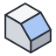
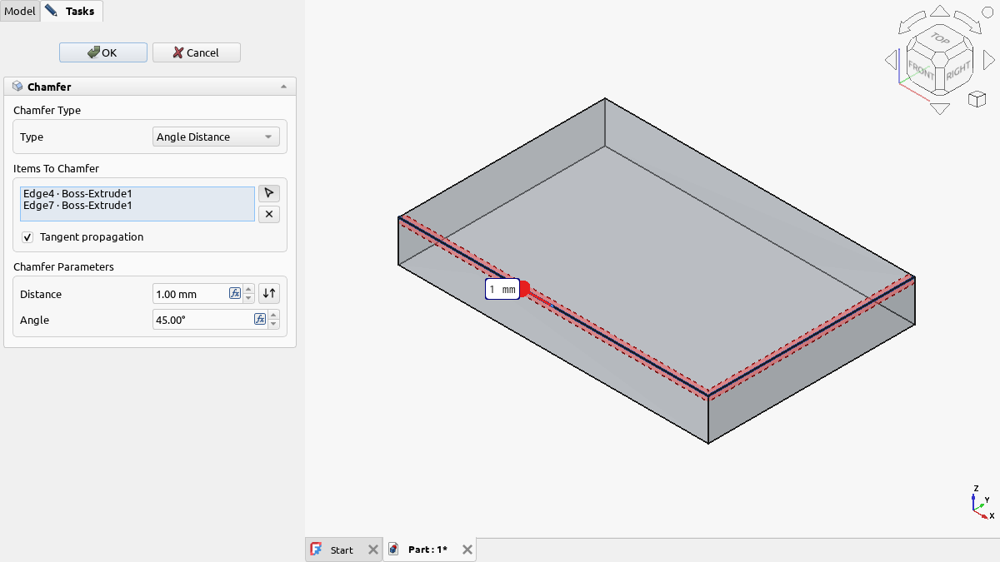

<!-- Generated by docs/build.py from docs/_data/catalog.json, docs/_authored/tools/chamfer.md, docs/_data/panels.json. Do not edit this file: change its sources and run `pixi run docs`. -->

# Chamfer

{ .tool-icon }
Creates a bevel on selected edges, faces or a vertex.
{ .tool-lead }

Chamfer bevels edges, every edge of a face, or the corner at a vertex.

## How to use it

1. Select edges, faces or a vertex.
2. Click **Chamfer**.
3. Choose the chamfer's **Type**: **Angle Distance**, **Distance Distance**, **Vertex** (three distances at a corner), **Offset Face** or **Face Face**. Set its values, or drag the handle.
4. Click **OK**.

## Good to know

- **Tangent propagation** carries the chamfer along tangent edges.

## Where to find it

- The **Features** toolbar.
- **Solid Design** → **Features** → **Chamfer**
- **Insert** → **Features** → **Chamfer**
- Command search: press <kbd>/</kbd> in the 3D view and type its name.
- The command line: <kbd>:</kbd> then `chamfer` ([below](#on-the-command-line)).

## The panel

Every control's tooltip says the same as here: hover over it in FreeCAD. **OK** (or <kbd>Enter</kbd>) makes the feature, **Cancel** (or <kbd>Esc</kbd>) leaves the model as it was.

### Chamfer Type

| Control | Kind | What it does |
| :-- | :-- | :-- |
| **Type** | One of: *Angle Distance*, *Distance Distance*, *Vertex*, *Offset Face*, *Face Face* | Angle Distance: a distance and an angle. Distance Distance: a distance on each face. Vertex: three distances at a corner. Offset Face: the faces offset by the distance. Face Face: pick faces that meet; the edges between them are chamfered, the first distance on the face picked first. |

### Items To Chamfer

| Control | Kind | What it does |
| :-- | :-- | :-- |
| **Edges** | Selection list: click edges or faces in the 3D view | The edges to chamfer, or corners for Vertex. Click an item again to take it out. |
| **Tangent propagation** | A check box | Also include the edges tangent to the ones you picked |

### Chamfer Parameters

| Control | Kind | What it does |
| :-- | :-- | :-- |
| **Distance** | A length | Size of the chamfer *(a flip button beside it)* |
| **Angle** | An angle | Angle of the chamfer face |
| **Equal distance** | A check box | Use the same distance on every side *(shown for some choices only)* |
| **Distance 2** | A length | Size of the chamfer on the second face *(shown for some choices only)* |
| **Distance 3** | A length | Size of the chamfer along the third edge *(shown for some choices only)* |

## Drag handles

While the panel is open, drag the handles in the 3D view to set **Distance**, or click a handle's value and type. The same handles show when you select the feature in the tree, so you can change it without opening the panel. See [drag handles](../../guides/drag-handles.md).

## On the command line

Press <kbd>:</kbd> in the 3D view and type `chamfer`, then what to set. See [the command line](../../guides/keyboard.md) for how it works.

Values typed straight after the name set, in order: **Distance**. For example `:chamfer 1`.

??? note "Options it takes"

    | Option | How to type it | What it is |
    | :-- | :-- | :-- |
    | `TangentPropagation` | `tangentpropagation` turns it on, `tangentpropagation=no` off | Include edges tangent to the picked ones |
    | `ChamferType` | a word: `angledistance`, `distancedistance`, `vertex`, `offsetface`, `faceface` | Chamfer type |
    | `Distance` | `distance=`a value | Distance (d1) |
    | `Distance2` | `distance2=`a value | Second distance (d2) |
    | `Distance3` | `distance3=`a value | Third distance (d3, Vertex) |
    | `Angle` | `angle=`a value | Angle (Angle Distance) |
    | `EqualDistance` | `equaldistance` turns it on, `equaldistance=no` off | Equal distance |
    | `FlipDirection` | `flipdirection` turns it on, `flipdirection=no` off | Flip direction |

## Properties

??? info "All properties"

    What the feature stores, as the **Property** editor shows it (select the feature in the tree, then the **Data** tab). The panel sets these for you.

    | Property | Kind | Default | What it is |
    | :-- | :-- | :-- | :-- |
    | `Items` | Picks | – | Edges, faces (all their edges) or vertices |
    | `TangentPropagation` | Yes/No | Yes | Include edges tangent to the picked ones |
    | `ChamferType` | Choice | Angle Distance | Chamfer type Choices: *Angle Distance*, *Distance Distance*, *Vertex*, *Offset Face*, *Face Face*. |
    | `Distance` | Length | 1 mm | Distance (d1) |
    | `Distance2` | Length | 1 mm | Second distance (d2) |
    | `Distance3` | Length | 1 mm | Third distance (d3, Vertex) |
    | `Angle` | Angle | 45° | Angle (Angle Distance) |
    | `EqualDistance` | Yes/No | Yes | Equal distance |
    | `FlipDirection` | Yes/No | No | Flip direction |

