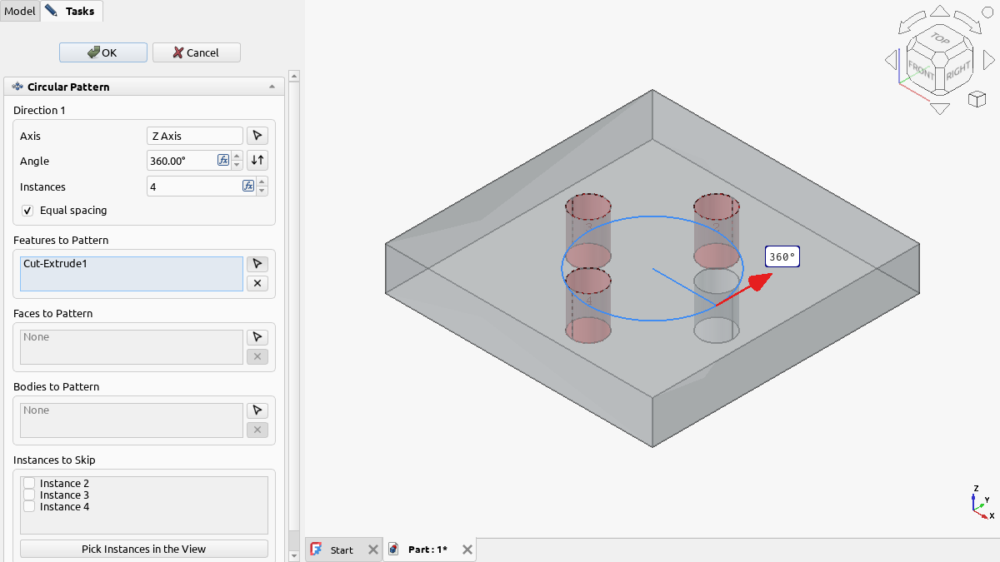

<!-- Generated by docs/build.py from docs/_data/catalog.json, docs/_authored/tools/circular-pattern.md, docs/_data/panels.json. Do not edit this file: change its sources and run `pixi run docs`. -->

# Circular Pattern

{ .tool-icon }
Repeats features or bodies around an axis.
{ .tool-lead }

Circular Pattern repeats features or bodies around an axis: bolt circles, spokes, teeth.

## How to use it

1. Select the features to repeat.
2. Click **Circular Pattern**.
3. Click the **Axis**: an origin axis, a reference [axis](axis.md), a straight edge, or a round face (its axis is used).
4. Set the **Angle** and number of **Instances**. With **Equal spacing** the instances share the angle out evenly.
5. Click **OK**.

## Where to find it

- The **Features** toolbar, in the **Patterns** drop-down.
- **Solid Design** → **Patterns** → **Circular Pattern**
- **Insert** → **Pattern/Mirror** → **Circular Pattern**
- Command search: press <kbd>/</kbd> in the 3D view and type its name.
- The command line: <kbd>:</kbd> then `circularpattern` ([below](#on-the-command-line)).

## The panel

Every control's tooltip says the same as here: hover over it in FreeCAD. **OK** (or <kbd>Enter</kbd>) makes the feature, **Cancel** (or <kbd>Esc</kbd>) leaves the model as it was.

### Direction 1

| Control | Kind | What it does |
| :-- | :-- | :-- |
| **Axis** | Selection box: click an axis or edge | The axis to pattern about: an axis, a straight edge or a round face |
| **Angle** | An angle | The angle between instances; with Equal spacing, the total angle they spread over *(a flip button beside it)* |
| **Instances** | A count | How many, counting the original |
| **Equal spacing** | A check box | Spread the instances evenly over the angle |

### Features to Pattern

| Control | Kind | What it does |
| :-- | :-- | :-- |
| **Features** | Selection list: click features in the tree, or their faces | The features to repeat: click them in the tree, or click a face they made |

### Faces to Pattern

| Control | Kind | What it does |
| :-- | :-- | :-- |
| **Faces** | Selection list: click faces | Every face of a boss, hole or pocket to repeat (its walls and top or floor). Material is added where they bound material, cut where they bound a gap. |

### Bodies to Pattern

| Control | Kind | What it does |
| :-- | :-- | :-- |
| **Bodies** | Selection list: click bodies in the 3D view or tree | Whole bodies to repeat |

### Instances to Skip

Tick the instances to leave out

| Control | Kind | What it does |
| :-- | :-- | :-- |
|  | A list | Every instance but the original: tick one to leave it out |
| **Pick Instances in the View** | A button | While on, clicking the model where an instance is (or would be) leaves it out, or puts it back |

## Drag handles

While the panel is open, drag the handles in the 3D view to set **Angle**, or click a handle's value and type. The same handles show when you select the feature in the tree, so you can change it without opening the panel. See [drag handles](../../guides/drag-handles.md).

## On the command line

Press <kbd>:</kbd> in the 3D view and type `circularpattern`, then what to set. See [the command line](../../guides/keyboard.md) for how it works.

Values typed straight after the name set, in order: **Angle**, **Instances**. For example `:circularpattern 360 4`.

??? note "Options it takes"

    | Option | How to type it | What it is |
    | :-- | :-- | :-- |
    | `Reverse` | `reverse` turns it on, `reverse=no` off | Reverse direction |
    | `Angle` | `angle=`a value | Total angle (Equal spacing) or spacing |
    | `Instances` | `instances=`a whole number | Number of instances (with the seed) |
    | `EqualSpacing` | `equalspacing` turns it on, `equalspacing=no` off | Equal spacing |

## Properties

??? info "All properties"

    What the feature stores, as the **Property** editor shows it (select the feature in the tree, then the **Data** tab). The panel sets these for you.

    | Property | Kind | Default | What it is |
    | :-- | :-- | :-- | :-- |
    | `Features` | Objects | – | Features to repeat |
    | `Bodies` | List | – | Bodies to repeat, by ID |
    | `Faces` | Picks | – | Faces to repeat: every face of a boss, hole or pocket |
    | `Axis` | Picks | – | Axis, straight or circular edge, round face |
    | `Reverse` | Yes/No | No | Reverse direction |
    | `Angle` | Angle | 360° | Total angle (Equal spacing) or spacing |
    | `Instances` | Whole number | 4 | Number of instances (with the seed) |
    | `EqualSpacing` | Yes/No | Yes | Equal spacing |
    | `InstancesToSkip` | List | – | Instances left out, by number (the seed is 1) |

