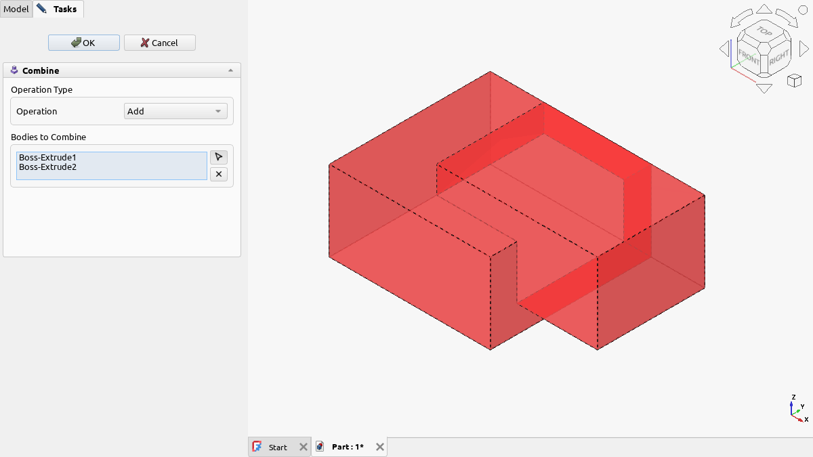

<!-- Generated by docs/build.py from docs/_data/catalog.json, docs/_authored/tools/combine.md, docs/_data/panels.json. Do not edit this file: change its sources and run `pixi run docs`. -->

# Combine

{ .tool-icon }
Combines bodies: adds them, subtracts some from a main body, or keeps what they have in common.
{ .tool-lead }

Combine joins bodies, subtracts some from a main body, or keeps only what they share.

## How to use it

1. Select the bodies.
2. Click **Combine** and choose the **Operation**: **Add**, **Subtract** or **Common**.
3. For **Subtract**, pick the **Main Body** and the bodies to take away from it.
4. Click **OK**.

## Where to find it

- The **Bodies** toolbar.
- **Solid Design** → **Bodies** → **Combine**
- **Insert** → **Features** → **Combine**
- Command search: press <kbd>/</kbd> in the 3D view and type its name.
- The command line: <kbd>:</kbd> then `combine` ([below](#on-the-command-line)).

## The panel

Every control's tooltip says the same as here: hover over it in FreeCAD. **OK** (or <kbd>Enter</kbd>) makes the feature, **Cancel** (or <kbd>Esc</kbd>) leaves the model as it was.

### Operation Type

| Control | Kind | What it does |
| :-- | :-- | :-- |
| **Operation** | One of: *Add*, *Subtract*, *Common* | Add: fuse the bodies into one. Subtract: cut the other bodies from the main body. Common: keep only where the bodies overlap. |

### Main Body

*Shown only for some choices above.*

| Control | Kind | What it does |
| :-- | :-- | :-- |
| **Main body** | Selection box: click a body | The body the others are cut from |

### Bodies to Combine

| Control | Kind | What it does |
| :-- | :-- | :-- |
| **Bodies** | Selection list: click bodies in the 3D view or tree | The bodies to combine. Click one again to take it out. |

## On the command line

Press <kbd>:</kbd> in the 3D view and type `combine`, then what to set. See [the command line](../../guides/keyboard.md) for how it works.

??? note "Options it takes"

    | Option | How to type it | What it is |
    | :-- | :-- | :-- |
    | `Operation` | a word: `add`, `subtract`, `common` | Operation |

## Properties

??? info "All properties"

    What the feature stores, as the **Property** editor shows it (select the feature in the tree, then the **Data** tab). The panel sets these for you.

    | Property | Kind | Default | What it is |
    | :-- | :-- | :-- | :-- |
    | `Operation` | Choice | Add | Operation Choices: *Add*, *Subtract*, *Common*. |
    | `MainBody` | Text |  | Main body (Subtract), by ID |
    | `Bodies` | List | – | Bodies to combine (Add, Common) or to subtract, by ID |

