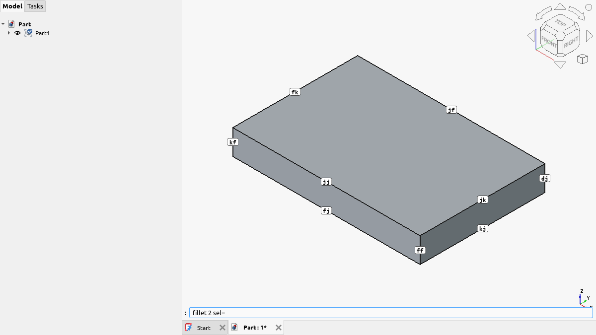

<!-- Generated by docs/build.py from docs/_data/catalog.json, docs/_authored/tools/command-line.md. Do not edit this file: change its sources and run `pixi run docs`. -->

# Command Line

{ .tool-icon }
Type a tool and its values, e.g. "fillet 2" (press : in the 3D view). Works on the selection, or what's under the pointer.
{ .tool-lead }

The command line runs a tool from the keyboard: type the tool and its values, and the feature is made with no panel. It's the fastest way to repeat simple features.

## How to use it

1. Select what the feature works on, or point at it.
2. Press <kbd>:</kbd> in the 3D view. A bar opens at the bottom of the view.
3. Type the tool and its values, for example `fillet 2` or `extrude 10 cut`, and press <kbd>Enter</kbd>.

If the feature builds, it is made in one undo step. If it can't, its panel opens with your values in and the problem shown.

## Good to know

- `sel=` then <kbd>Tab</kbd> labels what you can pick in the view; type a label to pick it.
- <kbd>Tab</kbd> completes, <kbd>Up</kbd> and <kbd>Down</kbd> go through the history.
- [Keyboard modelling](../../guides/keyboard.md) explains it all; [the command line words](../command-line.md) lists every tool.

## Where to find it

- **Solid Design** → **Command Line**
- Command search: press <kbd>/</kbd> in the 3D view and type its name.

