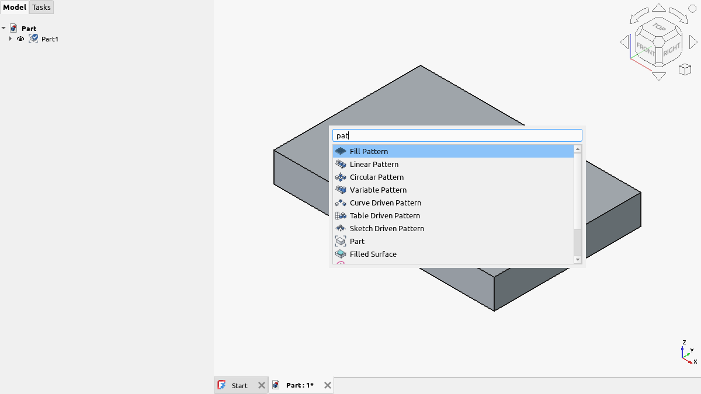

<!-- Generated by docs/build.py from docs/_data/catalog.json, docs/_authored/tools/command-search.md. Do not edit this file: change its sources and run `pixi run docs`. -->

# Command Search

{ .tool-icon }
Find a Solid Design tool by typing its name, then press Enter to start it.
{ .tool-lead }

Command Search finds any Solid Design tool by typing a few letters of its name.

## How to use it

1. Press <kbd>/</kbd> in the 3D view, with no tool open.
2. Type part of the name: letters in order are enough ("lpat" finds Linear Pattern).
3. Press <kbd>Enter</kbd> to start the highlighted tool, or use <kbd>Up</kbd> and <kbd>Down</kbd> to choose. <kbd>Esc</kbd> closes it.

## Where to find it

- **Solid Design** → **Command Search**
- Command search: press <kbd>/</kbd> in the 3D view and type its name.
- Keyboard: <kbd>/</kbd>.

