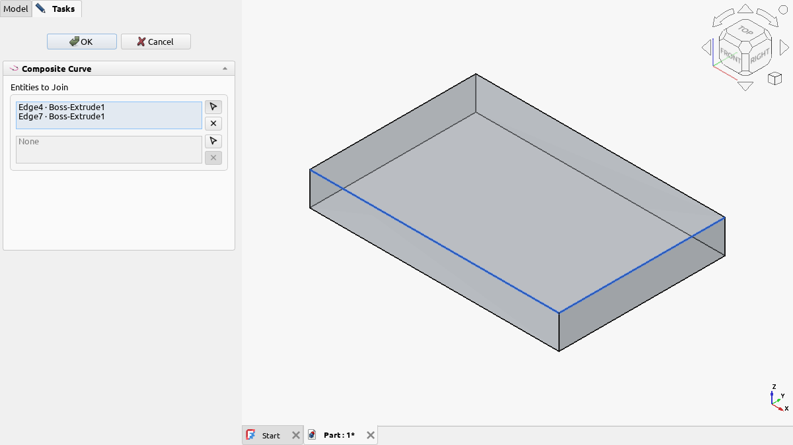

<!-- Generated by docs/build.py from docs/_data/catalog.json, docs/_authored/tools/composite-curve.md, docs/_data/panels.json. Do not edit this file: change its sources and run `pixi run docs`. -->

# Composite Curve

{ .tool-icon }
Joins edges and sketch curves end to end into one curve.
{ .tool-lead }

Composite Curve joins edges and sketch curves end to end into one curve: a single path for a sweep.

## How to use it

1. Select the edges and curves, in a chain, and click **Composite Curve**.
2. Click **OK**.

## Where to find it

- The **Curves** toolbar, in the **Curves** drop-down.
- **Solid Design** → **Curves** → **Composite Curve**
- **Insert** → **Curve** → **Composite Curve**
- Command search: press <kbd>/</kbd> in the 3D view and type its name.
- The command line: <kbd>:</kbd> then `compositecurve` ([below](#on-the-command-line)).

## The panel

Every control's tooltip says the same as here: hover over it in FreeCAD. **OK** (or <kbd>Enter</kbd>) makes the feature, **Cancel** (or <kbd>Esc</kbd>) leaves the model as it was.

### Entities to Join

| Control | Kind | What it does |
| :-- | :-- | :-- |
| **Edges** | Selection list: click edges | Model edges to join, end to end |
| **Sketches** | Selection list: click sketches | Sketches and curves to join, end to end |

## On the command line

Press <kbd>:</kbd> in the 3D view and type `compositecurve`, then what to set. See [the command line](../../guides/keyboard.md) for how it works.

??? note "Options it takes"

    | Option | How to type it | What it is |
    | :-- | :-- | :-- |
    | `Type` | a word: `curve` | How it is defined |

## Properties

??? info "All properties"

    What the feature stores, as the **Property** editor shows it (select the feature in the tree, then the **Data** tab). The panel sets these for you.

    | Property | Kind | Default | What it is |
    | :-- | :-- | :-- | :-- |
    | `Type` | Choice | Curve | How it is defined Choices: *Curve*. |
    | `Edges` | Picks | – | Model edges to join |
    | `Curves` | Objects | – | Sketches and curves to join |

