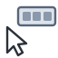
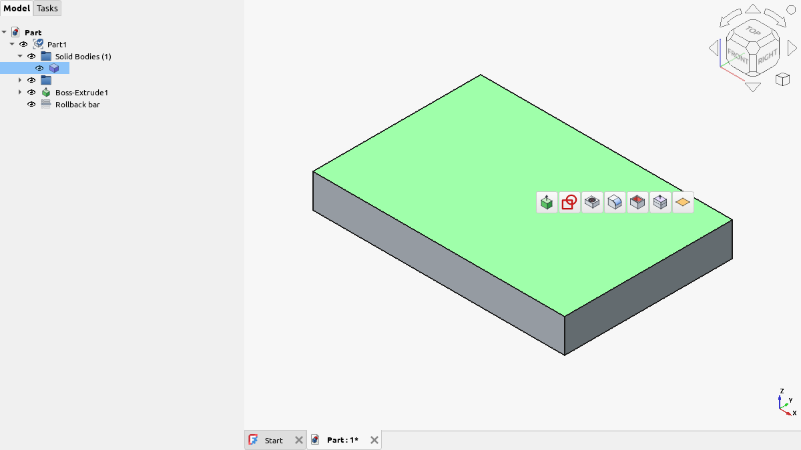

<!-- Generated by docs/build.py from docs/_data/catalog.json, docs/_authored/tools/context-toolbar.md. Do not edit this file: change its sources and run `pixi run docs`. -->

# Context Toolbar

{ .tool-icon }
Shows the tools that fit a face, edge or vertex by the pointer when you click it.
{ .tool-lead }

The context toolbar shows the tools that fit what you just clicked, beside the pointer: click a face and **Sketch**, **Extrude**, **Hole Wizard** and more are one click away. Click an edge and you get **Fillet** and **Chamfer**. Its first button edits the feature that made the face.

## How to use it

1. Click a face, edge or vertex in the 3D view.
2. Click a tool on the bar by the pointer. It fades as the pointer moves away.

## Good to know

- **Context Toolbar** in the **Solid Design** menu turns it on and off.

## Where to find it

- **Solid Design** → **Context Toolbar**
- Command search: press <kbd>/</kbd> in the 3D view and type its name.

