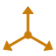
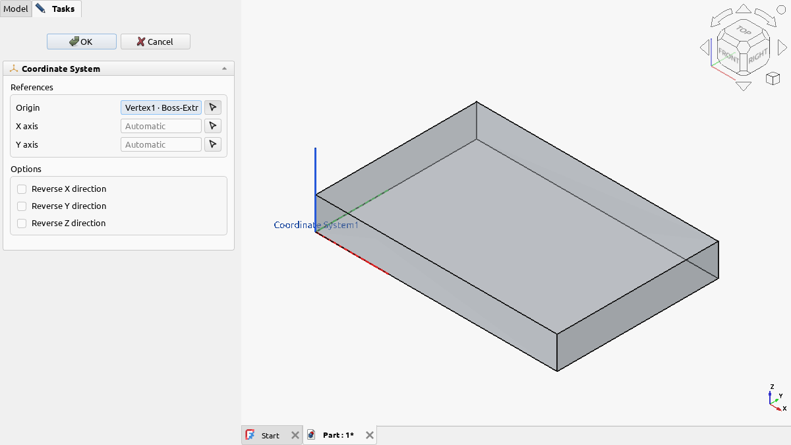

<!-- Generated by docs/build.py from docs/_data/catalog.json, docs/_authored/tools/coordinate-system.md, docs/_data/panels.json. Do not edit this file: change its sources and run `pixi run docs`. -->

# Coordinate System

{ .tool-icon }
Adds a coordinate system from an origin and X and Y directions (all optional). Sketches can be attached to it.
{ .tool-lead }

Coordinate System adds an origin with X, Y and Z directions: to measure from, to type positions in ([Table Driven Pattern](table-driven-pattern.md)), or to sketch on its XY plane.

## How to use it

1. Select a vertex or point for its origin, and click **Coordinate System**.
2. Optionally click edges for the **X axis** and **Y axis**; empty, they follow the part's. Reverse any direction under **Options**.
3. Click **OK**.

## Where to find it

- The **Reference Geometry** toolbar, in the **Reference Geometry** drop-down.
- **Solid Design** → **Reference Geometry** → **Coordinate System**
- **Insert** → **Reference Geometry** → **Coordinate System**
- Command search: press <kbd>/</kbd> in the 3D view and type its name.
- The command line: <kbd>:</kbd> then `coordinatesystem` ([below](#on-the-command-line)).

## The panel

Every control's tooltip says the same as here: hover over it in FreeCAD. **OK** (or <kbd>Enter</kbd>) makes the feature, **Cancel** (or <kbd>Esc</kbd>) leaves the model as it was.

### Type

*Shown only for some choices above.*

| Control | Kind | What it does |
| :-- | :-- | :-- |
| **Type** | One of: *Origin and Axes* | How the coordinate system is defined; the references below follow from it |

### References

| Control | Kind | What it does |
| :-- | :-- | :-- |
| **Origin** | Selection box: click a vertex or point | A reference the coordinate system is built from |
| **X axis** | Selection box: click an edge or face | A reference the coordinate system is built from |
| **Y axis** | Selection box: click an edge or face | A reference the coordinate system is built from |

### Options

| Control | Kind | What it does |
| :-- | :-- | :-- |
| **Reverse X direction** | A check box | Turn the X axis round |
| **Reverse Y direction** | A check box | Turn the Y axis round |
| **Reverse Z direction** | A check box | Turn the Z axis round (Y turns with it, so the axes stay right-handed) |

## On the command line

Press <kbd>:</kbd> in the 3D view and type `coordinatesystem`, then what to set. See [the command line](../../guides/keyboard.md) for how it works.

??? note "Options it takes"

    | Option | How to type it | What it is |
    | :-- | :-- | :-- |
    | `Type` | a word: `originandaxes` | How it is defined |
    | `Flip` | `flip` turns it on, `flip=no` off | Flip |
    | `FlipX` | `flipx` turns it on, `flipx=no` off | Reverse the X direction |
    | `FlipY` | `flipy` turns it on, `flipy=no` off | Reverse the Y direction |

## Properties

??? info "All properties"

    What the feature stores, as the **Property** editor shows it (select the feature in the tree, then the **Data** tab). The panel sets these for you.

    | Property | Kind | Default | What it is |
    | :-- | :-- | :-- | :-- |
    | `Type` | Choice | Origin and Axes | How it is defined Choices: *Origin and Axes*. |
    | `Reference1` | Picks | – | Reference 1 |
    | `Reference2` | Picks | – | Reference 2 |
    | `Reference3` | Picks | – | Reference 3 |
    | `Flip` | Yes/No | No | Flip |
    | `FlipX` | Yes/No | No | Reverse the X direction |
    | `FlipY` | Yes/No | No | Reverse the Y direction |

