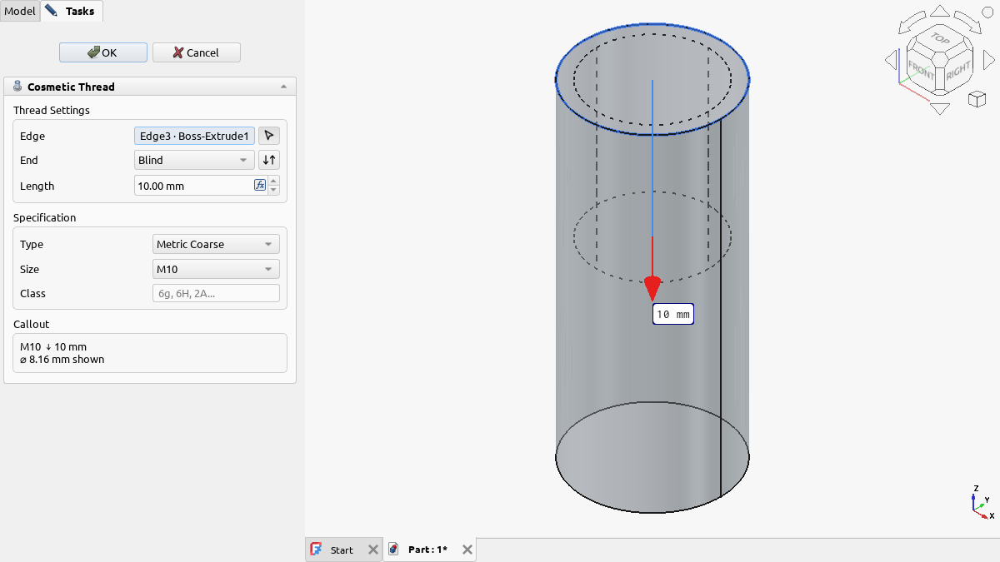

<!-- Generated by docs/build.py from docs/_data/catalog.json, docs/_authored/tools/cosmetic-thread.md, docs/_data/panels.json. Do not edit this file: change its sources and run `pixi run docs`. -->

# Cosmetic Thread

{ .tool-icon }
Shows a thread on a shaft or in a hole without modelling it: pick the circular edge where it starts.
{ .tool-lead }

Cosmetic Thread marks a thread without modelling it: dashed lines at the thread's diameter, and its callout. It keeps the model light.

## How to use it

1. Select the circular edge where the thread starts.
2. Click **Cosmetic Thread**.
3. Choose the thread **Type** and **Size**, and how far it goes (**End**, **Length**).
4. Click **OK**.

## Where to find it

- The **Features** toolbar, in the **Threads** drop-down.
- **Solid Design** → **Features** → **Cosmetic Thread**
- Command search: press <kbd>/</kbd> in the 3D view and type its name.
- The command line: <kbd>:</kbd> then `cosmeticthread` ([below](#on-the-command-line)).

## The panel

Every control's tooltip says the same as here: hover over it in FreeCAD. **OK** (or <kbd>Enter</kbd>) makes the feature, **Cancel** (or <kbd>Esc</kbd>) leaves the model as it was.

### Thread Settings

| Control | Kind | What it does |
| :-- | :-- | :-- |
| **Edge** | Selection box: click a circular edge | The circular edge where the thread starts: a shaft's end or a hole's rim |
| **End** | One of: *Blind*, *Up To Next* | Blind: a length. Up To Next: to the end of the cylinder *(a flip button beside it)* |
| **Length** | A length | Thread length |

### Specification

| Control | Kind | What it does |
| :-- | :-- | :-- |
| **Type** | One of: *Metric Coarse*, *Metric Fine*, *Unified Coarse (UNC)*, *Unified Fine (UNF)* | The thread standard and series |
| **Size** | One of: *M1.6*, *M2*, *M2.5*, *M3*, *M4*, *M5*, *M6*, *M8*, *M10*, *M12*, *M14*, *M16*, *M18*, *M20*, *M22*, *M24*, *M27*, *M30*, *M33*, *M36* | The thread size; it starts at the one nearest the cylinder |
| **Class** |  | The tolerance class, for the callout |

### Callout

> M10  ↓ 10 mm
⌀ 8.16 mm shown

## Drag handles

While the panel is open, drag the handles in the 3D view to set **Length**, or click a handle's value and type. The same handles show when you select the feature in the tree, so you can change it without opening the panel. See [drag handles](../../guides/drag-handles.md).

## On the command line

Press <kbd>:</kbd> in the 3D view and type `cosmeticthread`, then what to set. See [the command line](../../guides/keyboard.md) for how it works.

Values typed straight after the name set, in order: **Length**. For example `:cosmeticthread 10`.

??? note "Options it takes"

    | Option | How to type it | What it is |
    | :-- | :-- | :-- |
    | `Type` | a word: `blind`, `uptonext` | How it is defined |
    | `Flip` | `flip` turns it on, `flip=no` off | Flip |
    | `Series` | a word: `metriccoarse`, `metricfine`, `unifiedcoarseunc`, `unifiedfineunf` | Thread standard and series |
    | `Length` | `length=`a value | Thread length (Blind) |

## Properties

??? info "All properties"

    What the feature stores, as the **Property** editor shows it (select the feature in the tree, then the **Data** tab). The panel sets these for you.

    | Property | Kind | Default | What it is |
    | :-- | :-- | :-- | :-- |
    | `Type` | Choice | Blind | How it is defined Choices: *Blind*, *Up To Next*. |
    | `Reference1` | Picks | – | Reference 1 |
    | `Flip` | Yes/No | No | Flip |
    | `Series` | Choice | Metric Coarse | Thread standard and series Choices: *Metric Coarse*, *Metric Fine*, *Unified Coarse (UNC)*, *Unified Fine (UNF)*. |
    | `Size` | Text |  | Thread size (empty: the nearest one) |
    | `Length` | Length | 10 mm | Thread length (Blind) |
    | `ThreadClass` | Text |  | Tolerance class, for the callout |
    | `Diameter` | Length | 0 mm | The diameter shown: the minor diameter on a shaft, the major one in a hole |
    | `Callout` | Text |  | The thread's callout |

