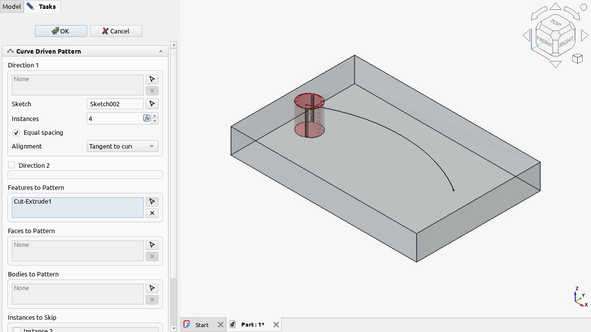

<!-- Generated by docs/build.py from docs/_data/catalog.json, docs/_authored/tools/curve-driven-pattern.md, docs/_data/panels.json. Do not edit this file: change its sources and run `pixi run docs`. -->

# Curve Driven Pattern

{ .tool-icon }
Repeats features or bodies along a curve.
{ .tool-lead }

Curve Driven Pattern repeats features or bodies along a curve: holes along a curved edge, studs along a path.

## How to use it

1. Select the curve (a sketch or an edge) and click **Curve Driven Pattern**.
2. Click the features to repeat into **Features to Pattern**.
3. Set the number of **Instances**; with **Equal spacing** they share out the curve's length.
4. Choose **Alignment**: the instances turn to follow the curve (**Tangent to curve**) or keep the original's direction.
5. Click **OK**.

## Where to find it

- The **Features** toolbar, in the **Patterns** drop-down.
- **Solid Design** → **Patterns** → **Curve Driven Pattern**
- **Insert** → **Pattern/Mirror** → **Curve Driven Pattern**
- Command search: press <kbd>/</kbd> in the 3D view and type its name.
- The command line: <kbd>:</kbd> then `curvedrivenpattern` ([below](#on-the-command-line)).

## The panel

Every control's tooltip says the same as here: hover over it in FreeCAD. **OK** (or <kbd>Enter</kbd>) makes the feature, **Cancel** (or <kbd>Esc</kbd>) leaves the model as it was.

### Direction 1

| Control | Kind | What it does |
| :-- | :-- | :-- |
| **Edges** | Selection list: click edges | The curve to pattern along: model edges, end to end |
| **Sketch** | Selection box: click a sketch | Or a sketch: its curves, end to end |
| **Instances** | A count | How many, counting the original |
| **Equal spacing** | A check box | Spread the instances over the whole curve |
| **Spacing** | A length | Distance along the curve *(a flip button beside it; shown for some choices only)* |
| **Alignment** | One of: *Tangent to curve*, *Align to seed* | Tangent to curve: each instance turns with the curve. Align to seed: they keep the original's orientation. |

### Direction 2

Pattern along a second curve too

*Optional: tick its title to use it.*

| Control | Kind | What it does |
| :-- | :-- | :-- |
| **Edges** | Selection list: click edges | The second curve: model edges, end to end *(shown for some choices only)* |
| **Sketch** | Selection box: click a sketch | Or a sketch *(shown for some choices only)* |
| **Instances** | A count | How many along the second curve, counting the first row *(shown for some choices only)* |
| **Equal spacing** | A check box | Spread them over the whole second curve *(shown for some choices only)* |
| **Spacing** | A length | Distance along the second curve *(a flip button beside it; shown for some choices only)* |

### Features to Pattern

| Control | Kind | What it does |
| :-- | :-- | :-- |
| **Features** | Selection list: click features in the tree, or their faces | The features to repeat: click them in the tree, or click a face they made |

### Faces to Pattern

| Control | Kind | What it does |
| :-- | :-- | :-- |
| **Faces** | Selection list: click faces | Every face of a boss, hole or pocket to repeat (its walls and top or floor). Material is added where they bound material, cut where they bound a gap. |

### Bodies to Pattern

| Control | Kind | What it does |
| :-- | :-- | :-- |
| **Bodies** | Selection list: click bodies in the 3D view or tree | Whole bodies to repeat |

### Instances to Skip

Tick the instances to leave out

| Control | Kind | What it does |
| :-- | :-- | :-- |
|  | A list | Every instance but the original: tick one to leave it out |
| **Pick Instances in the View** | A button | While on, clicking the model where an instance is (or would be) leaves it out, or puts it back |

## On the command line

Press <kbd>:</kbd> in the 3D view and type `curvedrivenpattern`, then what to set. See [the command line](../../guides/keyboard.md) for how it works.

Values typed straight after the name set, in order: **Instances**. For example `:curvedrivenpattern 4`.

??? note "Options it takes"

    | Option | How to type it | What it is |
    | :-- | :-- | :-- |
    | `Reverse` | `reverse` turns it on, `reverse=no` off | Reverse direction |
    | `Instances` | `instances=`a whole number | Number of instances (with the seed) |
    | `EqualSpacing` | `equalspacing` turns it on, `equalspacing=no` off | Spread over the whole curve |
    | `Spacing` | `spacing=`a value | Distance along the curve |
    | `Alignment` | a word: `tangenttocurve`, `aligntoseed` | Tangent to curve: instances turn with the curve. Align to seed: they keep the seed's orientation |
    | `Direction2` | `direction2` turns it on, `direction2=no` off | Pattern along a second curve too |
    | `Reverse2` | `reverse2` turns it on, `reverse2=no` off | Reverse direction 2 |
    | `Instances2` | `instances2=`a whole number | Number of instances along it |
    | `EqualSpacing2` | `equalspacing2` turns it on, `equalspacing2=no` off | Spread over the whole curve |
    | `Spacing2` | `spacing2=`a value | Distance along the second curve |

## Properties

??? info "All properties"

    What the feature stores, as the **Property** editor shows it (select the feature in the tree, then the **Data** tab). The panel sets these for you.

    | Property | Kind | Default | What it is |
    | :-- | :-- | :-- | :-- |
    | `Features` | Objects | – | Features to repeat |
    | `Bodies` | List | – | Bodies to repeat, by ID |
    | `Faces` | Picks | – | Faces to repeat: every face of a boss, hole or pocket |
    | `Curve` | Picks | – | The curve: model edges |
    | `CurveSketch` | Object | – | Or: a sketch (its curves, end to end) |
    | `Reverse` | Yes/No | No | Reverse direction |
    | `Instances` | Whole number | 4 | Number of instances (with the seed) |
    | `EqualSpacing` | Yes/No | Yes | Spread over the whole curve |
    | `Spacing` | Length | 10 mm | Distance along the curve |
    | `Alignment` | Choice | Tangent to curve | Tangent to curve: instances turn with the curve. Align to seed: they keep the seed's orientation Choices: *Tangent to curve*, *Align to seed*. |
    | `Direction2` | Yes/No | No | Pattern along a second curve too |
    | `Curve2` | Picks | – | The second curve: model edges |
    | `CurveSketch2` | Object | – | Or: a sketch |
    | `Reverse2` | Yes/No | No | Reverse direction 2 |
    | `Instances2` | Whole number | 2 | Number of instances along it |
    | `EqualSpacing2` | Yes/No | Yes | Spread over the whole curve |
    | `Spacing2` | Length | 10 mm | Distance along the second curve |
    | `InstancesToSkip` | List | – | Instances left out, by number (the seed is 1); with Direction 2, by i,j |

