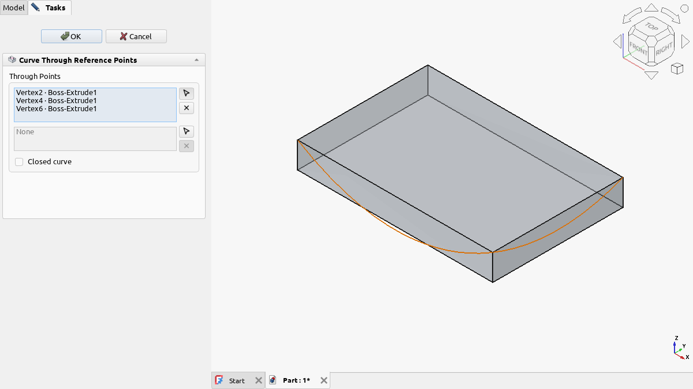

<!-- Generated by docs/build.py from docs/_data/catalog.json, docs/_authored/tools/curve-through-reference-points.md, docs/_data/panels.json. Do not edit this file: change its sources and run `pixi run docs`. -->

# Curve Through Reference Points

{ .tool-icon }
A smooth curve through vertices and reference points.
{ .tool-lead }

Curve Through Reference Points draws a smooth curve through vertices of the model and reference points.

## How to use it

1. Select the vertices and points in order, and click **Curve Through Reference Points**.
2. Tick **Closed curve** to join the end to the start.
3. Click **OK**.

## Where to find it

- The **Curves** toolbar, in the **Curves** drop-down.
- **Solid Design** → **Curves** → **Curve Through Reference Points**
- **Insert** → **Curve** → **Curve Through Reference Points**
- Command search: press <kbd>/</kbd> in the 3D view and type its name.
- The command line: <kbd>:</kbd> then `curvethroughreferencepoints` ([below](#on-the-command-line)).

## The panel

Every control's tooltip says the same as here: hover over it in FreeCAD. **OK** (or <kbd>Enter</kbd>) makes the feature, **Cancel** (or <kbd>Esc</kbd>) leaves the model as it was.

### Through Points

The curve passes through these, in order

| Control | Kind | What it does |
| :-- | :-- | :-- |
| **Vertexs** | Selection list: click vertexs | Vertices of the model, in order |
| **Points** | Selection list: click reference points | Reference points, after the vertices |
| **Closed curve** | A check box | Join the last point back to the first, smoothly |

## On the command line

Press <kbd>:</kbd> in the 3D view and type `curvethroughreferencepoints`, then what to set. See [the command line](../../guides/keyboard.md) for how it works.

??? note "Options it takes"

    | Option | How to type it | What it is |
    | :-- | :-- | :-- |
    | `Type` | a word: `curve` | How it is defined |
    | `Closed` | `closed` turns it on, `closed=no` off | Close the curve back to its start |

## Properties

??? info "All properties"

    What the feature stores, as the **Property** editor shows it (select the feature in the tree, then the **Data** tab). The panel sets these for you.

    | Property | Kind | Default | What it is |
    | :-- | :-- | :-- | :-- |
    | `Type` | Choice | Curve | How it is defined Choices: *Curve*. |
    | `Vertices` | Picks | – | Model vertices, in order |
    | `PointObjects` | Objects | – | Reference points, after the vertices |
    | `Closed` | Yes/No | No | Close the curve back to its start |

