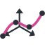
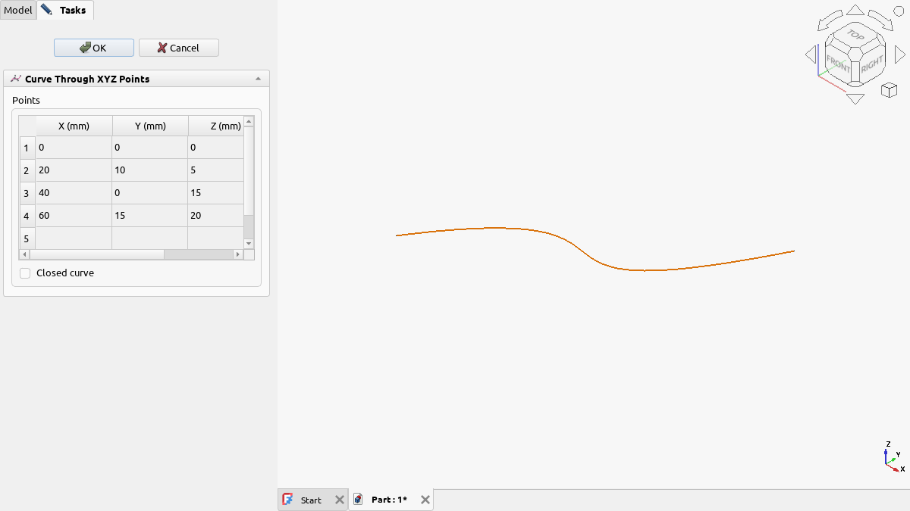

<!-- Generated by docs/build.py from docs/_data/catalog.json, docs/_authored/tools/curve-through-xyz-points.md, docs/_data/panels.json. Do not edit this file: change its sources and run `pixi run docs`. -->

# Curve Through XYZ Points

{ .tool-icon }
A smooth curve through points you type.
{ .tool-lead }

Curve Through XYZ Points draws a smooth curve through points you type.

## How to use it

1. Click **Curve Through XYZ Points**.
2. Type each point's X, Y and Z in the table. A new row appears as you fill the last.
3. Tick **Closed curve** to join the end to the start.
4. Click **OK**.

## Where to find it

- The **Curves** toolbar, in the **Curves** drop-down.
- **Solid Design** → **Curves** → **Curve Through XYZ Points**
- **Insert** → **Curve** → **Curve Through XYZ Points**
- Command search: press <kbd>/</kbd> in the 3D view and type its name.
- The command line: <kbd>:</kbd> then `curvethroughxyzpoints` ([below](#on-the-command-line)).

## The panel

Every control's tooltip says the same as here: hover over it in FreeCAD. **OK** (or <kbd>Enter</kbd>) makes the feature, **Cancel** (or <kbd>Esc</kbd>) leaves the model as it was.

### Points

The curve passes through these, in order

| Control | Kind | What it does |
| :-- | :-- | :-- |
|  | A table: X (mm), Y (mm), Z (mm) | Type each point; the last row is always empty for a new point |
| **Closed curve** | A check box | Join the last point back to the first, smoothly |

## On the command line

Press <kbd>:</kbd> in the 3D view and type `curvethroughxyzpoints`, then what to set. See [the command line](../../guides/keyboard.md) for how it works.

??? note "Options it takes"

    | Option | How to type it | What it is |
    | :-- | :-- | :-- |
    | `Type` | a word: `curve` | How it is defined |
    | `Closed` | `closed` turns it on, `closed=no` off | Close the curve back to its start |

## Properties

??? info "All properties"

    What the feature stores, as the **Property** editor shows it (select the feature in the tree, then the **Data** tab). The panel sets these for you.

    | Property | Kind | Default | What it is |
    | :-- | :-- | :-- | :-- |
    | `Type` | Choice | Curve | How it is defined Choices: *Curve*. |
    | `Points` | List | – | The points, as X,Y,Z, in order |
    | `Closed` | Yes/No | No | Close the curve back to its start |

