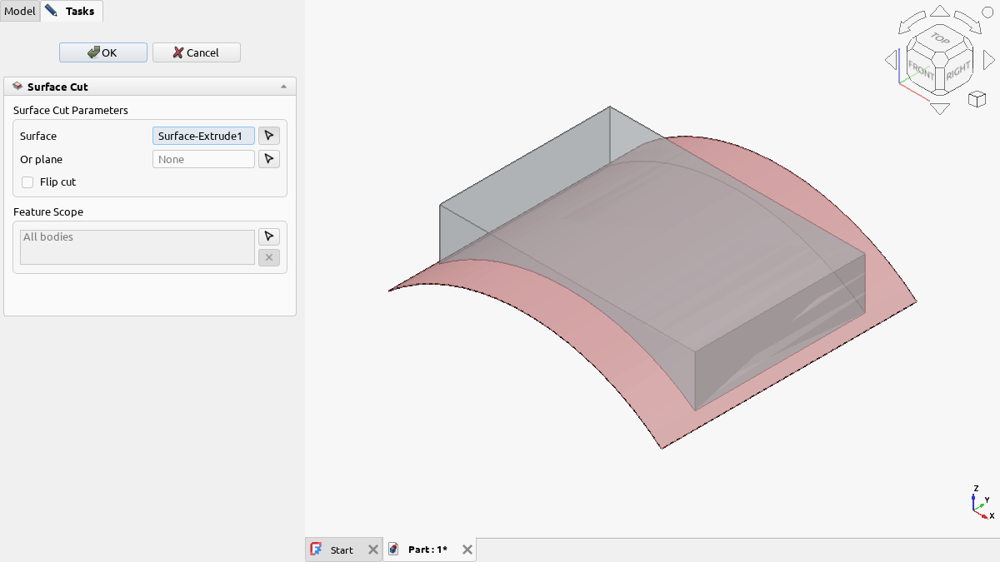

<!-- Generated by docs/build.py from docs/_data/catalog.json, docs/_authored/tools/cut-with-surface.md, docs/_data/panels.json. Do not edit this file: change its sources and run `pixi run docs`. -->

# Cut With Surface

{ .tool-icon }
Cuts bodies with a surface or plane, keeping one side.
{ .tool-lead }

Cut With Surface cuts bodies with a surface or a plane and keeps one side.

## How to use it

1. Select the bodies and the cutting surface (or plane), then click **Cut With Surface**.
2. Click **Flip cut** if the wrong side is kept.
3. Click **OK**.

## Good to know

- The surface has to reach right across the body.

## Where to find it

- The **Surfaces** toolbar.
- **Solid Design** → **Surfaces** → **Cut With Surface**
- **Insert** → **Surface** → **Cut With Surface**
- Command search: press <kbd>/</kbd> in the 3D view and type its name.
- The command line: <kbd>:</kbd> then `cutwithsurface` ([below](#on-the-command-line)).

## The panel

Every control's tooltip says the same as here: hover over it in FreeCAD. **OK** (or <kbd>Enter</kbd>) makes the feature, **Cancel** (or <kbd>Esc</kbd>) leaves the model as it was.

### Surface Cut Parameters

| Control | Kind | What it does |
| :-- | :-- | :-- |
| **Surface** | Selection box: click a body | The surface that cuts |
| **Or plane** | Selection box: click a plane or flat face | A plane that cuts |
| **Flip cut** | A check box | Keep the other side |

### Feature Scope

| Control | Kind | What it does |
| :-- | :-- | :-- |
| **Bodies** | Selection list: click bodies in the 3D view or tree | The bodies to cut (none picked: all) |

## On the command line

Press <kbd>:</kbd> in the 3D view and type `cutwithsurface`, then what to set. See [the command line](../../guides/keyboard.md) for how it works.

??? note "Options it takes"

    | Option | How to type it | What it is |
    | :-- | :-- | :-- |
    | `Flip` | `flip` turns it on, `flip=no` off | Keep the other side |

## Properties

??? info "All properties"

    What the feature stores, as the **Property** editor shows it (select the feature in the tree, then the **Data** tab). The panel sets these for you.

    | Property | Kind | Default | What it is |
    | :-- | :-- | :-- | :-- |
    | `CuttingBody` | Text |  | The cutting surface body, by ID |
    | `CuttingPlane` | Picks | – | Or: a plane or flat face |
    | `Flip` | Yes/No | No | Keep the other side |
    | `Bodies` | List | – | Bodies to cut (empty: all) |

