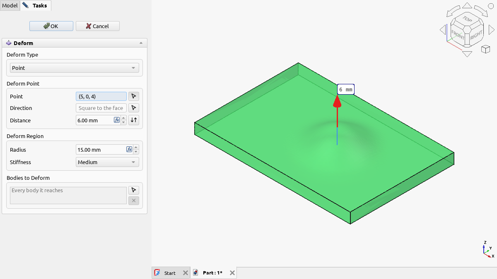

<!-- Generated by docs/build.py from docs/_data/catalog.json, docs/_authored/tools/deform.md, docs/_data/panels.json. Do not edit this file: change its sources and run `pixi run docs`. -->

# Deform

{ .tool-icon }
Pushes a point, moves curves onto others, or pushes a tool body in, and the body follows smoothly.
{ .tool-lead }

Deform reshapes a body smoothly: push a point in or out, move curves onto other curves, or press a tool body in.

## How to use it

1. Click **Deform** and choose the **Deform Type**.
2. For **Point**: click where to push, set the **Distance** (or drag the arrow) and the **Radius** of the area that follows.
3. Set the **Stiffness**: how sharply the shape bends.
4. Click **OK**.

## Where to find it

- The **Bodies** toolbar, in the **Deform Bodies** drop-down.
- **Solid Design** → **Bodies** → **Deform**
- **Insert** → **Features** → **Deform**
- Command search: press <kbd>/</kbd> in the 3D view and type its name.
- The command line: <kbd>:</kbd> then `deform` ([below](#on-the-command-line)).

## The panel

Every control's tooltip says the same as here: hover over it in FreeCAD. **OK** (or <kbd>Enter</kbd>) makes the feature, **Cancel** (or <kbd>Esc</kbd>) leaves the model as it was.

### Deform Type

| Control | Kind | What it does |
| :-- | :-- | :-- |
|  | One of: *Point*, *Curve to curve*, *Surface push* | Point: push a point. Curve to curve: move curves onto others. Surface push: a tool body pushes in. |

### Deform Point

| Control | Kind | What it does |
| :-- | :-- | :-- |
| **Point** | Selection box: click a vertex or a face | Where the push is: a vertex, or a point on a face (where you click) |
| **Direction** | Selection box: click an edge or plane | The push direction: an edge, axis or plane (its normal). Empty: square to the face |
| **Distance** | A length | How far the point moves *(a flip button beside it)* |

### Deform Curves

Initial curves move onto the target curves, in order

*Shown only for some choices above.*

| Control | Kind | What it does |
| :-- | :-- | :-- |
| **Sketches** | Selection list: click sketches | The curves that move |
| **Sketches** | Selection list: click sketches | Where they move to, in the same order |
| **Sketches** | Selection list: click sketches | Curves that stay put |

### Tool Body

The body that pushes into the others

*Shown only for some choices above.*

| Control | Kind | What it does |
| :-- | :-- | :-- |
| **Tool** | Selection box: click a body | The tool body (a solid) |
| **Direction** | Selection box: click an edge or plane | The push direction: an edge, axis or plane. Empty: from the tool towards the other bodies |
| **Deviation** | A length | How far round the tool the dent spreads; 0 keeps the tool's own shape |

### Deform Region

| Control | Kind | What it does |
| :-- | :-- | :-- |
| **Radius** | A length | How far round the point (or curves) the body follows |
| **Stiffness** | One of: *Minimum*, *Medium*, *Maximum* | Minimum spreads the change widely, Maximum keeps it close |

### Bodies to Deform

| Control | Kind | What it does |
| :-- | :-- | :-- |
| **Bodies** | Selection list: click bodies in the 3D view or tree | The bodies to deform (none picked: every body it reaches) |

## Drag handles

While the panel is open, drag the handles in the 3D view to set **Distance**, or click a handle's value and type. The same handles show when you select the feature in the tree, so you can change it without opening the panel. See [drag handles](../../guides/drag-handles.md).

## On the command line

Press <kbd>:</kbd> in the 3D view and type `deform`, then what to set. See [the command line](../../guides/keyboard.md) for how it works.

Values typed straight after the name set, in order: **Distance**. For example `:deform 5`.

??? note "Options it takes"

    | Option | How to type it | What it is |
    | :-- | :-- | :-- |
    | `DeformType` | a word: `point`, `curvetocurve`, `surfacepush` | Point: push a point. Curve to curve: move curves onto others. Surface push: a tool body pushes in |
    | `Distance` | `distance=`a value | Point: how far the point moves |
    | `ReverseDirection` | `reversedirection` turns it on, `reversedirection=no` off | The other way |
    | `Radius` | `radius=`a value | Deform region radius |
    | `Stiffness` | a word: `minimum`, `medium`, `maximum` | Minimum spreads the change widely, Maximum keeps it close |
    | `DeformDeviation` | `deformdeviation=`a value | Surface push: how far round the tool the dent spreads (0: the tool's own shape) |

## Properties

??? info "All properties"

    What the feature stores, as the **Property** editor shows it (select the feature in the tree, then the **Data** tab). The panel sets these for you.

    | Property | Kind | Default | What it is |
    | :-- | :-- | :-- | :-- |
    | `DeformType` | Choice | Point | Point: push a point. Curve to curve: move curves onto others. Surface push: a tool body pushes in Choices: *Point*, *Curve to curve*, *Surface push*. |
    | `Bodies` | List | – | Bodies to deform (empty: every body the change reaches) |
    | `DeformPoint` | Vector | – | Point: where the push is |
    | `DeformDirection` | Picks | – | Point: the direction (an edge, axis or plane); empty: square to the face |
    | `Distance` | Length | 5 mm | Point: how far the point moves |
    | `ReverseDirection` | Yes/No | No | The other way |
    | `Radius` | Length | 20 mm | Deform region radius |
    | `Stiffness` | Choice | Medium | Minimum spreads the change widely, Maximum keeps it close Choices: *Minimum*, *Medium*, *Maximum*. |
    | `InitialCurves` | Objects | – | Curve to curve: the curves that move (sketches or curves) |
    | `TargetCurves` | Objects | – | Curve to curve: where they move to, in the same order |
    | `FixedCurves` | Objects | – | Curve to curve: curves that stay put |
    | `ToolBody` | Text |  | Surface push: the tool body, by ID |
    | `PushDirection` | Picks | – | Surface push: the direction (an edge, axis or plane) |
    | `DeformDeviation` | Length | 0 mm | Surface push: how far round the tool the dent spreads (0: the tool's own shape) |

