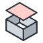
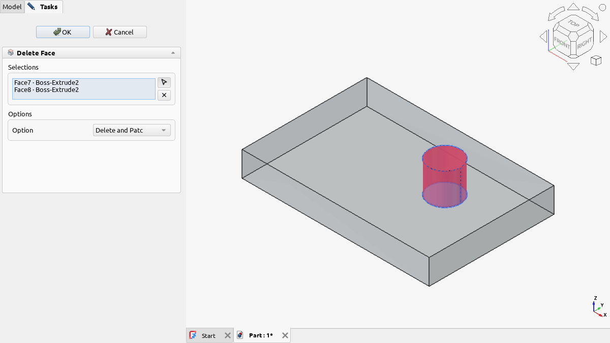

<!-- Generated by docs/build.py from docs/_data/catalog.json, docs/_authored/tools/delete-face.md, docs/_data/panels.json. Do not edit this file: change its sources and run `pixi run docs`. -->

# Delete Face

{ .tool-icon }
Deletes faces: leaves a gap (the body becomes a surface), heals it from the faces around, or fills it.
{ .tool-lead }

Delete Face removes faces from a solid: leave the hole (the body becomes a surface body), heal it from the faces around, or fill it.

## How to use it

1. Select the faces and click **Delete Face**.
2. Choose the **Option**: **Delete**, **Delete and Patch** (the faces around grow to close the gap: removes a boss or a fillet) or **Delete and Fill**.
3. Click **OK**.

## Where to find it

- The **Bodies** toolbar.
- **Solid Design** → **Bodies** → **Delete Face**
- **Insert** → **Features** → **Delete Face**
- Command search: press <kbd>/</kbd> in the 3D view and type its name.
- The command line: <kbd>:</kbd> then `deleteface` ([below](#on-the-command-line)).

## The panel

Every control's tooltip says the same as here: hover over it in FreeCAD. **OK** (or <kbd>Enter</kbd>) makes the feature, **Cancel** (or <kbd>Esc</kbd>) leaves the model as it was.

### Selections

| Control | Kind | What it does |
| :-- | :-- | :-- |
| **Faces** | Selection list: click faces | The faces to delete |

### Options

| Control | Kind | What it does |
| :-- | :-- | :-- |
| **Option** | One of: *Delete*, *Delete and Patch*, *Delete and Fill* | Delete: the faces go, and a solid becomes a surface body. Delete and Patch: the faces around heal over the gap (removes bosses, holes, fillets). Delete and Fill: a patch fills the gap. |
| **Tangent fill** | A check box | Make the patch tangent to the faces around it *(shown for some choices only)* |

## On the command line

Press <kbd>:</kbd> in the 3D view and type `deleteface`, then what to set. See [the command line](../../guides/keyboard.md) for how it works.

??? note "Options it takes"

    | Option | How to type it | What it is |
    | :-- | :-- | :-- |
    | `DeleteType` | a word: `delete`, `deleteandpatch`, `deleteandfill` | Delete: the faces go (a solid becomes a surface). Delete and Patch: the faces around heal over the gap. Delete and Fill: a patch fills it |
    | `TangentFill` | `tangentfill` turns it on, `tangentfill=no` off | Delete and Fill: a tangent patch |

## Properties

??? info "All properties"

    What the feature stores, as the **Property** editor shows it (select the feature in the tree, then the **Data** tab). The panel sets these for you.

    | Property | Kind | Default | What it is |
    | :-- | :-- | :-- | :-- |
    | `Items` | Picks | – | Faces to delete |
    | `DeleteType` | Choice | Delete | Delete: the faces go (a solid becomes a surface). Delete and Patch: the faces around heal over the gap. Delete and Fill: a patch fills it Choices: *Delete*, *Delete and Patch*, *Delete and Fill*. |
    | `TangentFill` | Yes/No | No | Delete and Fill: a tangent patch |

