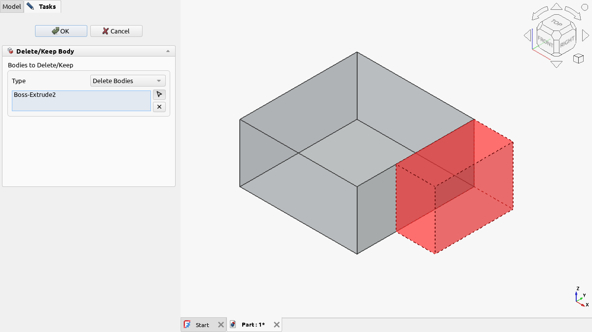

<!-- Generated by docs/build.py from docs/_data/catalog.json, docs/_authored/tools/delete-keep-body.md, docs/_data/panels.json. Do not edit this file: change its sources and run `pixi run docs`. -->

# Delete/Keep Body

{ .tool-icon }
Deletes the selected bodies, or keeps only them.
{ .tool-lead }

Delete/Keep Body removes bodies from the part from this point on in the history, or keeps only the ones you pick.

## How to use it

1. Select the bodies.
2. Click **Delete/Keep Body** and choose **Delete Bodies** or **Keep Bodies**.
3. Click **OK**.

## Good to know

- It is a feature: roll back above it and the bodies are there again. To remove a body for good, delete the features that made it.

## Where to find it

- The **Bodies** toolbar.
- **Solid Design** → **Bodies** → **Delete/Keep Body**
- **Insert** → **Features** → **Delete/Keep Body**
- Command search: press <kbd>/</kbd> in the 3D view and type its name.
- The command line: <kbd>:</kbd> then `deletekeepbody` ([below](#on-the-command-line)).

## The panel

Every control's tooltip says the same as here: hover over it in FreeCAD. **OK** (or <kbd>Enter</kbd>) makes the feature, **Cancel** (or <kbd>Esc</kbd>) leaves the model as it was.

### Bodies to Delete/Keep

| Control | Kind | What it does |
| :-- | :-- | :-- |
| **Type** | One of: *Delete Bodies*, *Keep Bodies* | Delete the listed bodies, or keep them and delete the rest |
| **Bodies** | Selection list: click bodies in the 3D view or tree | The bodies to delete or keep |

## On the command line

Press <kbd>:</kbd> in the 3D view and type `deletekeepbody`, then what to set. See [the command line](../../guides/keyboard.md) for how it works.

??? note "Options it takes"

    | Option | How to type it | What it is |
    | :-- | :-- | :-- |
    | `Type` | a word: `deletebodies`, `keepbodies` | Delete or keep |

## Properties

??? info "All properties"

    What the feature stores, as the **Property** editor shows it (select the feature in the tree, then the **Data** tab). The panel sets these for you.

    | Property | Kind | Default | What it is |
    | :-- | :-- | :-- | :-- |
    | `Type` | Choice | Delete Bodies | Delete or keep Choices: *Delete Bodies*, *Keep Bodies*. |
    | `Bodies` | List | – | Bodies, by ID |

