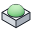
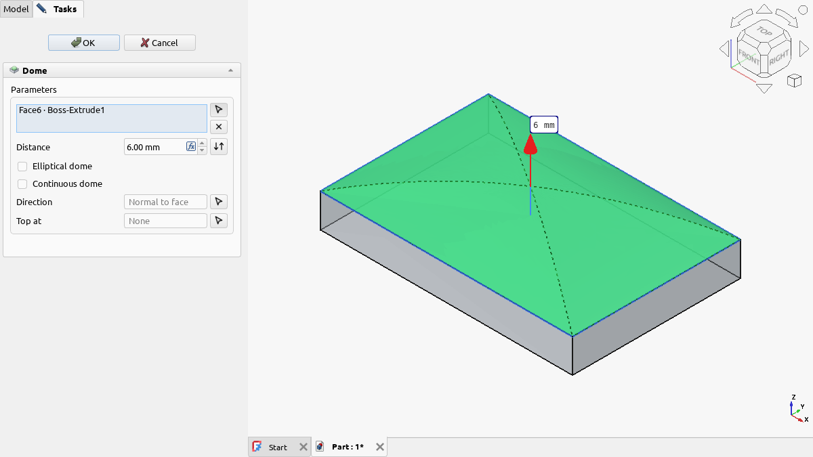

<!-- Generated by docs/build.py from docs/_data/catalog.json, docs/_authored/tools/dome.md, docs/_data/panels.json. Do not edit this file: change its sources and run `pixi run docs`. -->

# Dome

{ .tool-icon }
Adds a dome (or a dent) on flat faces.
{ .tool-lead }

Dome raises a dome (or presses a dent) on a flat face, its edge following the face's outline.

## How to use it

1. Select one or more flat faces.
2. Click **Dome**.
3. Set the **Distance** it rises (or drag the arrow). Reverse it for a dent.
4. Click **OK**.

## Good to know

- **Elliptical dome** gives an elliptical section; **Continuous dome** keeps it smooth over a non-round outline.

## Where to find it

- The **Features** toolbar.
- **Solid Design** → **Features** → **Dome**
- **Insert** → **Features** → **Dome**
- Command search: press <kbd>/</kbd> in the 3D view and type its name.
- The command line: <kbd>:</kbd> then `dome` ([below](#on-the-command-line)).

## The panel

Every control's tooltip says the same as here: hover over it in FreeCAD. **OK** (or <kbd>Enter</kbd>) makes the feature, **Cancel** (or <kbd>Esc</kbd>) leaves the model as it was.

### Parameters

| Control | Kind | What it does |
| :-- | :-- | :-- |
| **Faces** | Selection list: click faces | The flat faces to dome |
| **Distance** | A length | The dome's height *(a flip button beside it)* |
| **Elliptical dome** | A check box | Half an ellipsoid on a round face; square to the face at its edge on others |
| **Continuous dome** | A check box | Faces that aren't round: the outline rounds off as it rises, with no creases from the corners |
| **Direction** | Selection box: click an edge, axis or plane | Lean the dome this way; empty: straight up from the face |
| **Top at** | Selection box: click a point or vertex | The dome's top goes through this point (it sets the height and lean) |

## Drag handles

While the panel is open, drag the handles in the 3D view to set **Distance**, or click a handle's value and type. The same handles show when you select the feature in the tree, so you can change it without opening the panel. See [drag handles](../../guides/drag-handles.md).

## On the command line

Press <kbd>:</kbd> in the 3D view and type `dome`, then what to set. See [the command line](../../guides/keyboard.md) for how it works.

Values typed straight after the name set, in order: **Distance**. For example `:dome 5`.

??? note "Options it takes"

    | Option | How to type it | What it is |
    | :-- | :-- | :-- |
    | `Distance` | `distance=`a value | The dome's height |
    | `ReverseDirection` | `reversedirection` turns it on, `reversedirection=no` off | A dent instead of a dome |
    | `EllipticalDome` | `ellipticaldome` turns it on, `ellipticaldome=no` off | Half an ellipsoid (round faces) or square to the face at its edge |
    | `ContinuousDome` | `continuousdome` turns it on, `continuousdome=no` off | Faces that aren't round: round the outline off as it rises (no creases) |

## Properties

??? info "All properties"

    What the feature stores, as the **Property** editor shows it (select the feature in the tree, then the **Data** tab). The panel sets these for you.

    | Property | Kind | Default | What it is |
    | :-- | :-- | :-- | :-- |
    | `Items` | Picks | – | Flat faces to dome |
    | `Distance` | Length | 5 mm | The dome's height |
    | `ReverseDirection` | Yes/No | No | A dent instead of a dome |
    | `EllipticalDome` | Yes/No | No | Half an ellipsoid (round faces) or square to the face at its edge |
    | `ContinuousDome` | Yes/No | No | Faces that aren't round: round the outline off as it rises (no creases) |
    | `DomeDirection` | Picks | – | Lean the dome along this direction (edge, axis or plane); empty: square to the face |
    | `ConstraintPoint` | Picks | – | The dome's top goes through this point (sets the height and the lean) |

