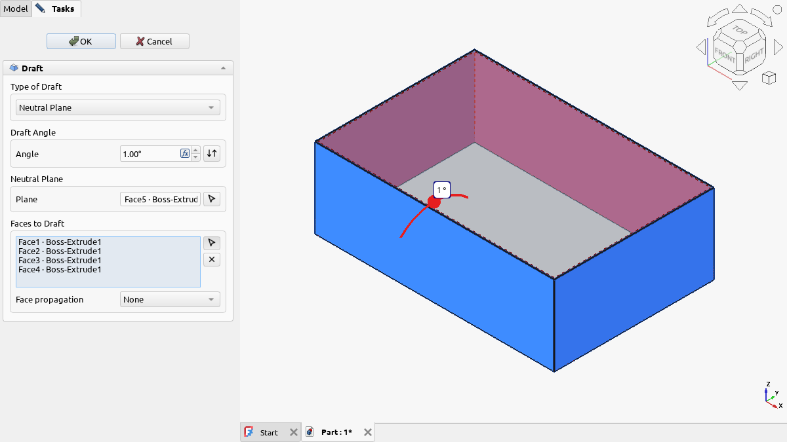

<!-- Generated by docs/build.py from docs/_data/catalog.json, docs/_authored/tools/draft.md, docs/_data/panels.json. Do not edit this file: change its sources and run `pixi run docs`. -->

# Draft

{ .tool-icon }
Tapers faces by an angle so the part releases from a mould: about a neutral plane, or about parting lines.
{ .tool-lead }

Draft tapers faces by an angle so a moulded or cast part comes out of its mould.

## How to use it

1. Select the faces to taper.
2. Click **Draft**.
3. With **Neutral Plane**, click the face or plane that stays the same size; the faces taper away from it. With **Parting Line**, pick the direction of pull and the edges where the mould splits.
4. Set the **Angle** (or drag the handle), then click **OK**.

## Good to know

- **Type of Draft** also has **Step Draft** and **DraftXpert**, as in SolidWorks.
- **Face propagation** adds faces tangent to (or all round) the ones you picked.

## Where to find it

- The **Features** toolbar.
- **Solid Design** → **Features** → **Draft**
- **Insert** → **Features** → **Draft**
- Command search: press <kbd>/</kbd> in the 3D view and type its name.
- The command line: <kbd>:</kbd> then `draft` ([below](#on-the-command-line)).

## The panel

Every control's tooltip says the same as here: hover over it in FreeCAD. **OK** (or <kbd>Enter</kbd>) makes the feature, **Cancel** (or <kbd>Esc</kbd>) leaves the model as it was.

### Type of Draft

| Control | Kind | What it does |
| :-- | :-- | :-- |
|  | One of: *Neutral Plane*, *Parting Line*, *Step Draft*, *DraftXpert* | Neutral Plane: faces turn about where they meet a plane. Parting Line: faces turn about the edges you pick. Step Draft: parting lines at several heights, each step turning about its own lines. DraftXpert: a neutral plane; the faces that need draft are found for you, and faces that can't be drafted are left out and listed. |

### Draft Angle

| Control | Kind | What it does |
| :-- | :-- | :-- |
| **Angle** | An angle | How far the faces lean. The part gets narrower along the direction of pull. *(a flip button beside it)* |

### Neutral Plane

| Control | Kind | What it does |
| :-- | :-- | :-- |
| **Plane** | Selection box: click a plane or planar face | The faces turn about where they meet this plane. Its normal is the direction of pull, pointing away from it into the faces. |

### Direction of Pull

*Shown only for some choices above.*

| Control | Kind | What it does |
| :-- | :-- | :-- |
| **Direction** | Selection box: click an edge, axis or face | The direction the mould opens: a straight edge, an axis, or a face (its normal). Empty: normal to the parting lines. |

### Parting Lines

*Shown only for some choices above.*

| Control | Kind | What it does |
| :-- | :-- | :-- |
| **Edges** | Selection list: click edges | The edges the faces turn about: in one plane, or (Step Draft) square to the pull at several heights. Click an edge again to take it out. |
| **Other face** | A check box | Draft the faces on the other side of the parting lines |
| **Face propagation** | One of: *None*, *Along Tangent* | Faces added to the ones next to the parting lines |

### Faces to Draft

| Control | Kind | What it does |
| :-- | :-- | :-- |
| **Faces** | Selection list: click faces | The faces to lean. Click a face again to take it out. |
| **Face propagation** | One of: *None*, *Along Tangent*, *All Faces*, *Inner Faces*, *Outer Faces* | Faces added to the ones you picked |

### Draft Analysis

How much draft the faces have now, for this angle and direction of pull

*Shown only for some choices above.*

| Control | Kind | What it does |
| :-- | :-- | :-- |
| **Pick the Faces That Need Draft** | A button | Put every face with too little draft in Faces to Draft |

## Drag handles

While the panel is open, drag the handles in the 3D view to set **Angle**, or click a handle's value and type. The same handles show when you select the feature in the tree, so you can change it without opening the panel. See [drag handles](../../guides/drag-handles.md).

## On the command line

Press <kbd>:</kbd> in the 3D view and type `draft`, then what to set. See [the command line](../../guides/keyboard.md) for how it works.

Values typed straight after the name set, in order: **Angle**. For example `:draft 1`.

??? note "Options it takes"

    | Option | How to type it | What it is |
    | :-- | :-- | :-- |
    | `DraftType` | a word: `neutralplane`, `partingline`, `stepdraft`, `draftxpert` | Neutral Plane or Parting Line |
    | `Angle` | `angle=`a value | Draft angle |
    | `ReverseDirection` | `reversedirection` turns it on, `reversedirection=no` off | Reverse the direction of pull |
    | `OtherFace` | `otherface` turns it on, `otherface=no` off | Parting Line: draft the faces on the other side |
    | `FacePropagation` | a word: `none`, `alongtangent`, `allfaces`, `innerfaces`, `outerfaces` | Faces added to the picked ones |

## Properties

??? info "All properties"

    What the feature stores, as the **Property** editor shows it (select the feature in the tree, then the **Data** tab). The panel sets these for you.

    | Property | Kind | Default | What it is |
    | :-- | :-- | :-- | :-- |
    | `DraftType` | Choice | Neutral Plane | Neutral Plane or Parting Line Choices: *Neutral Plane*, *Parting Line*, *Step Draft*, *DraftXpert*. |
    | `Angle` | Angle | 1° | Draft angle |
    | `NeutralPlane` | Picks | – | Neutral plane: a plane or planar face |
    | `Items` | Picks | – | Faces to draft |
    | `PartingLines` | Picks | – | Parting lines (edges) |
    | `PullDirection` | Picks | – | Direction of pull: an edge, axis, plane or face (empty: from the plane) |
    | `ReverseDirection` | Yes/No | No | Reverse the direction of pull |
    | `OtherFace` | Yes/No | No | Parting Line: draft the faces on the other side |
    | `FacePropagation` | Choice | None | Faces added to the picked ones Choices: *None*, *Along Tangent*, *All Faces*, *Inner Faces*, *Outer Faces*. |

