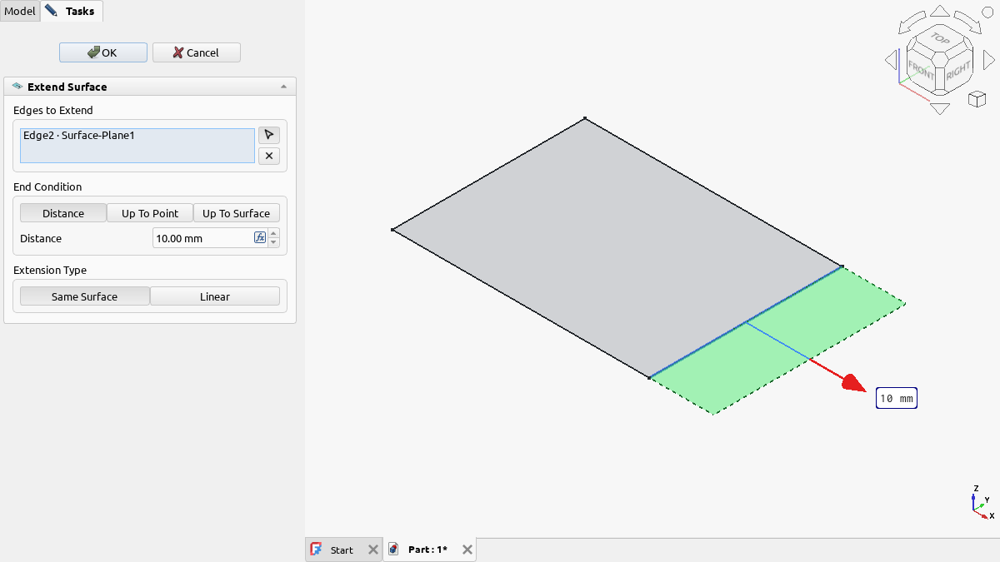

<!-- Generated by docs/build.py from docs/_data/catalog.json, docs/_authored/tools/extend-surface.md, docs/_data/panels.json. Do not edit this file: change its sources and run `pixi run docs`. -->

# Extend Surface

{ .tool-icon }
Extends a surface past its open edges, on the same surface or straight on.
{ .tool-lead }

Extend Surface grows a surface past its open edges.

## How to use it

1. Select the edges to extend.
2. Click **Extend Surface**.
3. Set how far under **End Condition** (a distance, or up to a point or surface) and the **Extension Type**: **Same Surface** carries on the surface's curve, **Linear** goes straight on.
4. Click **OK**.

## Where to find it

- The **Surfaces** toolbar.
- **Solid Design** → **Surfaces** → **Extend Surface**
- **Insert** → **Surface** → **Extend Surface**
- Command search: press <kbd>/</kbd> in the 3D view and type its name.
- The command line: <kbd>:</kbd> then `extendsurface` ([below](#on-the-command-line)).

## The panel

Every control's tooltip says the same as here: hover over it in FreeCAD. **OK** (or <kbd>Enter</kbd>) makes the feature, **Cancel** (or <kbd>Esc</kbd>) leaves the model as it was.

### Edges to Extend

| Control | Kind | What it does |
| :-- | :-- | :-- |
| **Edges** | Selection list: click edges | The open edges of a surface to carry on |

### End Condition

| Control | Kind | What it does |
| :-- | :-- | :-- |
| **Distance \\| Up To Point \\| Up To Surface** | Buttons: *Distance* \\| *Up To Point* \\| *Up To Surface* |  |
| **Distance** | A length | How far to extend |
| **Up to** | Selection box: click a point, face or plane | The point, or the surface or plane, to extend up to *(shown for some choices only)* |

### Extension Type

| Control | Kind | What it does |
| :-- | :-- | :-- |
| **Same Surface \\| Linear** | Buttons: *Same Surface* \\| *Linear* |  |

## Drag handles

While the panel is open, drag the handles in the 3D view to set **Distance**, or click a handle's value and type. The same handles show when you select the feature in the tree, so you can change it without opening the panel. See [drag handles](../../guides/drag-handles.md).

## On the command line

Press <kbd>:</kbd> in the 3D view and type `extendsurface`, then what to set. See [the command line](../../guides/keyboard.md) for how it works.

Values typed straight after the name set, in order: **Distance**. For example `:extendsurface 5`.

??? note "Options it takes"

    | Option | How to type it | What it is |
    | :-- | :-- | :-- |
    | `Distance` | `distance=`a value | How far to extend |
    | `ExtensionType` | a word: `samesurface`, `linear` | Same Surface: carry the surface on. Linear: go straight on, tangent to it |
    | `EndCondition` | a word: `distance`, `uptopoint`, `uptosurface` | Distance, Up To Point or Up To Surface |

## Properties

??? info "All properties"

    What the feature stores, as the **Property** editor shows it (select the feature in the tree, then the **Data** tab). The panel sets these for you.

    | Property | Kind | Default | What it is |
    | :-- | :-- | :-- | :-- |
    | `Items` | Picks | – | Open edges of surfaces to extend |
    | `Distance` | Length | 5 mm | How far to extend |
    | `ExtensionType` | Choice | Same Surface | Same Surface: carry the surface on. Linear: go straight on, tangent to it Choices: *Same Surface*, *Linear*. |
    | `EndCondition` | Choice | Distance | Distance, Up To Point or Up To Surface Choices: *Distance*, *Up To Point*, *Up To Surface*. |
    | `UpTo` | Picks | – | The point, or the surface or plane, to extend up to |

