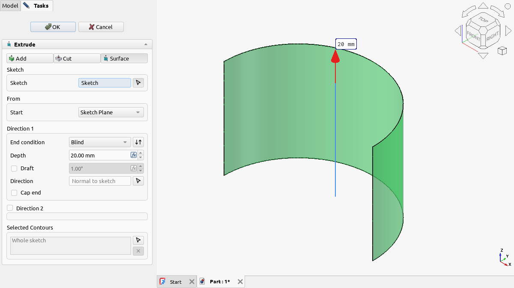

<!-- Generated by docs/build.py from docs/_data/catalog.json, docs/_authored/tools/extruded-surface.md, docs/_data/panels.json. Do not edit this file: change its sources and run `pixi run docs`. -->

# Extruded Surface

{ .tool-icon }
Extrudes a sketch's curves (open or closed) into a surface body. Surface in the feature's Add | Cut | Surface switch.
{ .tool-lead }

Extruded Surface pushes a sketch's curves out into a surface body. It is [Extrude](extrude.md) with **Surface** pressed: the same panel and options.

## How to use it

1. Select a sketch (open or closed) and click **Extruded Surface**.
2. Set the **End condition** and **Depth**, or drag the arrow.
3. Click **OK**.

## Good to know

- **Cap end** closes a closed sketch's ends.
- See [surfaces](../../guides/surfaces.md).

## Where to find it

- The **Surfaces** toolbar.
- **Solid Design** → **Surfaces** → **Extruded Surface**
- **Insert** → **Surface** → **Extruded Surface**
- Command search: press <kbd>/</kbd> in the 3D view and type its name.
- The command line: <kbd>:</kbd> then `extrudedsurface` ([below](#on-the-command-line)).

## The panel

Every control's tooltip says the same as here: hover over it in FreeCAD. **OK** (or <kbd>Enter</kbd>) makes the feature, **Cancel** (or <kbd>Esc</kbd>) leaves the model as it was.

| Control | Kind | What it does |
| :-- | :-- | :-- |
| **Add \\| Cut \\| Surface** | Buttons: *Add* \\| *Cut* \\| *Surface* |  |

### Sketch

| Control | Kind | What it does |
| :-- | :-- | :-- |
| **Sketch** | Selection box: click a sketch | The sketch to use. Press the button, then click a sketch in the 3D view or tree. |

### From

Where the extrusion starts

| Control | Kind | What it does |
| :-- | :-- | :-- |
| **Start** | One of: *Sketch Plane*, *Surface/Face/Plane*, *Vertex*, *Offset* | Where the extrusion starts: the sketch plane, a face or plane, a vertex, or an offset from the sketch plane |
| **Face** | Selection box: click a face or plane | The face or plane the extrusion starts from *(shown for some choices only)* |
| **Vertex** | Selection box: click a vertex or point | The vertex or point the extrusion starts from *(shown for some choices only)* |
| **Offset** | A length | Distance from the sketch plane to the start *(a flip button beside it; shown for some choices only)* |

### Direction 1

| Control | Kind | What it does |
| :-- | :-- | :-- |
| **End condition** | One of: *Blind*, *Through All*, *Through All - Both*, *Up To Next*, *Up To Vertex*, *Up To Surface*, *Offset From Surface*, *Up To Body*, *Mid Plane* | How far the extrusion goes: a depth, through everything, up to a face, vertex or body, or both ways from the sketch (Mid Plane) *(a flip button beside it)* |
| **Depth** | A length | Distance from the sketch to the end |
| **Face** | Selection box: click a face or plane | The face or plane the extrusion ends at *(shown for some choices only)* |
| **Vertex** | Selection box: click a vertex or point | The vertex or point the extrusion ends at *(shown for some choices only)* |
| **Body** | Selection box: click a body | The body the extrusion ends at *(shown for some choices only)* |
| **Offset** | A length | Distance from the face to the end of the extrusion *(a flip button beside it; shown for some choices only)* |
| **Draft** | An angle | Taper the side faces by this angle *(tick it to use it)* |
| **Draft outward** | A check box | Taper outwards, so the far end is bigger; off: it is smaller *(shown for some choices only)* |
| **Direction** | Selection box: click an edge or plane | Extrude along an edge or axis, or a plane's normal, instead of square to the sketch (none: square to it) |
| **Merge result** | A check box | Fuse the new material with the bodies it touches. Off: it becomes a body of its own. *(shown for some choices only)* |
| **Flip side to cut** | A check box | Remove the material outside the profile instead of inside it *(shown for some choices only)* |
| **Cap end** | A check box | Close both ends of a closed profile, so the surface is closed |

### Direction 2

Extrude the other way from the sketch too

*Optional: tick its title to use it.*

| Control | Kind | What it does |
| :-- | :-- | :-- |
| **End condition** | One of: *Blind*, *Through All*, *Up To Next*, *Up To Vertex*, *Up To Surface*, *Offset From Surface*, *Up To Body* | How far the extrusion goes: a depth, through everything, up to a face, vertex or body, or both ways from the sketch (Mid Plane) the other way *(shown for some choices only)* |
| **Depth** | A length | Distance from the sketch to the end the other way *(shown for some choices only)* |
| **Face** | Selection box: click a face or plane | The face or plane the extrusion ends at *(shown for some choices only)* |
| **Vertex** | Selection box: click a vertex or point | The vertex or point the extrusion ends at *(shown for some choices only)* |
| **Body** | Selection box: click a body | The body the extrusion ends at *(shown for some choices only)* |
| **Offset** | A length | Distance from the face to the end of the extrusion *(a flip button beside it; shown for some choices only)* |
| **Draft** | An angle | Taper the side faces by this angle *(tick it to use it; shown for some choices only)* |
| **Draft outward** | A check box | Taper outwards, so the far end is bigger; off: it is smaller *(shown for some choices only)* |

### Thin Feature

Make a wall of constant thickness from the sketch's curves instead of filling it

*Optional: tick its title to use it. Shown only for some choices above.*

| Control | Kind | What it does |
| :-- | :-- | :-- |
| **Type** | One of: *One-Direction*, *Mid-Plane*, *Two-Direction* | Which side of the curves the wall grows on *(a flip button beside it; shown for some choices only)* |
| **Thickness** | A length | Wall thickness *(shown for some choices only)* |
| **Thickness 2** | A length | Wall thickness on the second side *(shown for some choices only)* |
| **Cap ends** | A check box | Close the ends of the thin feature with walls *(shown for some choices only)* |
| **Cap thickness** | A length | Thickness of the end caps *(shown for some choices only)* |

### Selected Contours

| Control | Kind | What it does |
| :-- | :-- | :-- |
| **Regions** | Selection list: click inside regions of the sketch | Use only some regions of the sketch: click inside them in the 3D view. Empty: the whole sketch. |

### Feature Scope

Which bodies the feature works on

*Shown only for some choices above.*

| Control | Kind | What it does |
| :-- | :-- | :-- |
| **All bodies \\| Selected bodies** | Buttons: *All bodies* \\| *Selected bodies* |  |
| **Auto-select** | A check box | Use the bodies the feature touches; untick to choose them *(shown for some choices only)* |
| **Bodies** | Selection list: click bodies in the 3D view or tree | The bodies the feature works on *(shown for some choices only)* |

### Bodies to Keep

The cut splits a body: choose which pieces to keep

*Shown only for some choices above.*

| Control | Kind | What it does |
| :-- | :-- | :-- |
| **All bodies \\| Selected bodies** | Buttons: *All bodies* \\| *Selected bodies* |  |
|  | A list | Tick the pieces to keep. They are numbered in the 3D view. |

## Drag handles

While the panel is open, drag the handles in the 3D view to set **Depth**, or click a handle's value and type. The same handles show when you select the feature in the tree, so you can change it without opening the panel. See [drag handles](../../guides/drag-handles.md).

## On the command line

Press <kbd>:</kbd> in the 3D view and type `extrudedsurface`, then what to set. See [the command line](../../guides/keyboard.md) for how it works.

Values typed straight after the name set, in order: **Depth**, **Depth2**. For example `:extrudedsurface 10 10`.

??? note "Options it takes"

    | Option | How to type it | What it is |
    | :-- | :-- | :-- |
    | `Mode` | a word: `add`, `cut`, `surface` | Add material, cut it, or make a surface body |
    | `Thin` | `thin` turns it on, `thin=no` off | Thin Feature on/off |
    | `ThinType` | a word: `onedirection`, `midplane`, `twodirection` | Thin type |
    | `ThinThickness` | `thinthickness=`a value | Thickness |
    | `ThinThickness2` | `thinthickness2=`a value | Thickness 2 (Two-Direction) |
    | `ThinReverse` | `thinreverse` turns it on, `thinreverse=no` off | Reverse the thin direction |
    | `CapEnds` | `capends` turns it on, `capends=no` off | Cap ends (closed profiles) |
    | `CapThickness` | `capthickness=`a value | Cap thickness |
    | `MergeResult` | `mergeresult` turns it on, `mergeresult=no` off | Merge result (Add mode) |
    | `FeatureScope` | a word: `allbodies`, `selectedbodies` | Feature scope |
    | `AutoSelect` | `autoselect` turns it on, `autoselect=no` off | Auto-select the bodies in scope |
    | `BodiesToKeep` | a word: `allbodies`, `selectedbodies` | Bodies to Keep |
    | `FlipSideToCut` | `flipsidetocut` turns it on, `flipsidetocut=no` off | Flip side to cut (Cut mode) |
    | `Reverse` | `reverse` turns it on, `reverse=no` off | Reverse Direction |
    | `CapEnd` | `capend` turns it on, `capend=no` off | Surface mode: close both ends of a closed profile (a closed surface) |
    | `From` | a word: `sketchplane`, `surfacefaceplane`, `vertex`, `offset` | Where the extrusion starts |
    | `FromOffset` | `fromoffset=`a value | Offset of the start from the sketch |
    | `FromReverse` | `fromreverse` turns it on, `fromreverse=no` off | Reverse the start offset |
    | `EndCondition` | a word: `blind`, `throughall`, `throughallboth`, `uptonext`, `uptovertex`, `uptosurface`, `offsetfromsurface`, `uptobody`, `midplane` | End condition |
    | `Depth` | `depth=`a value | Depth |
    | `Offset` | `offset=`a value | Offset From Surface distance |
    | `ReverseOffset` | `reverseoffset` turns it on, `reverseoffset=no` off | Reverse offset |
    | `Draft` | `draft` turns it on, `draft=no` off | Draft on/off |
    | `DraftAngle` | `draftangle=`a value | Draft angle |
    | `DraftOutward` | `draftoutward` turns it on, `draftoutward=no` off | Draft outward |
    | `Direction2` | `direction2` turns it on, `direction2=no` off | Extrude in the other direction too |
    | `EndCondition2` | a word: `blind`, `throughall`, `uptonext`, `uptovertex`, `uptosurface`, `offsetfromsurface`, `uptobody` | End condition |
    | `Depth2` | `depth2=`a value | Depth |
    | `Offset2` | `offset2=`a value | Offset From Surface distance |
    | `ReverseOffset2` | `reverseoffset2` turns it on, `reverseoffset2=no` off | Reverse offset |
    | `Draft2` | `draft2` turns it on, `draft2=no` off | Draft on/off |
    | `DraftAngle2` | `draftangle2=`a value | Draft angle |
    | `DraftOutward2` | `draftoutward2` turns it on, `draftoutward2=no` off | Draft outward |

## Properties

??? info "All properties"

    What the feature stores, as the **Property** editor shows it (select the feature in the tree, then the **Data** tab). The panel sets these for you.

    | Property | Kind | Default | What it is |
    | :-- | :-- | :-- | :-- |
    | `Mode` | Choice | Add | Add material, cut it, or make a surface body Choices: *Add*, *Cut*, *Surface*. |
    | `Sketch` | Object | – | The profile sketch |
    | `Contours` | List | – | Selected Contours: regions of the sketch (bounding geometry IDs + a point inside) |
    | `Thin` | Yes/No | No | Thin Feature on/off |
    | `ThinType` | Choice | One-Direction | Thin type Choices: *One-Direction*, *Mid-Plane*, *Two-Direction*. |
    | `ThinThickness` | Length | 1 mm | Thickness |
    | `ThinThickness2` | Length | 1 mm | Thickness 2 (Two-Direction) |
    | `ThinReverse` | Yes/No | No | Reverse the thin direction |
    | `CapEnds` | Yes/No | No | Cap ends (closed profiles) |
    | `CapThickness` | Length | 1 mm | Cap thickness |
    | `MergeResult` | Yes/No | Yes | Merge result (Add mode) |
    | `FeatureScope` | Choice | All bodies | Feature scope Choices: *All bodies*, *Selected bodies*. |
    | `AutoSelect` | Yes/No | Yes | Auto-select the bodies in scope |
    | `ScopeBodies` | List | – | Body IDs in scope |
    | `BodiesToKeep` | Choice | All bodies | Bodies to Keep Choices: *All bodies*, *Selected bodies*. |
    | `KeepBodies` | List | – | Piece IDs to keep |
    | `FlipSideToCut` | Yes/No | No | Flip side to cut (Cut mode) |
    | `Reverse` | Yes/No | No | Reverse Direction |
    | `CapEnd` | Yes/No | No | Surface mode: close both ends of a closed profile (a closed surface) |
    | `From` | Choice | Sketch Plane | Where the extrusion starts Choices: *Sketch Plane*, *Surface/Face/Plane*, *Vertex*, *Offset*. |
    | `FromOffset` | Length | 0 mm | Offset of the start from the sketch |
    | `FromReverse` | Yes/No | No | Reverse the start offset |
    | `FromFace` | Picks | – | Face or plane to start from |
    | `FromVertex` | Picks | – | Vertex to start from |
    | `DirectionOfExtrusion` | Picks | – | Extrude along an edge, axis or plane normal instead of the sketch's normal |
    | `EndCondition` | Choice | Blind | End condition Choices: *Blind*, *Through All*, *Through All - Both*, *Up To Next*, *Up To Vertex*, *Up To Surface*, *Offset From Surface*, *Up To Body*, *Mid Plane*. |
    | `Depth` | Length | 10 mm | Depth |
    | `UpToFace` | Picks | – | Face or plane to extrude up to |
    | `UpToVertex` | Picks | – | Vertex to extrude up to |
    | `UpToBody` | Text |  | Body ID to extrude up to |
    | `Offset` | Length | 0 mm | Offset From Surface distance |
    | `ReverseOffset` | Yes/No | No | Reverse offset |
    | `Draft` | Yes/No | No | Draft on/off |
    | `DraftAngle` | Angle | 1° | Draft angle |
    | `DraftOutward` | Yes/No | No | Draft outward |
    | `Direction2` | Yes/No | No | Extrude in the other direction too |
    | `EndCondition2` | Choice | Blind | End condition Choices: *Blind*, *Through All*, *Up To Next*, *Up To Vertex*, *Up To Surface*, *Offset From Surface*, *Up To Body*. |
    | `Depth2` | Length | 10 mm | Depth |
    | `UpToFace2` | Picks | – | Face or plane to extrude up to |
    | `UpToVertex2` | Picks | – | Vertex to extrude up to |
    | `UpToBody2` | Text |  | Body ID to extrude up to |
    | `Offset2` | Length | 0 mm | Offset From Surface distance |
    | `ReverseOffset2` | Yes/No | No | Reverse offset |
    | `Draft2` | Yes/No | No | Draft on/off |
    | `DraftAngle2` | Angle | 1° | Draft angle |
    | `DraftOutward2` | Yes/No | No | Draft outward |

