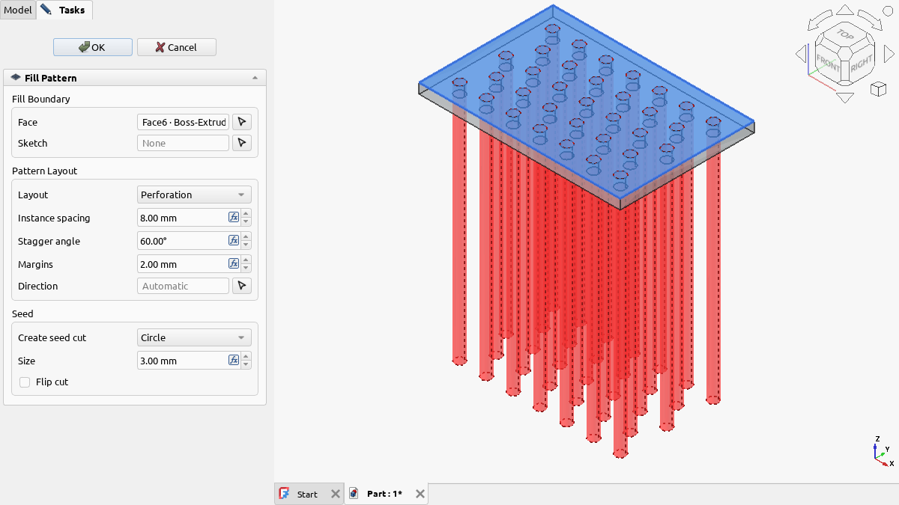

<!-- Generated by docs/build.py from docs/_data/catalog.json, docs/_authored/tools/fill-pattern.md, docs/_data/panels.json. Do not edit this file: change its sources and run `pixi run docs`. -->

# Fill Pattern

{ .tool-icon }
Fills a face with features, or with cuts of a simple shape, in rows or rings.
{ .tool-lead }

Fill Pattern fills a face with copies in rows or rings: perforated panels, speaker grilles, grip textures.

## How to use it

1. Select the face to fill and click **Fill Pattern**.
2. Choose the **Layout** (perforation, square, circular or polygon rows) and its spacing.
3. Either click features to repeat, or choose a **Seed** shape (a circle, square...) to cut, with its size.
4. Set the **Margins** from the face's edge, then click **OK**.

## Where to find it

- The **Features** toolbar, in the **Patterns** drop-down.
- **Solid Design** → **Patterns** → **Fill Pattern**
- **Insert** → **Pattern/Mirror** → **Fill Pattern**
- Command search: press <kbd>/</kbd> in the 3D view and type its name.
- The command line: <kbd>:</kbd> then `fillpattern` ([below](#on-the-command-line)).

## The panel

Every control's tooltip says the same as here: hover over it in FreeCAD. **OK** (or <kbd>Enter</kbd>) makes the feature, **Cancel** (or <kbd>Esc</kbd>) leaves the model as it was.

### Fill Boundary

| Control | Kind | What it does |
| :-- | :-- | :-- |
| **Face** | Selection box: click a flat face | The flat face to fill |
| **Sketch** | Selection box: click a sketch | Or a sketch's closed region |

### Pattern Layout

| Control | Kind | What it does |
| :-- | :-- | :-- |
| **Layout** | One of: *Perforation*, *Circular*, *Square*, *Polygon* | Perforation: staggered rows, like a perforated sheet. Circular: rings round the original. Square: a square grid. Polygon: polygon rings. |
| **Instance spacing** | A length | Between instances |
| **Loop spacing** | A length | Between rings *(shown for some choices only)* |
| **Stagger angle** | An angle | How each row shifts against the last |
| **Sides** | A count | The polygon's sides *(shown for some choices only)* |
| **Margins** | A length | Kept clear inside the boundary |
| **Direction** | Selection box: click an edge | The direction the rows run (none: along the boundary's first straight edge) |

### Seed

| Control | Kind | What it does |
| :-- | :-- | :-- |
| **Create seed cut** | One of: *None*, *Circle*, *Square*, *Diamond*, *Polygon* | Cut this shape at every instance; None repeats the features you pick below |
| **Size** | A length | The seed cut's size, across |
| **Sides** | A count | Polygon seed: sides *(shown for some choices only)* |
| **Flip cut** | A check box | Cut the other way |

### Features to Pattern

*Shown only for some choices above.*

| Control | Kind | What it does |
| :-- | :-- | :-- |
| **Features** | Selection list: click features in the tree, or their faces | The features to repeat: click them in the tree, or click a face they made |

### Faces to Pattern

*Shown only for some choices above.*

| Control | Kind | What it does |
| :-- | :-- | :-- |
| **Faces** | Selection list: click faces | Every face of a boss, hole or pocket to repeat (its walls and top or floor). Material is added where they bound material, cut where they bound a gap. |

### Bodies to Pattern

*Shown only for some choices above.*

| Control | Kind | What it does |
| :-- | :-- | :-- |
| **Bodies** | Selection list: click bodies in the 3D view or tree | Whole bodies to repeat |

## On the command line

Press <kbd>:</kbd> in the 3D view and type `fillpattern`, then what to set. See [the command line](../../guides/keyboard.md) for how it works.

Values typed straight after the name set, in order: **InstanceSpacing**. For example `:fillpattern 10`.

??? note "Options it takes"

    | Option | How to type it | What it is |
    | :-- | :-- | :-- |
    | `Layout` | a word: `perforation`, `circular`, `square`, `polygon` | Perforation: staggered rows. Circular: rings. Square: a grid. Polygon: polygon rings |
    | `InstanceSpacing` | `instancespacing=`a value | Between instances |
    | `LoopSpacing` | `loopspacing=`a value | Between rings (Circular, Polygon) |
    | `StaggerAngle` | `staggerangle=`a value | Perforation: how rows shift |
    | `PolygonSides` | `polygonsides=`a whole number | Polygon: sides |
    | `Margin` | `margin=`a value | Kept clear inside the boundary |
    | `SeedCut` | a word: `none`, `circle`, `square`, `diamond`, `polygon` | Create seed cut: cut this shape at every instance (None: repeat the features picked) |
    | `SeedSize` | `seedsize=`a value | The seed cut's size (across) |
    | `SeedSides` | `seedsides=`a whole number | Polygon seed: sides |
    | `FlipCut` | `flipcut` turns it on, `flipcut=no` off | Cut the other way |

## Properties

??? info "All properties"

    What the feature stores, as the **Property** editor shows it (select the feature in the tree, then the **Data** tab). The panel sets these for you.

    | Property | Kind | Default | What it is |
    | :-- | :-- | :-- | :-- |
    | `Features` | Objects | – | Features to repeat |
    | `Bodies` | List | – | Bodies to repeat, by ID |
    | `Faces` | Picks | – | Faces to repeat: every face of a boss, hole or pocket |
    | `Boundary` | Picks | – | A flat face to fill |
    | `BoundarySketch` | Object | – | Or: a sketch's closed region |
    | `Layout` | Choice | Perforation | Perforation: staggered rows. Circular: rings. Square: a grid. Polygon: polygon rings Choices: *Perforation*, *Circular*, *Square*, *Polygon*. |
    | `InstanceSpacing` | Length | 10 mm | Between instances |
    | `LoopSpacing` | Length | 10 mm | Between rings (Circular, Polygon) |
    | `StaggerAngle` | Angle | 60° | Perforation: how rows shift |
    | `PolygonSides` | Whole number | 6 | Polygon: sides |
    | `Margin` | Length | 2 mm | Kept clear inside the boundary |
    | `PatternDirection` | Picks | – | The direction rows run: an edge (none: along the boundary's first straight edge) |
    | `SeedCut` | Choice | None | Create seed cut: cut this shape at every instance (None: repeat the features picked) Choices: *None*, *Circle*, *Square*, *Diamond*, *Polygon*. |
    | `SeedSize` | Length | 4 mm | The seed cut's size (across) |
    | `SeedSides` | Whole number | 6 | Polygon seed: sides |
    | `FlipCut` | Yes/No | No | Cut the other way |

