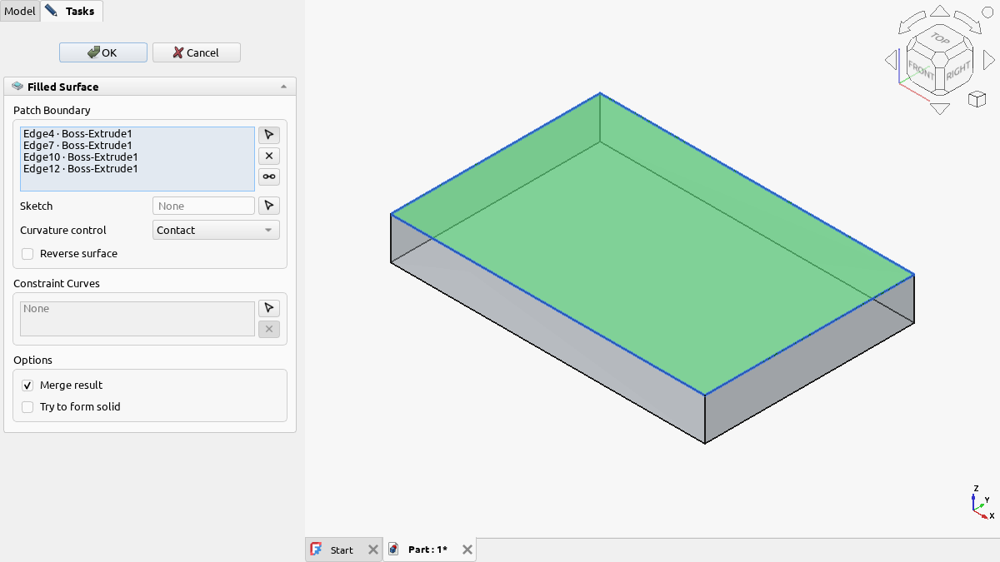

<!-- Generated by docs/build.py from docs/_data/catalog.json, docs/_authored/tools/filled-surface.md, docs/_data/panels.json. Do not edit this file: change its sources and run `pixi run docs`. -->

# Filled Surface

{ .tool-icon }
Patches a closed loop of edges with a surface, touching or tangent to the faces around it.
{ .tool-lead }

Filled Surface patches a hole bounded by edges, touching or tangent to the faces around it.

## How to use it

1. Click **Filled Surface**.
2. Click the edges round the hole into **Patch Boundary**, in a closed loop.
3. Choose how it meets the faces around (**Curvature control**: contact, tangent, curvature).
4. Click **OK**.

## Good to know

- **Constraint Curves** pull the patch through extra curves.
- **Merge result** knits the patch into the surface it closes; **Try to form solid** makes a solid if that closes it completely.

## Where to find it

- The **Surfaces** toolbar.
- **Solid Design** → **Surfaces** → **Filled Surface**
- **Insert** → **Surface** → **Filled Surface**
- Command search: press <kbd>/</kbd> in the 3D view and type its name.
- The command line: <kbd>:</kbd> then `filledsurface` ([below](#on-the-command-line)).

## The panel

Every control's tooltip says the same as here: hover over it in FreeCAD. **OK** (or <kbd>Enter</kbd>) makes the feature, **Cancel** (or <kbd>Esc</kbd>) leaves the model as it was.

### Patch Boundary

| Control | Kind | What it does |
| :-- | :-- | :-- |
| **Edges** | Selection list: click edges | The edges around the patch: one closed loop |
| **Sketch** | Selection box: click a sketch | Or a sketch whose curves make the loop |
| **Curvature control** | One of: *Contact*, *Tangent*, *Curvature* | Contact: the patch meets the edges. Tangent: it continues the faces beside them smoothly. Curvature: smoother still. |
| **Reverse surface** | A check box | Flip the patch's side |

### Constraint Curves

| Control | Kind | What it does |
| :-- | :-- | :-- |
| **Sketches** | Selection list: click sketches | Sketches whose curves and points the patch passes through |

### Options

| Control | Kind | What it does |
| :-- | :-- | :-- |
| **Merge result** | A check box | Knit the patch into the surface its edges belong to |
| **Try to form solid** | A check box | Make a solid when the merged surface closes |

## On the command line

Press <kbd>:</kbd> in the 3D view and type `filledsurface`, then what to set. See [the command line](../../guides/keyboard.md) for how it works.

??? note "Options it takes"

    | Option | How to type it | What it is |
    | :-- | :-- | :-- |
    | `Curvature` | a word: `contact`, `tangent`, `curvature` | Contact: the patch meets the edges. Tangent / Curvature: it continues the faces beside them smoothly |
    | `Reverse` | `reverse` turns it on, `reverse=no` off | Flip the patch's side |
    | `MergeResult` | `mergeresult` turns it on, `mergeresult=no` off | Knit the patch into the surface its edges are on |
    | `CreateSolid` | `createsolid` turns it on, `createsolid=no` off | Make a solid when the merged surface closes |

## Properties

??? info "All properties"

    What the feature stores, as the **Property** editor shows it (select the feature in the tree, then the **Data** tab). The panel sets these for you.

    | Property | Kind | Default | What it is |
    | :-- | :-- | :-- | :-- |
    | `Items` | Picks | – | Model edges around the patch |
    | `BoundarySketch` | Object | – | Or: a sketch whose curves bound it |
    | `Curvature` | Choice | Contact | Contact: the patch meets the edges. Tangent / Curvature: it continues the faces beside them smoothly Choices: *Contact*, *Tangent*, *Curvature*. |
    | `Reverse` | Yes/No | No | Flip the patch's side |
    | `Constraints` | Objects | – | Sketches whose curves and points the patch passes through |
    | `MergeResult` | Yes/No | Yes | Knit the patch into the surface its edges are on |
    | `CreateSolid` | Yes/No | No | Make a solid when the merged surface closes |

