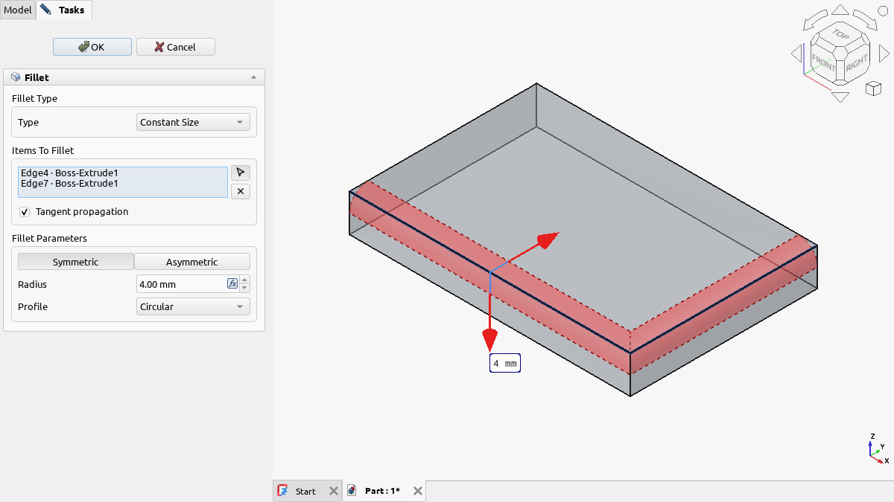

<!-- Generated by docs/build.py from docs/_data/catalog.json, docs/_authored/tools/fillet.md, docs/_data/panels.json. Do not edit this file: change its sources and run `pixi run docs`. -->

# Fillet

{ .tool-icon }
Creates a rounded internal or external face along one or more edges.
{ .tool-lead }

Fillet rounds edges. Pick edges, or a face to round all its edges.

## How to use it

1. Select the edges (or faces) to round.
2. Click **Fillet**. The preview shows the rounds.
3. Set the **Radius**, or drag the handle on an edge in the 3D view.
4. Click **OK**.

## Good to know

- **Tangent propagation** carries the fillet along edges that run smoothly on from the ones you picked.
- **Type** gives SolidWorks' other fillets: **Variable Size** (a radius at each end and points between), **Face Fillet** (between two sets of faces) and **Full Round Fillet** (a full round across a wall, from three sets of faces).
- **Asymmetric** uses a different distance on each face; **Profile** changes the round's shape (conic or curvature continuous).
- With an edge picked, the chain button by the list adds tangent, loop and chain edges at a click. See [picking things](../../guides/picking.md).

## Where to find it

- The **Features** toolbar.
- **Solid Design** → **Features** → **Fillet**
- **Insert** → **Features** → **Fillet**
- Command search: press <kbd>/</kbd> in the 3D view and type its name.
- The command line: <kbd>:</kbd> then `fillet` ([below](#on-the-command-line)).

## The panel

Every control's tooltip says the same as here: hover over it in FreeCAD. **OK** (or <kbd>Enter</kbd>) makes the feature, **Cancel** (or <kbd>Esc</kbd>) leaves the model as it was.

### Fillet Type

| Control | Kind | What it does |
| :-- | :-- | :-- |
| **Type** | One of: *Constant Size*, *Variable Size*, *Face Fillet*, *Full Round Fillet* | Constant Size: one radius. Variable Size: the radius changes from start to end along the edges. Face Fillet: rounds where two sets of faces meet. Full Round Fillet: replaces a centre face with a round between two side faces. |

### Items To Fillet

| Control | Kind | What it does |
| :-- | :-- | :-- |
| **Items** | Selection list: click edges or faces in the 3D view | The edges to round. A face rounds all its edges. Click an item again to take it out. |
| **Tangent propagation** | A check box | Also include the edges tangent to the ones you picked |

### Items To Fillet

*Shown only for some choices above.*

| Control | Kind | What it does |
| :-- | :-- | :-- |
| **Faces** | Selection list: click faces | The first set of faces (a side face for a full round). Click it again to take it out. |
| **Faces** | Selection list: click faces | The face the full round replaces. Click it again to take it out. *(shown for some choices only)* |
| **Faces** | Selection list: click faces | The second set of faces (the other side face for a full round). Click it again to take it out. |
| **Edges** | Selection list: click edges | Optional: edges on a face set where the round stops (its size follows them). Click it again to take it out. *(shown for some choices only)* |

> Face set 1

> Face set 2

### Fillet Parameters

| Control | Kind | What it does |
| :-- | :-- | :-- |
| **Symmetric \\| Asymmetric** | Buttons: *Symmetric* \\| *Asymmetric* |  |
| **Radius** | A length | Radius of the rounds |
| **Distance 2** | A length | Asymmetric: the distance on the second face *(a flip button beside it; shown for some choices only)* |
| **Profile** | One of: *Circular*, *Conic Rho*, *Curvature Continuous* | Circular: a round. Conic Rho: a conic, its shoulder set by rho. Curvature Continuous: a softer round that meets the faces without a jump in curvature. |
| **Rho** | A number | Conic Rho: 0.05 (flat) to 0.95 (sharp); 0.5 is a parabola *(shown for some choices only)* |
| **Start radius** | A length | Radius at the start of the edges *(a flip button beside it; shown for some choices only)* |
| **End radius** | A length | Radius at the end of the edges *(shown for some choices only)* |
|  | A list | Radii along the edges: click one to change it *(shown for some choices only)* |
| **Add** | A button | *(a **Delete** button; shown for some choices only)* |
| **Position** | A number | How far along the edges, in percent *(shown for some choices only)* |
| **Radius** | A number | The radius there *(shown for some choices only)* |

## Drag handles

While the panel is open, drag the handles in the 3D view to set **Radius**, or click a handle's value and type. The same handles show when you select the feature in the tree, so you can change it without opening the panel. See [drag handles](../../guides/drag-handles.md).

## On the command line

Press <kbd>:</kbd> in the 3D view and type `fillet`, then what to set. See [the command line](../../guides/keyboard.md) for how it works.

Values typed straight after the name set, in order: **Radius**. For example `:fillet 1`.

??? note "Options it takes"

    | Option | How to type it | What it is |
    | :-- | :-- | :-- |
    | `TangentPropagation` | `tangentpropagation` turns it on, `tangentpropagation=no` off | Include edges tangent to the picked ones |
    | `FilletType` | a word: `constantsize`, `variablesize`, `facefillet`, `fullroundfillet` | Fillet type |
    | `Radius` | `radius=`a value | Radius |
    | `StartRadius` | `startradius=`a value | Variable Size: radius at the start |
    | `EndRadius` | `endradius=`a value | Variable Size: radius at the end |
    | `ReverseVariable` | `reversevariable` turns it on, `reversevariable=no` off | Variable Size: swap which end gets the start radius |
    | `FilletMethod` | a word: `symmetric`, `asymmetric` | Symmetric: one radius. Asymmetric: a distance on each face |
    | `Distance2` | `distance2=`a value | Asymmetric: the distance on the second face |
    | `FlipAsymmetric` | `flipasymmetric` turns it on, `flipasymmetric=no` off | Asymmetric: swap which face gets which distance |
    | `Profile` | a word: `circular`, `conicrho`, `curvaturecontinuous` | The round's shape across the edge |
    | `ConicRho` | `conicrho=`a value | Conic Rho: where the shoulder sits, 0.05 (flat) to 0.95 (sharp); 0.5 is a parabola |

## Properties

??? info "All properties"

    What the feature stores, as the **Property** editor shows it (select the feature in the tree, then the **Data** tab). The panel sets these for you.

    | Property | Kind | Default | What it is |
    | :-- | :-- | :-- | :-- |
    | `Items` | Picks | – | Edges, faces (all their edges) or vertices |
    | `TangentPropagation` | Yes/No | Yes | Include edges tangent to the picked ones |
    | `FilletType` | Choice | Constant Size | Fillet type Choices: *Constant Size*, *Variable Size*, *Face Fillet*, *Full Round Fillet*. |
    | `Radius` | Length | 1 mm | Radius |
    | `StartRadius` | Length | 1 mm | Variable Size: radius at the start |
    | `EndRadius` | Length | 3 mm | Variable Size: radius at the end |
    | `ReverseVariable` | Yes/No | No | Variable Size: swap which end gets the start radius |
    | `FaceSet1` | Picks | – | Face Fillet: face set 1. Full Round: side face set 1 |
    | `FaceSet2` | Picks | – | Face Fillet: face set 2. Full Round: side face set 2 |
    | `CenterFaces` | Picks | – | Full Round: the centre face set |
    | `FilletMethod` | Choice | Symmetric | Symmetric: one radius. Asymmetric: a distance on each face Choices: *Symmetric*, *Asymmetric*. |
    | `Distance2` | Length | 2 mm | Asymmetric: the distance on the second face |
    | `FlipAsymmetric` | Yes/No | No | Asymmetric: swap which face gets which distance |
    | `Profile` | Choice | Circular | The round's shape across the edge Choices: *Circular*, *Conic Rho*, *Curvature Continuous*. |
    | `ConicRho` | Number | – | Conic Rho: where the shoulder sits, 0.05 (flat) to 0.95 (sharp); 0.5 is a parabola |
    | `VariablePoints` | List | – | Variable Size: radii along the edges, as percent\|radius |
    | `HoldLine` | Picks | – | Face Fillet: the edges the round stops at (the hold line) |

