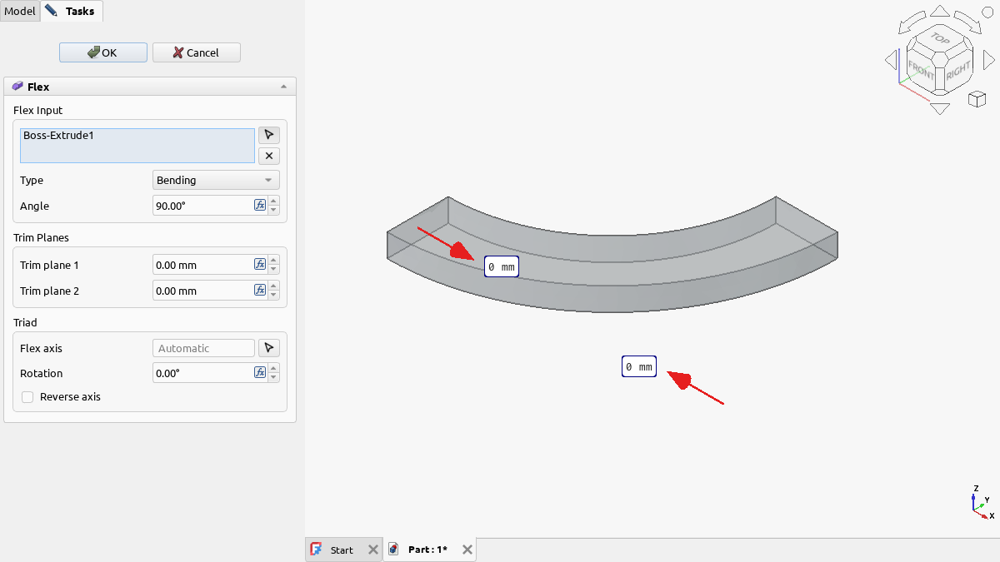

<!-- Generated by docs/build.py from docs/_data/catalog.json, docs/_authored/tools/flex.md, docs/_data/panels.json. Do not edit this file: change its sources and run `pixi run docs`. -->

# Flex

{ .tool-icon }
Bends, twists, tapers or stretches bodies along an axis.
{ .tool-lead }

Flex bends, twists, tapers or stretches bodies along an axis.

## How to use it

1. Select the bodies and click **Flex**.
2. Choose the **Type**: **Bending**, **Twisting**, **Tapering** or **Stretching**, and set its amount.
3. Move the **Trim planes** to limit the part of the body that flexes.
4. Click **OK**.

## Where to find it

- The **Bodies** toolbar, in the **Deform Bodies** drop-down.
- **Solid Design** → **Bodies** → **Flex**
- **Insert** → **Features** → **Flex**
- Command search: press <kbd>/</kbd> in the 3D view and type its name.
- The command line: <kbd>:</kbd> then `flex` ([below](#on-the-command-line)).

## The panel

Every control's tooltip says the same as here: hover over it in FreeCAD. **OK** (or <kbd>Enter</kbd>) makes the feature, **Cancel** (or <kbd>Esc</kbd>) leaves the model as it was.

### Flex Input

| Control | Kind | What it does |
| :-- | :-- | :-- |
| **Bodies** | Selection list: click bodies in the 3D view or tree | The bodies to flex (none picked: every solid) |
| **Type** | One of: *Bending*, *Twisting*, *Tapering*, *Stretching* | Bending, twisting, tapering or stretching along the flex axis, between the trim planes |
| **Angle** | An angle | How far it bends or twists |
| **Taper factor** | A number | Its size at the far trim plane (1: no taper) *(shown for some choices only)* |
| **Stretch distance** | A length | How much longer *(shown for some choices only)* |

### Trim Planes

Where the flexing starts and ends along the axis

| Control | Kind | What it does |
| :-- | :-- | :-- |
| **Trim plane 1** | A length | In from the body's near end |
| **Trim plane 2** | A length | In from the body's far end |

### Triad

The flex axis and the way it bends

| Control | Kind | What it does |
| :-- | :-- | :-- |
| **Flex axis** | Selection box: click an edge or axis | The axis it flexes along (none: the body's longest side) |
| **Rotation** | An angle | Turns the bend's direction round the flex axis |
| **Reverse axis** | A check box | Flex from the other end |

## Drag handles

While the panel is open, drag the handles in the 3D view to set **TrimPlane1**, **TrimPlane2**, or click a handle's value and type. The same handles show when you select the feature in the tree, so you can change it without opening the panel. See [drag handles](../../guides/drag-handles.md).

## On the command line

Press <kbd>:</kbd> in the 3D view and type `flex`, then what to set. See [the command line](../../guides/keyboard.md) for how it works.

??? note "Options it takes"

    | Option | How to type it | What it is |
    | :-- | :-- | :-- |
    | `FlexType` | a word: `bending`, `twisting`, `tapering`, `stretching` | Bend, twist, taper or stretch |
    | `Angle` | `angle=`a value | Bending / twisting angle |
    | `TaperFactor` | `taperfactor=`a value | Tapering: size at the far trim plane |
    | `StretchDistance` | `stretchdistance=`a value | Stretching: how much longer |
    | `TrimPlane1` | `trimplane1=`a value | Where the flexing starts: in from the body's near end |
    | `TrimPlane2` | `trimplane2=`a value | Where it ends: in from the body's far end |
    | `TriadRotation` | `triadrotation=`a value | Turns the bend's direction round the flex axis |
    | `ReverseAxis` | `reverseaxis` turns it on, `reverseaxis=no` off | Flex from the other end |

## Properties

??? info "All properties"

    What the feature stores, as the **Property** editor shows it (select the feature in the tree, then the **Data** tab). The panel sets these for you.

    | Property | Kind | Default | What it is |
    | :-- | :-- | :-- | :-- |
    | `Bodies` | List | – | Bodies to flex (empty: all solids) |
    | `FlexType` | Choice | Bending | Bend, twist, taper or stretch Choices: *Bending*, *Twisting*, *Tapering*, *Stretching*. |
    | `Angle` | Angle | 90° | Bending / twisting angle |
    | `TaperFactor` | Number | 0.5 | Tapering: size at the far trim plane |
    | `StretchDistance` | Length | 10 mm | Stretching: how much longer |
    | `TrimPlane1` | Length | 0 mm | Where the flexing starts: in from the body's near end |
    | `TrimPlane2` | Length | 0 mm | Where it ends: in from the body's far end |
    | `FlexAxis` | Picks | – | The flex axis: an edge or axis (none: along the body's longest side) |
    | `TriadRotation` | Angle | 0° | Turns the bend's direction round the flex axis |
    | `ReverseAxis` | Yes/No | No | Flex from the other end |

