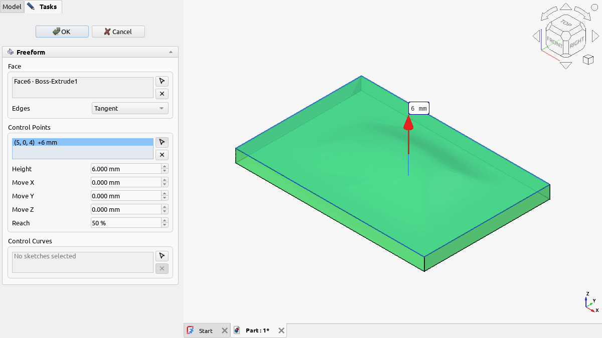

<!-- Generated by docs/build.py from docs/_data/catalog.json, docs/_authored/tools/freeform.md, docs/_data/panels.json. Do not edit this file: change its sources and run `pixi run docs`. -->

# Freeform

{ .tool-icon }
Pushes or pulls a face at points you place on it; its edges stay put.
{ .tool-lead }

Freeform pushes or pulls a face at points you place on it; its edges stay put. Use it to shape organic surfaces.

## How to use it

1. Select a face and click **Freeform**.
2. Click on the face to add **Control Points**.
3. Select a point in the list and set its **Height** (or drag its arrow).
4. Click **OK**.

## Good to know

- **Control Curves** shape the face along sketched curves instead of at points.

## Where to find it

- The **Bodies** toolbar, in the **Deform Bodies** drop-down.
- **Solid Design** → **Bodies** → **Freeform**
- **Insert** → **Features** → **Freeform**
- Command search: press <kbd>/</kbd> in the 3D view and type its name.
- The command line: <kbd>:</kbd> then `freeform` ([below](#on-the-command-line)).

## The panel

Every control's tooltip says the same as here: hover over it in FreeCAD. **OK** (or <kbd>Enter</kbd>) makes the feature, **Cancel** (or <kbd>Esc</kbd>) leaves the model as it was.

### Face

| Control | Kind | What it does |
| :-- | :-- | :-- |
| **Faces** | Selection list: click faces | The face to change (its edges stay put) |
| **Edges** | One of: *Contact*, *Tangent*, *Curvature* | How the change meets the face's edges: Contact (a crease), Tangent (smooth) or Curvature (smoothest) |

### Control Points

Click on the face to add a point; drag its arrow or type how far it moves

| Control | Kind | What it does |
| :-- | :-- | :-- |
| **Points** | Selection list: click on the face | Control points; click one in the list to set its height |
| **Height** | A number | How far the selected point moves along the face's normal (negative: in) |
| **Move X** | A number | Slide the selected point sideways across the face (the part along the normal is ignored; Height does that) |
| **Move Y** | A number | Slide the selected point sideways across the face (the part along the normal is ignored; Height does that) |
| **Move Z** | A number | Slide the selected point sideways across the face (the part along the normal is ignored; Height does that) |
| **Reach** | A number | How far each point's pull spreads, as a share of the face's size |

### Control Curves

The face is pulled onto these curves

| Control | Kind | What it does |
| :-- | :-- | :-- |
| **Sketches** | Selection list: click sketches | Sketches or curves the face passes through |

## Drag handles

While the panel is open, drag the handles in the 3D view to set **Point0+**, or click a handle's value and type. The same handles show when you select the feature in the tree, so you can change it without opening the panel. See [drag handles](../../guides/drag-handles.md).

## On the command line

Press <kbd>:</kbd> in the 3D view and type `freeform`, then what to set. See [the command line](../../guides/keyboard.md) for how it works.

??? note "Options it takes"

    | Option | How to type it | What it is |
    | :-- | :-- | :-- |
    | `Continuity` | a word: `contact`, `tangent`, `curvature` | How the change meets the face's edges |
    | `Reach` | `reach=`a value | How far each point's change spreads, as a share of the face's size |

## Properties

??? info "All properties"

    What the feature stores, as the **Property** editor shows it (select the feature in the tree, then the **Data** tab). The panel sets these for you.

    | Property | Kind | Default | What it is |
    | :-- | :-- | :-- | :-- |
    | `Items` | Picks | – | The face to change |
    | `ControlPoints` | List | – | Points on the face and how far each moves: x,y,z\|height[\|dx,dy,dz sideways] |
    | `ControlCurves` | Objects | – | Curves (sketches) the face is pulled onto |
    | `Continuity` | Choice | Tangent | How the change meets the face's edges Choices: *Contact*, *Tangent*, *Curvature*. |
    | `Reach` | Percent | 50 | How far each point's change spreads, as a share of the face's size |

