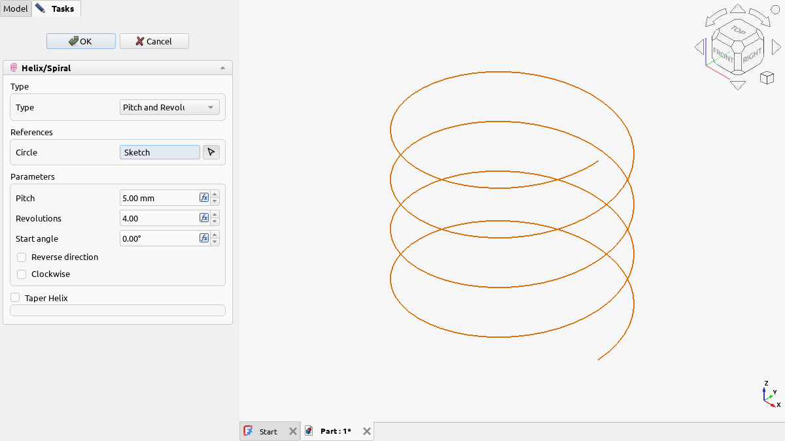

<!-- Generated by docs/build.py from docs/_data/catalog.json, docs/_authored/tools/helix-spiral.md, docs/_data/panels.json. Do not edit this file: change its sources and run `pixi run docs`. -->

# Helix/Spiral

{ .tool-icon }
Adds a helix or spiral from a circle (a sketch with one circle, or a circular edge): a path for springs and threads.
{ .tool-lead }

Helix/Spiral makes a helix or a flat spiral from a circle: a path for springs, coils and threads.

## How to use it

1. Select a sketch with one circle, or a circular edge, and click **Helix/Spiral**.
2. Choose the **Type** (**Pitch and Revolution**, **Height and Revolution**, **Height and Pitch** or **Spiral**) and set its values.
3. Click **OK**.

## Good to know

- **Taper Helix** narrows it as it climbs. Sweep a circle along it with [Sweep](sweep.md) for a spring.

## Where to find it

- The **Curves** toolbar, in the **Curves** drop-down.
- **Solid Design** → **Curves** → **Helix/Spiral**
- **Insert** → **Curve** → **Helix/Spiral**
- Command search: press <kbd>/</kbd> in the 3D view and type its name.
- The command line: <kbd>:</kbd> then `helixspiral` ([below](#on-the-command-line)).

## The panel

Every control's tooltip says the same as here: hover over it in FreeCAD. **OK** (or <kbd>Enter</kbd>) makes the feature, **Cancel** (or <kbd>Esc</kbd>) leaves the model as it was.

### Type

| Control | Kind | What it does |
| :-- | :-- | :-- |
| **Type** | One of: *Pitch and Revolution*, *Height and Revolution*, *Height and Pitch*, *Spiral* | How the helix/spiral is defined; the references below follow from it |

### References

| Control | Kind | What it does |
| :-- | :-- | :-- |
| **Circle** | Selection box: click a circle or sketch | A reference the helix/spiral is built from |
| **Reference 2** | Selection box | A reference the helix/spiral is built from *(shown for some choices only)* |
| **Reference 3** | Selection box | A reference the helix/spiral is built from *(shown for some choices only)* |

### Parameters

| Control | Kind | What it does |
| :-- | :-- | :-- |
| **Pitch** | A length | Distance between turns |
| **Revolutions** | A number | Number of turns |
| **Height** | A length | Height of the helix *(shown for some choices only)* |
| **Start angle** | An angle | Where the first turn starts, measured round from the circle's X direction |
| **Reverse direction** | A check box | Grow the helix the other way from the circle |
| **Clockwise** | A check box | Turn clockwise (a left-hand helix); off: counterclockwise |

### Taper Helix

Make the helix cone-shaped

*Optional: tick its title to use it.*

| Control | Kind | What it does |
| :-- | :-- | :-- |
| **Angle** | An angle | Taper angle *(shown for some choices only)* |
| **Taper outward** | A check box | Wider at the end; off: narrower *(shown for some choices only)* |

## On the command line

Press <kbd>:</kbd> in the 3D view and type `helixspiral`, then what to set. See [the command line](../../guides/keyboard.md) for how it works.

Values typed straight after the name set, in order: **Height**. For example `:helixspiral 20`.

??? note "Options it takes"

    | Option | How to type it | What it is |
    | :-- | :-- | :-- |
    | `Type` | a word: `pitchandrevolution`, `heightandrevolution`, `heightandpitch`, `spiral` | How it is defined |
    | `Flip` | `flip` turns it on, `flip=no` off | Flip |
    | `Pitch` | `pitch=`a value | Distance between turns |
    | `Revolutions` | `revolutions=`a value | Number of turns |
    | `Height` | `height=`a value | Height of the helix |
    | `StartAngle` | `startangle=`a value | Where the first turn starts |
    | `Clockwise` | `clockwise` turns it on, `clockwise=no` off | Turn clockwise (a left-hand helix) instead of counterclockwise |
    | `TaperHelix` | `taperhelix` turns it on, `taperhelix=no` off | Taper the helix |
    | `TaperAngle` | `taperangle=`a value | Taper angle |
    | `TaperOutward` | `taperoutward` turns it on, `taperoutward=no` off | Taper outwards (wider at the end) |

## Properties

??? info "All properties"

    What the feature stores, as the **Property** editor shows it (select the feature in the tree, then the **Data** tab). The panel sets these for you.

    | Property | Kind | Default | What it is |
    | :-- | :-- | :-- | :-- |
    | `Type` | Choice | Pitch and Revolution | How it is defined Choices: *Pitch and Revolution*, *Height and Revolution*, *Height and Pitch*, *Spiral*. |
    | `Reference1` | Picks | – | Reference 1 |
    | `Reference2` | Picks | – | Reference 2 |
    | `Reference3` | Picks | – | Reference 3 |
    | `Flip` | Yes/No | No | Flip |
    | `Pitch` | Length | 5 mm | Distance between turns |
    | `Revolutions` | Number | 4 | Number of turns |
    | `Height` | Length | 20 mm | Height of the helix |
    | `StartAngle` | Angle | 0° | Where the first turn starts |
    | `Clockwise` | Yes/No | No | Turn clockwise (a left-hand helix) instead of counterclockwise |
    | `TaperHelix` | Yes/No | No | Taper the helix |
    | `TaperAngle` | Angle | 5° | Taper angle |
    | `TaperOutward` | Yes/No | No | Taper outwards (wider at the end) |

