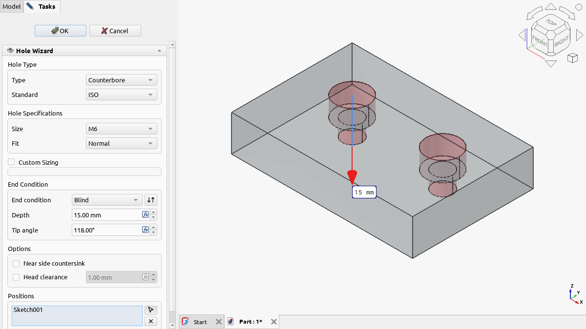

<!-- Generated by docs/build.py from docs/_data/catalog.json, docs/_authored/tools/hole-wizard.md, docs/_data/panels.json. Do not edit this file: change its sources and run `pixi run docs`. -->

# Hole Wizard

{ .tool-icon }
Inserts holes of a standard type and size at points on a face or a sketch.
{ .tool-lead }

Hole Wizard makes standard holes at the right size for a fastener: counterbored, countersunk, plain, tapped, and slots, in ISO and ANSI Inch sizes.

## How to use it

1. Click **Hole Wizard**.
2. Choose the hole **Type**, **Standard**, **Size** and **Fit**.
3. Set the **End Condition** (Blind with its depth, Through All...).
4. Click on a face where each hole goes. Each click adds a position; you can also pick a sketch with points.
5. Click **OK**.

## Good to know

- Tapped holes can be drilled at the tap drill size, at the thread size, or with a modelled thread.
- **Custom Sizing** overrides the table's sizes. The **Options** group adds near and far side countersinks and head clearance.

## Where to find it

- The **Features** toolbar.
- **Solid Design** → **Features** → **Hole Wizard**
- **Insert** → **Features** → **Hole Wizard**
- Command search: press <kbd>/</kbd> in the 3D view and type its name.
- The command line: <kbd>:</kbd> then `holewizard` ([below](#on-the-command-line)).

## The panel

Every control's tooltip says the same as here: hover over it in FreeCAD. **OK** (or <kbd>Enter</kbd>) makes the feature, **Cancel** (or <kbd>Esc</kbd>) leaves the model as it was.

### Hole Type

| Control | Kind | What it does |
| :-- | :-- | :-- |
| **Type** | One of: *Counterbore*, *Countersink*, *Hole*, *Straight Tap*, *Tapered Tap*, *Counterbore Slot*, *Countersink Slot*, *Slot*, *Advanced*, *Legacy* | Counterbore, countersink, plain or tapped hole, or a slot |
| **Standard** | One of: *ISO*, *ANSI Inch* | The standard the sizes come from: ISO, or ANSI Inch |

### Hole Specifications

| Control | Kind | What it does |
| :-- | :-- | :-- |
| **Size** | One of: *M2*, *M2.5*, *M3*, *M4*, *M5*, *M6*, *M8*, *M10*, *M12*, *M16*, *M20* | The fastener size |
| **Fit** | One of: *Close*, *Normal*, *Loose* | Close, normal or loose clearance for the fastener |
| **Thread** | One of: *Tap Drill Diameter*, *Thread Diameter*, *Modelled Thread* | Tap Drill Diameter: the drilled hole. Thread Diameter: the hole at the thread's size. Modelled Thread: the helical thread cut into it. *(shown for some choices only)* |
| **Slot length** | A length | Slot length, centre to centre *(shown for some choices only)* |
| **Slot angle** | An angle | Slot direction, from the sketch's X axis *(shown for some choices only)* |

### Legacy Hole

An older hole type, sized by its own dimensions

*Shown only for some choices above.*

| Control | Kind | What it does |
| :-- | :-- | :-- |
| **Type** | One of: *Simple*, *Tapered*, *Counterbored*, *Countersunk*, *Counterdrilled* | Simple, Tapered, Counterbored, Countersunk or Counterdrilled |
| **Taper angle** | An angle | Tapered: how far the wall leans *(shown for some choices only)* |
| **Counterdrill angle** | An angle | Counterdrilled: the cone down to the hole *(shown for some choices only)* |

### Custom Sizing

Use your own dimensions instead of the standard's

*Optional: tick its title to use it.*

| Control | Kind | What it does |
| :-- | :-- | :-- |
| **Hole diameter** | A length | Diameter of the hole *(shown for some choices only)* |
| **Counterbore diameter** | A length | Diameter of the counterbore *(shown for some choices only)* |
| **Counterbore depth** | A length | Depth of the counterbore *(shown for some choices only)* |
| **Countersink diameter** | A length | Diameter of the countersink at the face *(shown for some choices only)* |
| **Countersink angle** | An angle | Included angle of the countersink *(shown for some choices only)* |

### End Condition

| Control | Kind | What it does |
| :-- | :-- | :-- |
| **End condition** | One of: *Blind*, *Through All*, *Up To Next*, *Up To Vertex*, *Up To Surface*, *Offset From Surface* | Blind: to a depth. Through All: through everything. Up To Next: through the first body it meets. Up To Vertex, Up To Surface, Offset From Surface: to what you pick. *(a flip button beside it)* |
| **Depth** | A length | Depth of the hole |
| **Tip angle** | An angle | Angle of the drill point at the bottom (0: flat) |
| **Thread depth** | A length | How deep the modelled thread goes *(shown for some choices only)* |
| **Up to** | Selection box: click a face, plane or vertex | The vertex, face or plane the holes go up to *(shown for some choices only)* |
| **Offset** | A length | How far before the surface the holes stop *(shown for some choices only)* |

### Options

| Control | Kind | What it does |
| :-- | :-- | :-- |
| **Near side countersink** | A check box | A countersink where the hole starts |
| **Diameter** | A length | Diameter of the countersink at the face *(shown for some choices only)* |
| **Angle** | An angle | Included angle of the countersink *(shown for some choices only)* |
| **Far side countersink** | A check box | A countersink where the hole comes out (Through All, Up To Next) *(shown for some choices only)* |
| **Diameter** | A length | Diameter of the countersink at the face *(shown for some choices only)* |
| **Angle** | An angle | Included angle of the countersink *(shown for some choices only)* |
| **Head clearance** | A length | Carry the counterbore or countersink up above the face, so the screw head has room *(tick it to use it)* |

### Near Side Elements

Advanced: the steps of the hole from the face down; the last one runs to the end condition

*Shown only for some choices above.*

| Control | Kind | What it does |
| :-- | :-- | :-- |
|  | A list | From the face down. The last element runs to the end condition. |
| **Add** | A button | *(a **Remove** button; a **Up** button; a **Down** button)* |
| **Element** | One of: *Counterbore*, *Countersink*, *Hole*, *Tapered* | Counterbore or Hole: a straight step. Countersink: a cone down to the next element. Tapered: narrows by its angle. *(shown for some choices only)* |
| **Diameter** | A number | Diameter at the top of the element *(shown for some choices only)* |
| **Depth** | A number | How deep the element goes *(shown for some choices only)* |
| **Angle** | A number | Included angle (Countersink, Tapered) *(shown for some choices only)* |

### Far Side Elements

Advanced: steps cut back from where the hole comes out (Through All, Up To Next)

*Shown only for some choices above.*

| Control | Kind | What it does |
| :-- | :-- | :-- |
|  | A list | From the exit face back up the hole |
| **Add** | A button | *(a **Remove** button; a **Up** button; a **Down** button)* |
| **Element** | One of: *Counterbore*, *Countersink*, *Hole*, *Tapered* | Counterbore or Hole: a straight step. Countersink: a cone down to the next element. Tapered: narrows by its angle. *(shown for some choices only)* |
| **Diameter** | A number | Diameter at the top of the element *(shown for some choices only)* |
| **Depth** | A number | How deep the element goes *(shown for some choices only)* |
| **Angle** | A number | Included angle (Countersink, Tapered) *(shown for some choices only)* |

### Positions

| Control | Kind | What it does |
| :-- | :-- | :-- |
| **Positions** | Selection list: click on a face to add a hole | Click on a planar face to add a hole there, or pick a sketch whose points are the hole centres |

## Drag handles

While the panel is open, drag the handles in the 3D view to set **Depth**, or click a handle's value and type. The same handles show when you select the feature in the tree, so you can change it without opening the panel. See [drag handles](../../guides/drag-handles.md).

## On the command line

Press <kbd>:</kbd> in the 3D view and type `holewizard`, then what to set. See [the command line](../../guides/keyboard.md) for how it works.

Values typed straight after the name set, in order: **Depth**. For example `:holewizard 15`.

??? note "Options it takes"

    | Option | How to type it | What it is |
    | :-- | :-- | :-- |
    | `HoleType` | a word: `counterbore`, `countersink`, `hole`, `straighttap`, `taperedtap`, `counterboreslot`, `countersinkslot`, `slot`, `advanced`, `legacy` | Hole type |
    | `Standard` | a word: `iso`, `ansiinch` | Standard |
    | `Size` | a word: `m2`, `m25`, `m3`, `m4`, `m5`, `m6`, `m8`, `m10`, `m12`, `m16`, `m20` | Size |
    | `Fit` | a word: `close`, `normal`, `loose` | Fit |
    | `EndCondition` | a word: `blind`, `throughall`, `uptonext`, `uptovertex`, `uptosurface`, `offsetfromsurface` | End condition |
    | `Depth` | `depth=`a value | Blind depth |
    | `TipAngle` | `tipangle=`a value | Drill tip angle (0: flat) |
    | `Reverse` | `reverse` turns it on, `reverse=no` off | Reverse Direction |
    | `OffsetDistance` | `offsetdistance=`a value | Offset From Surface distance |
    | `SlotLength` | `slotlength=`a value | Slot length, centre to centre |
    | `SlotAngle` | `slotangle=`a value | Slot direction from the sketch's X axis |
    | `ThreadOption` | a word: `tapdrilldiameter`, `threaddiameter`, `modelledthread` | Straight Tap: the tap drill, the thread's diameter, or a modelled thread |
    | `ThreadDepth` | `threaddepth=`a value | Thread depth (Blind) |
    | `CustomSizing` | `customsizing` turns it on, `customsizing=no` off | Use your own dimensions |
    | `HoleDiameter` | `holediameter=`a value | Hole diameter |
    | `CboreDiameter` | `cborediameter=`a value | Counterbore diameter |
    | `CboreDepth` | `cboredepth=`a value | Counterbore depth |
    | `CskDiameter` | `cskdiameter=`a value | Countersink diameter |
    | `CskAngle` | `cskangle=`a value | Countersink angle |
    | `LegacyType` | a word: `simple`, `tapered`, `counterbored`, `countersunk`, `counterdrilled` | Legacy hole: Simple, Tapered, Counterbored, Countersunk or Counterdrilled |
    | `TaperAngle` | `taperangle=`a value | Legacy Tapered: the wall's angle |
    | `CdrillAngle` | `cdrillangle=`a value | Legacy Counterdrilled: the cone from the counterdrill down to the hole |
    | `NearSideCsk` | `nearsidecsk` turns it on, `nearsidecsk=no` off | Near side countersink |
    | `NearCskDiameter` | `nearcskdiameter=`a value | Near side countersink diameter |
    | `NearCskAngle` | `nearcskangle=`a value | Near side countersink angle |
    | `FarSideCsk` | `farsidecsk` turns it on, `farsidecsk=no` off | Far side countersink (Through All, Up To Next) |
    | `FarCskDiameter` | `farcskdiameter=`a value | Far side countersink diameter |
    | `FarCskAngle` | `farcskangle=`a value | Far side countersink angle |
    | `HeadClearance` | `headclearance` turns it on, `headclearance=no` off | Head clearance (Counterbore, Countersink) |
    | `HeadClearanceValue` | `headclearancevalue=`a value | Head clearance |

## Properties

??? info "All properties"

    What the feature stores, as the **Property** editor shows it (select the feature in the tree, then the **Data** tab). The panel sets these for you.

    | Property | Kind | Default | What it is |
    | :-- | :-- | :-- | :-- |
    | `HoleType` | Choice | Counterbore | Hole type Choices: *Counterbore*, *Countersink*, *Hole*, *Straight Tap*, *Tapered Tap*, *Counterbore Slot*, *Countersink Slot*, *Slot*, *Advanced*, *Legacy*. |
    | `Standard` | Choice | ISO | Standard Choices: *ISO*, *ANSI Inch*. |
    | `Size` | Choice | M2 | Size Choices: *M2*, *M2.5*, *M3*, *M4*, *M5*, *M6*, *M8*, *M10*, *M12*, *M16*, *M20*. |
    | `Fit` | Choice | Normal | Fit Choices: *Close*, *Normal*, *Loose*. |
    | `EndCondition` | Choice | Blind | End condition Choices: *Blind*, *Through All*, *Up To Next*, *Up To Vertex*, *Up To Surface*, *Offset From Surface*. |
    | `Depth` | Length | 15 mm | Blind depth |
    | `TipAngle` | Angle | 118° | Drill tip angle (0: flat) |
    | `Reverse` | Yes/No | No | Reverse Direction |
    | `UpTo` | Picks | – | Vertex, face or plane (Up To Vertex, Up To Surface, Offset From Surface) |
    | `OffsetDistance` | Length | 1 mm | Offset From Surface distance |
    | `SlotLength` | Length | 10 mm | Slot length, centre to centre |
    | `SlotAngle` | Angle | 0° | Slot direction from the sketch's X axis |
    | `ThreadOption` | Choice | Tap Drill Diameter | Straight Tap: the tap drill, the thread's diameter, or a modelled thread Choices: *Tap Drill Diameter*, *Thread Diameter*, *Modelled Thread*. |
    | `ThreadDepth` | Length | 12 mm | Thread depth (Blind) |
    | `CustomSizing` | Yes/No | No | Use your own dimensions |
    | `HoleDiameter` | Length | 6.6 mm | Hole diameter |
    | `CboreDiameter` | Length | 11 mm | Counterbore diameter |
    | `CboreDepth` | Length | 6.4 mm | Counterbore depth |
    | `CskDiameter` | Length | 13.44 mm | Countersink diameter |
    | `CskAngle` | Angle | 90° | Countersink angle |
    | `LegacyType` | Choice | Simple | Legacy hole: Simple, Tapered, Counterbored, Countersunk or Counterdrilled Choices: *Simple*, *Tapered*, *Counterbored*, *Countersunk*, *Counterdrilled*. |
    | `TaperAngle` | Angle | 2° | Legacy Tapered: the wall's angle |
    | `CdrillAngle` | Angle | 118° | Legacy Counterdrilled: the cone from the counterdrill down to the hole |
    | `NearSideCsk` | Yes/No | No | Near side countersink |
    | `NearCskDiameter` | Length | 10 mm | Near side countersink diameter |
    | `NearCskAngle` | Angle | 90° | Near side countersink angle |
    | `FarSideCsk` | Yes/No | No | Far side countersink (Through All, Up To Next) |
    | `FarCskDiameter` | Length | 10 mm | Far side countersink diameter |
    | `FarCskAngle` | Angle | 90° | Far side countersink angle |
    | `HeadClearance` | Yes/No | No | Head clearance (Counterbore, Countersink) |
    | `HeadClearanceValue` | Length | 1 mm | Head clearance |
    | `NearElements` | List | – | Advanced: near side elements from the face down, as Kind\|Diameter\|Depth\|Angle |
    | `FarElements` | List | – | Advanced: far side elements from the exit face up, as Kind\|Diameter\|Depth\|Angle |
    | `Sketch` | Object | – | Sketch whose points place the holes |

