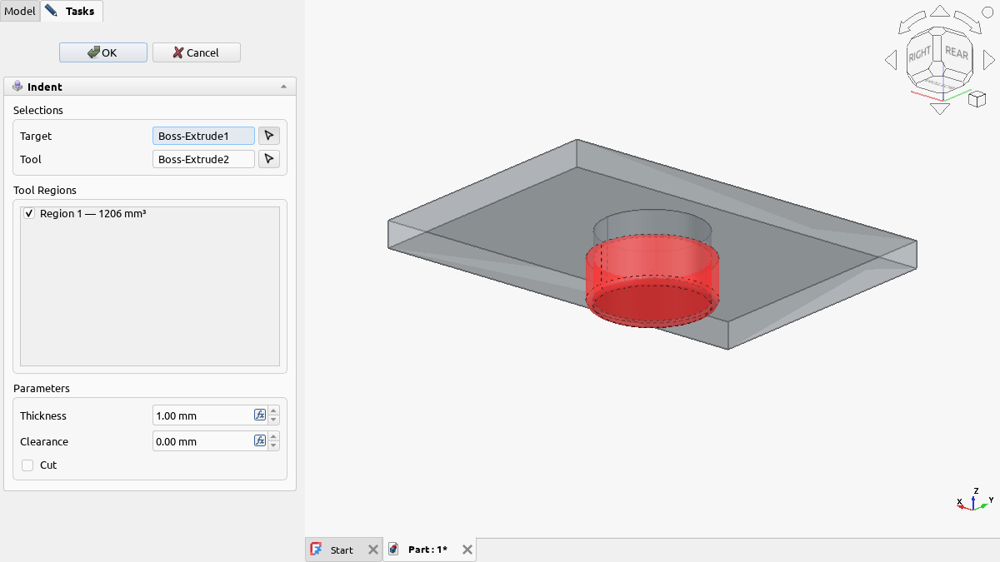

<!-- Generated by docs/build.py from docs/_data/catalog.json, docs/_authored/tools/indent.md, docs/_data/panels.json. Do not edit this file: change its sources and run `pixi run docs`. -->

# Indent

{ .tool-icon }
Presses a tool body's shape into a target body, with a wall round it, or cuts it in.
{ .tool-lead }

Indent presses a tool body's shape into a target body, leaving a wall of set thickness round it, or cuts the shape out.

## How to use it

1. Place the tool body where it meets the target body.
2. Select the target body, then the tool body, and click **Indent**.
3. In **Tool Regions**, tick the parts of the tool that press in.
4. Set the wall **Thickness** and **Clearance**, or tick **Cut**.
5. Click **OK**.

## Where to find it

- The **Bodies** toolbar, in the **Deform Bodies** drop-down.
- **Solid Design** → **Bodies** → **Indent**
- **Insert** → **Features** → **Indent**
- Command search: press <kbd>/</kbd> in the 3D view and type its name.
- The command line: <kbd>:</kbd> then `indent` ([below](#on-the-command-line)).

## The panel

Every control's tooltip says the same as here: hover over it in FreeCAD. **OK** (or <kbd>Enter</kbd>) makes the feature, **Cancel** (or <kbd>Esc</kbd>) leaves the model as it was.

### Selections

| Control | Kind | What it does |
| :-- | :-- | :-- |
| **Target** | Selection box: click a body | The body to indent |
| **Tool** | Selection box: click a body | The body whose shape is pressed in |

### Tool Regions

The tool's parts outside the target: the target wraps the ticked ones

| Control | Kind | What it does |
| :-- | :-- | :-- |
|  | A list | The regions, numbered in the view: untick one and the target is only cut there |

### Parameters

| Control | Kind | What it does |
| :-- | :-- | :-- |
| **Thickness** | A length | Wall thickness round the tool |
| **Clearance** | A length | Gap between the tool and the target |
| **Cut** | A check box | Only cut the target where the tool is (no wall) |

## On the command line

Press <kbd>:</kbd> in the 3D view and type `indent`, then what to set. See [the command line](../../guides/keyboard.md) for how it works.

??? note "Options it takes"

    | Option | How to type it | What it is |
    | :-- | :-- | :-- |
    | `Thickness` | `thickness=`a value | Wall thickness round the tool |
    | `Clearance` | `clearance=`a value | Gap between the tool and the wall |
    | `Cut` | `cut` turns it on, `cut=no` off | Only cut the target (no wall) |

## Properties

??? info "All properties"

    What the feature stores, as the **Property** editor shows it (select the feature in the tree, then the **Data** tab). The panel sets these for you.

    | Property | Kind | Default | What it is |
    | :-- | :-- | :-- | :-- |
    | `TargetBody` | Text |  | The body to indent, by ID |
    | `ToolBody` | Text |  | The body pressed in, by ID |
    | `ExcludedPoints` | List | – | A point inside each tool region not kept (x,y,z) |
    | `Thickness` | Length | 1 mm | Wall thickness round the tool |
    | `Clearance` | Length | 0 mm | Gap between the tool and the wall |
    | `Cut` | Yes/No | No | Only cut the target (no wall) |

