<!-- Generated by docs/build.py from docs/_data/catalog.json. Do not edit this file: change its sources and run `pixi run docs`. -->

# Tools

Every tool in the workbench, as the **Solid Design** menu groups them. Each page says what the tool does, how to use it, where to find it and what every control in its panel means.

## Part and sketch

|  | Tool | What it does |
| :-- | :-- | :-- |
| 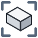{ .tool-icon-small } | [Part](part.md) | Creates a part with its origin, default planes and body folders. |
|  | [Sketch](sketch.md) | Sketches on the selected plane or planar face. |

## Features

|  | Tool | What it does |
| :-- | :-- | :-- |
| { .tool-icon-small } | [Extrude](extrude.md) | Extrudes a sketch or selected sketch contours in one or two directions to add material, or to cut it (Add \| Cut in the panel). |
| { .tool-icon-small } | [Revolve](revolve.md) | Revolves a sketch or selected sketch contours around an axis to add material, or to cut it (Add \| Cut in the panel). |
| { .tool-icon-small } | [Sweep](sweep.md) | Sweeps a profile along a path to add material, or to cut it (Add \| Cut in the panel). |
| 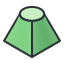{ .tool-icon-small } | [Loft](loft.md) | Adds or cuts material between two or more profiles (Add \| Cut in the panel). |
| { .tool-icon-small } | [Boundary](boundary.md) | Adds or cuts material through curves in one or two directions (Add \| Cut in the panel); with curves both ways the shape passes through the whole network. |
| 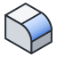{ .tool-icon-small } | [Fillet](fillet.md) | Creates a rounded internal or external face along one or more edges. |
| 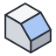{ .tool-icon-small } | [Chamfer](chamfer.md) | Creates a bevel on selected edges, faces or a vertex. |
| 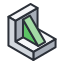{ .tool-icon-small } | [Rib](rib.md) | Grows a wall of material from open sketch lines until it meets the model: in the sketch plane, or out of it. |
| { .tool-icon-small } | [Wrap](wrap.md) | Wraps a sketch onto a cylindrical or flat face: emboss, deboss or scribe it. |
| { .tool-icon-small } | [Draft](draft.md) | Tapers faces by an angle so the part releases from a mould: about a neutral plane, or about parting lines. |
| 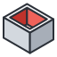{ .tool-icon-small } | [Shell](shell.md) | Hollows a body, leaving open the faces you pick, with walls of the given thickness. |
| 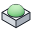{ .tool-icon-small } | [Dome](dome.md) | Adds a dome (or a dent) on flat faces. |
| 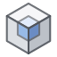{ .tool-icon-small } | [Intersect](intersect.md) | Makes solid bodies from the regions where solids, surfaces and planes meet; exclude the regions you don't want. |
| 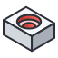{ .tool-icon-small } | [Hole Wizard](hole-wizard.md) | Inserts holes of a standard type and size at points on a face or a sketch. |
| { .tool-icon-small } | [Thread](thread.md) | Models a helical thread on a shaft or in a hole, starting at a circular edge: cut into it, or grown out of it. |
| { .tool-icon-small } | [Cosmetic Thread](cosmetic-thread.md) | Shows a thread on a shaft or in a hole without modelling it: pick the circular edge where it starts. |
| { .tool-icon-small } | [Mounting Boss](mounting-boss.md) | Adds a round boss on a face, with a hole or a pin and optional fins: click where it goes. |
| { .tool-icon-small } | [Snap Hook](snap-hook.md) | Adds a snap hook (a beam with a catch on its tip) on a face: click where it goes. |
| { .tool-icon-small } | [Lip/Groove](lip-groove.md) | Where two bodies meet on a flat face, grows a lip out of one and cuts a matching groove in the other. |
| { .tool-icon-small } | [Vent](vent.md) | Cuts a vent from a sketch: its outer loop opens the wall, its lines stay as ribs and its inner loops as spars. |
| { .tool-icon-small } | [Mirror](mirror.md) | Mirrors features or bodies about a face or plane. |

## Patterns

|  | Tool | What it does |
| :-- | :-- | :-- |
| 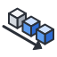{ .tool-icon-small } | [Linear Pattern](linear-pattern.md) | Repeats features or bodies in one or two directions. |
| 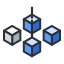{ .tool-icon-small } | [Circular Pattern](circular-pattern.md) | Repeats features or bodies around an axis. |
| 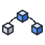{ .tool-icon-small } | [Curve Driven Pattern](curve-driven-pattern.md) | Repeats features or bodies along a curve. |
| 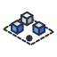{ .tool-icon-small } | [Sketch Driven Pattern](sketch-driven-pattern.md) | Repeats features or bodies at a sketch's points. |
| 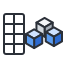{ .tool-icon-small } | [Table Driven Pattern](table-driven-pattern.md) | Repeats features or bodies at X, Y positions you type in. |
| 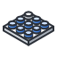{ .tool-icon-small } | [Fill Pattern](fill-pattern.md) | Fills a face with features, or with cuts of a simple shape, in rows or rings. |
| 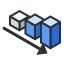{ .tool-icon-small } | [Variable Pattern](variable-pattern.md) | Repeats a feature with its dimensions changed per instance, from a table: position, size or depth. |

## Bodies

|  | Tool | What it does |
| :-- | :-- | :-- |
| { .tool-icon-small } | [Combine](combine.md) | Combines bodies: adds them, subtracts some from a main body, or keeps what they have in common. |
| { .tool-icon-small } | [Split](split.md) | Splits bodies with planes, faces, surface bodies or sketches into separate bodies. |
| 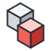{ .tool-icon-small } | [Delete/Keep Body](delete-keep-body.md) | Deletes the selected bodies, or keeps only them. |
| 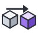{ .tool-icon-small } | [Move/Copy Body](move-copy-body.md) | Moves or copies bodies by a translation and a rotation. |
| { .tool-icon-small } | [Flex](flex.md) | Bends, twists, tapers or stretches bodies along an axis. |
| { .tool-icon-small } | [Deform](deform.md) | Pushes a point, moves curves onto others, or pushes a tool body in, and the body follows smoothly. |
| { .tool-icon-small } | [Indent](indent.md) | Presses a tool body's shape into a target body, with a wall round it, or cuts it in. |
| { .tool-icon-small } | [Freeform](freeform.md) | Pushes or pulls a face at points you place on it; its edges stay put. |
| { .tool-icon-small } | [Scale](scale.md) | Scales bodies about their centre, the origin or a coordinate system. |
| 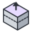{ .tool-icon-small } | [Move Face](move-face.md) | Moves faces of a solid (offset, translate or rotate); the faces around them extend or trim to follow. |
| 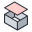{ .tool-icon-small } | [Delete Face](delete-face.md) | Deletes faces: leaves a gap (the body becomes a surface), heals it from the faces around, or fills it. |
| 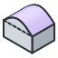{ .tool-icon-small } | [Replace Face](replace-face.md) | Replaces faces of a solid with a surface: the solid grows out to it or is trimmed back. |

## Reference Geometry

|  | Tool | What it does |
| :-- | :-- | :-- |
| { .tool-icon-small } | [Plane](plane.md) | Adds a reference plane. |
| 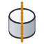{ .tool-icon-small } | [Axis](axis.md) | Adds a reference axis. |
| 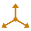{ .tool-icon-small } | [Coordinate System](coordinate-system.md) | Adds a coordinate system from an origin and X and Y directions (all optional). Sketches can be attached to it. |
| 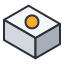{ .tool-icon-small } | [Point](point.md) | Adds a reference point: an arc's centre, a face's centre, where an edge meets a face, a projection, or a distance along an edge. |
| { .tool-icon-small } | [Bounding Box](bounding-box.md) | Adds a box round the bodies: the smallest one, or one square to a plane. Its length, width and thickness follow the model. |
| { .tool-icon-small } | [Center of Mass](center-of-mass.md) | Adds a point at the solid bodies' centre of mass; it follows the model and can be used like any point. |

## Surfaces

|  | Tool | What it does |
| :-- | :-- | :-- |
| { .tool-icon-small } | [Extruded Surface](extruded-surface.md) | Extrudes a sketch's curves (open or closed) into a surface body. Surface in the feature's Add \| Cut \| Surface switch. |
| { .tool-icon-small } | [Revolved Surface](revolved-surface.md) | Revolves a sketch's curves around an axis into a surface body. Surface in the feature's Add \| Cut \| Surface switch. |
| { .tool-icon-small } | [Swept Surface](swept-surface.md) | Sweeps a profile's curves along a path into a surface body. Surface in the feature's Add \| Cut \| Surface switch. |
| { .tool-icon-small } | [Lofted Surface](lofted-surface.md) | Makes a surface body between two or more profiles. Surface in the feature's Add \| Cut \| Surface switch. |
| { .tool-icon-small } | [Boundary Surface](boundary-surface.md) | Makes a surface body through curves in one or two directions. Surface in the feature's Add \| Cut \| Surface switch. |
| 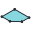{ .tool-icon-small } | [Planar Surface](planar-surface.md) | Makes a flat surface inside a sketch's closed regions or closed, flat loops of edges. |
| { .tool-icon-small } | [Offset Surface](offset-surface.md) | Offsets faces or surfaces by a distance into a new surface body (0: a copy). |
| 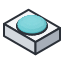{ .tool-icon-small } | [Filled Surface](filled-surface.md) | Patches a closed loop of edges with a surface, touching or tangent to the faces around it. |
| { .tool-icon-small } | [Extend Surface](extend-surface.md) | Extends a surface past its open edges, on the same surface or straight on. |
| { .tool-icon-small } | [Trim Surface](trim-surface.md) | Trims surfaces with a plane, sketch or surface, or with each other; click the pieces to keep or remove. |
| 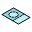{ .tool-icon-small } | [Untrim Surface](untrim-surface.md) | A face back to the surface it lies on: holes filled, or grown past its edges. |
| { .tool-icon-small } | [Knit Surface](knit-surface.md) | Knits surfaces into one; closed, it can become a solid. |
| { .tool-icon-small } | [Ruled Surface](ruled-surface.md) | Strips standing off edges: tangent or normal to the faces, or at an angle to a direction. |
| { .tool-icon-small } | [Radiate Surface](radiate-surface.md) | A surface spreading outward from edges, parallel to a plane (a parting surface). |
| 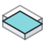{ .tool-icon-small } | [Mid-Surface](mid-surface.md) | Surfaces midway between the two sides of thin walls. |
| 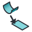{ .tool-icon-small } | [Surface Flatten](surface-flatten.md) | Lays faces out flat as a new surface body. |
| 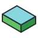{ .tool-icon-small } | [Thicken](thicken.md) | Thickens a surface body into a solid, or cuts the solids with it (Add \| Cut in the panel). |
| { .tool-icon-small } | [Cut With Surface](cut-with-surface.md) | Cuts bodies with a surface or plane, keeping one side. |

## Curves

|  | Tool | What it does |
| :-- | :-- | :-- |
| 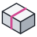{ .tool-icon-small } | [Split Line](split-line.md) | Splits faces into more faces, without changing the body: by a projected sketch, where planes cut them, or along their silhouette. |
| 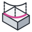{ .tool-icon-small } | [Projected Curve](projected-curve.md) | Projects a sketch onto faces, or makes the curve where two sketches on crossing planes meet. |
| { .tool-icon-small } | [Composite Curve](composite-curve.md) | Joins edges and sketch curves end to end into one curve. |
| 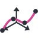{ .tool-icon-small } | [Curve Through XYZ Points](curve-through-xyz-points.md) | A smooth curve through points you type. |
| 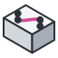{ .tool-icon-small } | [Curve Through Reference Points](curve-through-reference-points.md) | A smooth curve through vertices and reference points. |
| { .tool-icon-small } | [Helix/Spiral](helix-spiral.md) | Adds a helix or spiral from a circle (a sketch with one circle, or a circular edge): a path for springs and threads. |

## Evaluate

|  | Tool | What it does |
| :-- | :-- | :-- |
| 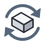{ .tool-icon-small } | [Force Rebuild](force-rebuild.md) | Rebuilds every feature from scratch. |
| { .tool-icon-small } | [What's Wrong](whats-wrong.md) | Lists what's wrong in the model, why, and what to do: shows each problem in the view and offers the fix. |

## Working faster

|  | Tool | What it does |
| :-- | :-- | :-- |
| { .tool-icon-small } | [Command Search](command-search.md) | Find a Solid Design tool by typing its name, then press Enter to start it. |
| 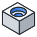{ .tool-icon-small } | [Command Line](command-line.md) | Type a tool and its values, e.g. "fillet 2" (press : in the 3D view). Works on the selection, or what's under the pointer. |
| { .tool-icon-small } | [Repeat Last Feature](repeat-last-feature.md) | Make the last feature again with the same settings, on the selection or what's under the pointer (press . in the 3D view). |
| { .tool-icon-small } | [Context Toolbar](context-toolbar.md) | Shows the tools that fit a face, edge or vertex by the pointer when you click it. |
| { .tool-icon-small } | [Reference Names](reference-names.md) | Shows the names of planes, axes, points and coordinate systems in the 3D view. |

