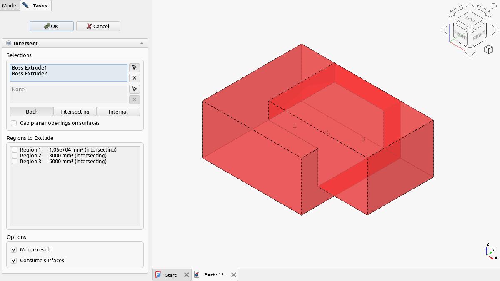

<!-- Generated by docs/build.py from docs/_data/catalog.json, docs/_authored/tools/intersect.md, docs/_data/panels.json. Do not edit this file: change its sources and run `pixi run docs`. -->

# Intersect

{ .tool-icon }
Makes solid bodies from the regions where solids, surfaces and planes meet; exclude the regions you don't want.
{ .tool-lead }

Intersect finds the regions where solids, surfaces and planes meet, and makes solids from the ones you keep: the air inside a closed housing, the overlap of two parts, a body cut by surfaces.

## How to use it

1. Select the bodies, surfaces and planes to intersect.
2. Click **Intersect**. The panel lists every region it finds.
3. Choose what to find: **Intersecting** regions, **Internal** ones, or **Both**.
4. Tick the regions you don't want in **Regions to Exclude**, then click **OK**.

## Good to know

- **Merge result** joins the kept regions into one body; **Consume surfaces** removes the surfaces used.

## Where to find it

- The **Features** toolbar.
- **Solid Design** → **Features** → **Intersect**
- **Insert** → **Features** → **Intersect**
- Command search: press <kbd>/</kbd> in the 3D view and type its name.
- The command line: <kbd>:</kbd> then `intersect` ([below](#on-the-command-line)).

## The panel

Every control's tooltip says the same as here: hover over it in FreeCAD. **OK** (or <kbd>Enter</kbd>) makes the feature, **Cancel** (or <kbd>Esc</kbd>) leaves the model as it was.

### Selections

| Control | Kind | What it does |
| :-- | :-- | :-- |
| **Bodies** | Selection list: click solids or surfaces | Solids and surfaces to intersect |
| **Planes** | Selection list: click planes | Planes that cut the selections into regions |
| **Both \\| Intersecting \\| Internal** | Buttons: *Both* \\| *Intersecting* \\| *Internal* |  |
| **Cap planar openings on surfaces** | A check box | Close the surfaces' flat openings so they bound regions |

### Regions to Exclude

Tick the regions to leave out; the rest become solid bodies

| Control | Kind | What it does |
| :-- | :-- | :-- |
|  | A list | The regions, numbered in the view: tick one to exclude it |

### Options

| Control | Kind | What it does |
| :-- | :-- | :-- |
| **Merge result** | A check box | Kept regions that touch become one body |
| **Consume surfaces** | A check box | The surfaces are used up |

## On the command line

Press <kbd>:</kbd> in the 3D view and type `intersect`, then what to set. See [the command line](../../guides/keyboard.md) for how it works.

??? note "Options it takes"

    | Option | How to type it | What it is |
    | :-- | :-- | :-- |
    | `IntersectMode` | a word: `createboth`, `createintersectingregions`, `createinternalregions` | Intersecting regions: inside the solids. Internal regions: hollows closed off by the selections |
    | `CapPlanarOpenings` | `capplanaropenings` turns it on, `capplanaropenings=no` off | Close the surfaces' flat openings |
    | `MergeResult` | `mergeresult` turns it on, `mergeresult=no` off | Merge the kept regions where they touch |
    | `ConsumeSurfaces` | `consumesurfaces` turns it on, `consumesurfaces=no` off | The surfaces are used up |

## Properties

??? info "All properties"

    What the feature stores, as the **Property** editor shows it (select the feature in the tree, then the **Data** tab). The panel sets these for you.

    | Property | Kind | Default | What it is |
    | :-- | :-- | :-- | :-- |
    | `Bodies` | List | – | Solids and surfaces to intersect, by ID |
    | `Planes` | Objects | – | Planes to intersect with |
    | `IntersectMode` | Choice | Create both | Intersecting regions: inside the solids. Internal regions: hollows closed off by the selections Choices: *Create both*, *Create intersecting regions*, *Create internal regions*. |
    | `CapPlanarOpenings` | Yes/No | No | Close the surfaces' flat openings |
    | `ExcludedPoints` | List | – | A point inside each excluded region (x,y,z) |
    | `MergeResult` | Yes/No | Yes | Merge the kept regions where they touch |
    | `ConsumeSurfaces` | Yes/No | Yes | The surfaces are used up |

