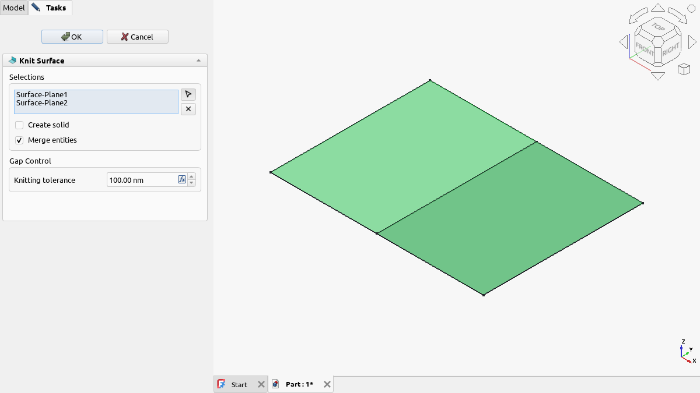

<!-- Generated by docs/build.py from docs/_data/catalog.json, docs/_authored/tools/knit-surface.md, docs/_data/panels.json. Do not edit this file: change its sources and run `pixi run docs`. -->

# Knit Surface

{ .tool-icon }
Knits surfaces into one; closed, it can become a solid.
{ .tool-lead }

Knit Surface joins surfaces that meet edge to edge into one. If they close up completely, it can make a solid.

## How to use it

1. Select the surface bodies and click **Knit Surface**.
2. Tick **Create solid** if they close a volume.
3. Raise the **Knitting tolerance** if small gaps keep them apart.
4. Click **OK**.

## Where to find it

- The **Surfaces** toolbar.
- **Solid Design** → **Surfaces** → **Knit Surface**
- **Insert** → **Surface** → **Knit Surface**
- Command search: press <kbd>/</kbd> in the 3D view and type its name.
- The command line: <kbd>:</kbd> then `knitsurface` ([below](#on-the-command-line)).

## The panel

Every control's tooltip says the same as here: hover over it in FreeCAD. **OK** (or <kbd>Enter</kbd>) makes the feature, **Cancel** (or <kbd>Esc</kbd>) leaves the model as it was.

### Selections

| Control | Kind | What it does |
| :-- | :-- | :-- |
| **Bodies** | Selection list: click surface bodies | The surfaces to knit into one; the first keeps its name |
| **Create solid** | A check box | Make a solid when the knitted surfaces close up |
| **Merge entities** | A check box | Merge faces lying on one surface |

### Gap Control

| Control | Kind | What it does |
| :-- | :-- | :-- |
| **Knitting tolerance** | A length | Gaps up to this wide are closed |

## On the command line

Press <kbd>:</kbd> in the 3D view and type `knitsurface`, then what to set. See [the command line](../../guides/keyboard.md) for how it works.

??? note "Options it takes"

    | Option | How to type it | What it is |
    | :-- | :-- | :-- |
    | `CreateSolid` | `createsolid` turns it on, `createsolid=no` off | Make a solid when the knit closes |
    | `MergeEntities` | `mergeentities` turns it on, `mergeentities=no` off | Merge faces on one surface |
    | `GapTolerance` | `gaptolerance=`a value | Gaps up to this close are knitted |

## Properties

??? info "All properties"

    What the feature stores, as the **Property** editor shows it (select the feature in the tree, then the **Data** tab). The panel sets these for you.

    | Property | Kind | Default | What it is |
    | :-- | :-- | :-- | :-- |
    | `Bodies` | List | – | Surface bodies to knit, by ID |
    | `CreateSolid` | Yes/No | No | Make a solid when the knit closes |
    | `MergeEntities` | Yes/No | Yes | Merge faces on one surface |
    | `GapTolerance` | Length | 0.0001 mm | Gaps up to this close are knitted |

